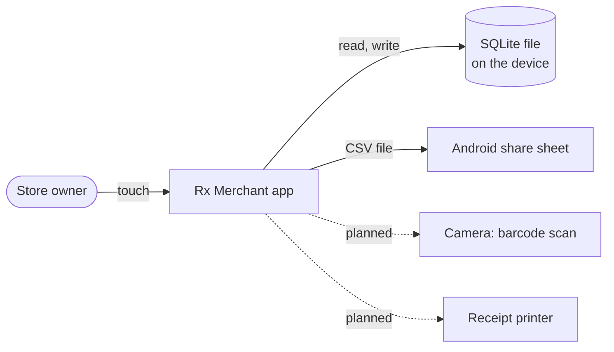
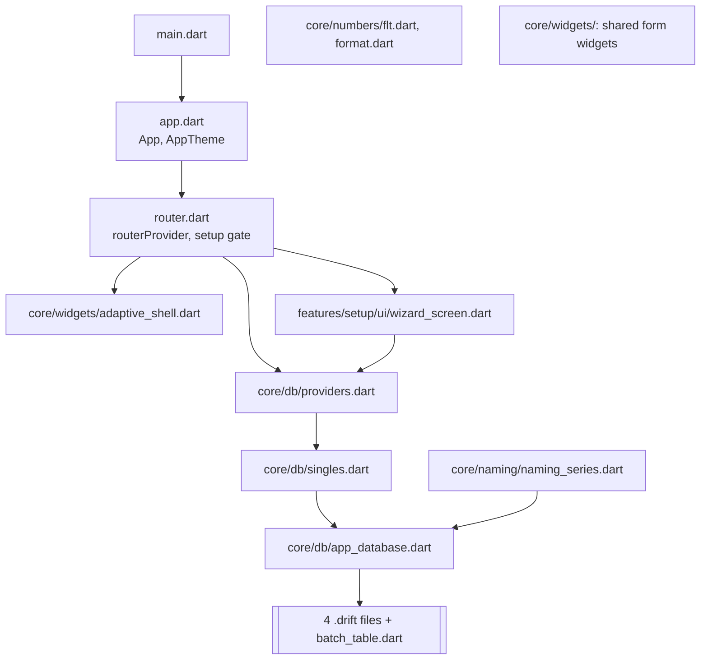
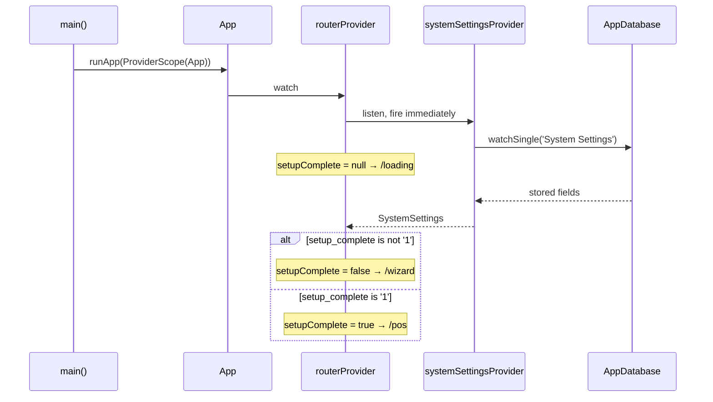

# Rx Merchant: System Documentation

## 0. Document control

| Item | Value |
|---|---|
| Title | Rx Merchant: System Documentation |
| System | Rx Merchant, an offline Android point-of-sale app |
| System version | 1.0.0+1 (`pubspec.yaml`) |
| Date of issue | 2026-11-15 |
| Status | Issued. Describes the system at the end of milestone M0 (Foundation). |
| Issuing organization | The Rx Merchant project (one owner, who is also the developer) |
| Prepared by | Claude (AI assistant), for the project owner |
| Approval | Pending the project owner's review |
| Location | `.claude/erpnext-planner/system-documentation.md` |

### Change history

| Issue | Date | Change |
|---|---|---|
| 1 | 2026-11-15 | First issue. Covers milestone M0: project setup, database schema version 1, settings access, rounding and formatting, naming series, theme, adaptive shell, wizard gate, shared widgets. |

### How this document follows ISO/IEC/IEEE 15289

ISO/IEC/IEEE 15289 defines what each life-cycle information item (document) must contain. It does not fix a layout, and it allows several items to be combined in one document. This document combines the items in the table below. Every section carries the generic content the standard asks of a description, report or specification: date of issue and status, scope, issuing organization, references, context, body, summary, glossary and change history.

| 15289 information item | Generic type | Section |
|---|---|---|
| Concept of operations | Description | 3 |
| System requirements specification | Specification | 4 |
| System architecture description | Description | 5 |
| Software design description | Description | 6 |
| Database design description | Description | 7 |
| Interface description | Description | 8 |
| Installation procedure; configuration status report | Procedure; Report | 9 |
| Test report (verification) | Report | 10 |
| User documentation | Description | 11 |
| Problem report | Report | 12 |

**Limit of this claim.** The text of the standard was not available when this document was written. The structure follows the standard's generic content elements (clause 7) and information-item names (clause 10) as the author knows them. Check it against a licensed copy before claiming formal conformance.

---

## 1. Scope

This document describes the Rx Merchant system as it exists in the repository on the date of issue. It records what the system is for, what it must do, how it is built, how its data is stored, how it is built and installed, how it was verified, and what is known to be wrong or missing.

It describes the current state only. Planned behaviour is listed in section 4.4 and section 12.3 so that a reader can tell built from not built. The feature plans in section 2.1 remain the source for planned behaviour.

### 1.1 System identification

| Item | Value |
|---|---|
| Product name | Rx Merchant |
| Dart package | `rx_merchant` |
| Android application ID | `com.rx_merchant.rx_merchant` |
| Launcher label | Rx Merchant |
| Version | 1.0.0, build 1 |
| Platform | Android only. Minimum SDK 24 (Android 7.0), target and compile SDK 36. |
| Form factors | Phones and tablets, portrait and landscape |
| Milestone state | M0 Foundation complete. M1 to M9 not started. |

### 1.2 What the system is

An Android app for one store run by one owner. It works with no internet connection. When complete it will keep the item catalogue and stock, sell at a cash register, print receipts and invoices, and show a sales dashboard. Its screens, field names and rules follow ERPNext, reduced to what one store owner needs.

At this issue the system is the foundation only: the app starts, creates its database, shows a first-run gate, and shows a navigation frame with five empty destinations. No business screen exists yet.

---

## 2. References, glossary and notation

### 2.1 References

| Ref | Document | Location |
|---|---|---|
| R1 | Overview and foundation plan (the M0 specification) | `.claude/erpnext-planner/Plans/00-overview-and-foundation.md` |
| R2 | Setup plan (rules SET-R1 to R6, acceptance SET-A1 to A7) | `.claude/erpnext-planner/Plans/01-setup.md` |
| R3 | Stock plan | `.claude/erpnext-planner/Plans/02-stock.md` |
| R4 | Cash Register plan | `.claude/erpnext-planner/Plans/03-cash-register.md` |
| R5 | Sales Dashboard plan | `.claude/erpnext-planner/Plans/04-sales-dashboard.md` |
| R6 | Invoices and Receipts plan | `.claude/erpnext-planner/Plans/05-invoices-and-receipts.md` |
| R7 | ERPNext documentation, merged | `.claude/erpnext-planner/erpnext-docs-merged.md` |
| R8 | ISO/IEC/IEEE 15289:2019, Content of life-cycle information items (documentation) | Published standard |
| R9 | Material Design 3 guidelines (window size classes, navigation, sheets) | m3.material.io |
| R10 | Session report for this issue | `.claude/commits/` |

### 2.2 Glossary

| Term | Meaning |
|---|---|
| Doctype | ERPNext's word for a record type, such as Item or Sales Invoice. |
| Single | A doctype with exactly one record: a settings page. Stored as key-value rows in the `singles` table. |
| Master | A record that other records point to, such as Item, Warehouse or Tax. |
| Document | A dated transaction that is saved, then submitted: Stock Entry, Sales Invoice and similar. |
| Child table | Rows that belong to one parent record, such as the items of an invoice. |
| Docstatus | The life-cycle state of a document: 0 Draft, 1 Submitted, 2 Cancelled. |
| Naming series | A pattern such as `ACC-SINV-.YYYY.-` that produces document names with a running number. |
| `flt` | The rounding function every calculated value passes through before it is stored. Named after the same function in ERPNext's framework. |
| Link field | A form field that picks one master record. |
| Store Profile | The single record describing the store. It replaces ERPNext's Company. |
| POS Profile | The configuration of the cash register: warehouse, price list, taxes, payment methods. |
| Wizard gate | The rule that only the first-run wizard is reachable until setup is complete. |
| Window size class | Material 3's width bands: compact (under 600dp), medium (600 to 839dp), expanded (840dp and up). |
| dp | Density-independent pixel, Android's unit of layout size. |
| SLE | Stock Ledger Entry: one row per stock movement. |
| Bin | The current quantity and value of one item in one warehouse. |

### 2.3 Notation

- Diagrams use Mermaid.
- File paths are relative to the repository root.
- Table and column names are written as they appear in SQL.
- Requirement identifiers such as SET-R4 and SET-A1 come from the plans in section 2.1.
- In table catalogues, **PK** marks a primary key, **U** a unique column, and `a → b` a foreign key from column `a` to table `b`.

---

## 3. Concept of operations

### 3.1 Users

One person: the store owner. The owner sets the system up, maintains items and stock, sells, and reads the reports. There are no accounts, roles, permissions or login.

### 3.2 Operating environment

- One Android phone or tablet. The data lives on that device only.
- No network. The release build does not hold the Android `INTERNET` permission, so it cannot open a connection even if a library tries.
- Peripherals planned for later milestones: the device camera for barcode scanning, and a receipt printer.

### 3.3 Intended operation (when complete)

1. **First run.** A wizard collects the store name, country, currency and formats, then creates the default records.
2. **Setup.** The owner defines payment methods, taxes, price lists and the POS Profile.
3. **Stock.** The owner creates items and receives stock through Stock Entries and Stock Reconciliations.
4. **Selling.** The owner opens a cash-register session, sells to walk-in buyers who pay in full, and closes the session.
5. **Invoices.** Each sale is a Sales Invoice that can be printed, returned or cancelled.
6. **Dashboard.** Sales cards, charts and reports.

### 3.4 Operation at this issue

Only the first step of the flow exists, in placeholder form:

1. The app starts and reads System Settings.
2. On a fresh install it shows the wizard placeholder. Nothing else is reachable.
3. The owner taps **Finish setup**. The app records that setup is complete.
4. The app shows the navigation frame with five destinations: Register, Invoices, Stock, Dashboard, Setup. Each shows the message "This screen arrives in a later milestone."

### 3.5 What the system deliberately leaves out

Taken from R1, section 2. Each exclusion applies to every screen and table.

| Excluded | Consequence |
|---|---|
| Multiple companies | Exactly one Store Profile. No Company field anywhere. |
| Cost centers | Every Cost Center field is removed. |
| Fixed assets | No asset fields on Item. |
| Customers | No customer master. Every sale is to an anonymous walk-in buyer, paid in full. No credit sales, receivables or loyalty points. |
| Sales persons | No sales team, commission or targets. |
| Chart of accounts | No ledgers and no account fields. Sales tax is still calculated. |
| Staff | No users, roles or login. |
| Purchasing | No suppliers or purchase documents. Stock arrives through a Stock Entry of type Material Receipt. |
| Fiscal year | Naming series and reports use the calendar year. |

---

## 4. System requirements

### 4.1 Constraints

| ID | Constraint | Met by | Status |
|---|---|---|---|
| C-1 | Android only | Project created with `--platforms=android`; no other platform folder exists | Met |
| C-2 | Works fully offline; the release build holds no `INTERNET` permission | `android/app/src/release/AndroidManifest.xml` removes the permission even when a plugin declares it | Met, verified (section 10.4) |
| C-3 | SQLite is the only data store | `lib/core/db/app_database.dart` | Met |
| C-4 | Phones and tablets from the first build, in three window size classes | `WindowSize`, `AdaptiveShell`, `ListDetailPane`, `showRowEditor` | Met, verified (sections 10.2, 10.5) |
| C-5 | Material 3 only. Colours come from `ColorScheme` roles; the seed colour is the only literal. | `AppTheme` in `lib/app.dart` | Met |
| C-6 | Every user-visible label goes through localisation | `lib/l10n/app_en.arb`, generated `AppLocalizations` | Met |
| C-7 | Three hops at most: screen, provider, query or pure function. No repository interfaces, use-case classes or mapper layers. | Code structure (section 5) | Met |
| C-8 | Numeric columns are `REAL`. Every calculated value is rounded by `flt` before it is stored. | Schema; `lib/core/numbers/flt.dart` | Schema and function met. No calculation code exists yet to apply it. |
| C-9 | Foreign keys are enforced | `PRAGMA foreign_keys = ON` at every open | Met, verified |
| C-10 | Schema version 1 contains every table of every feature plan | 48 tables, 14 indexes | Met, verified |
| C-11 | ERPNext's labels and status names are used as is | Status values in the schema; localisation keys | Met for what exists |

### 4.2 Functional requirements implemented

| ID | Requirement | Implementation | Verified by |
|---|---|---|---|
| SET-R1 | Until setup is complete the app shows only the first-run wizard. Afterwards the wizard is unreachable. | `redirect` in `lib/router.dart`, driven by `setup_complete` in System Settings | `test/app_test.dart`, group "wizard gate (SET-R1)" |
| SET-R4 | Rounding follows the Rounding Method setting: Banker's Rounding (default) sends a midpoint to the nearest even digit; Commercial Rounding sends it away from zero. Binary float error must not change the result. | `flt` and `RoundingMethod` in `lib/core/numbers/flt.dart` | `test/core/numbers/flt_test.dart` |
| SET-R5 | Numbers, currency, dates and times are shown in the formats chosen in System Settings. Formats affect display only. | `lib/core/numbers/format.dart` | `test/core/numbers/format_test.dart` |
| SET-R6 | A naming series pattern resolves date parts from the posting date and keeps one counter per resolved prefix. A failed transaction does not consume a number. | `parseSeries` and `nextName` in `lib/core/naming/naming_series.dart` | `test/core/naming/naming_series_test.dart` |
| R1 §6.5 | Settings pages are stored as key-value rows, with typed access and defaults | `lib/core/db/singles.dart` | `test/core/db/singles_test.dart` |
| R1 §7.2, §7.3 | Navigation is a bottom bar on compact windows, a rail on medium windows, a rail with labels on expanded windows; five destinations in fixed order | `lib/core/widgets/adaptive_shell.dart` | `test/app_test.dart`, group "adaptive shell" |
| R1 §7.1 | Shared form building blocks: list and detail panes, link field, child table with row editor, status chip, report table with CSV export | `lib/core/widgets/` | `test/core/widgets/` |

### 4.3 Acceptance criteria met

| ID | Criterion | Result |
|---|---|---|
| SET-A1 | Banker's: `flt(2.345, 2)` is 2.34 and `flt(2.355, 2)` is 2.36 | Pass |
| SET-A2 | Commercial: `flt(2.345, 2)` is 2.35 | Pass |
| SET-A3 | Commercial: `flt(1.005, 2)` is 1.01 | Pass |
| SET-A4 | 12345.67 shows as `12,345.67` in `#,###.##` and `12.345,67` in `#.###,##` | Pass |
| SET-A5 | `ACC-SINV-.YYYY.-` used three times in 2026 gives `ACC-SINV-2026-00001`, `-00002`, `-00003` | Pass |
| SET-A6 | The same series in 2027 starts again at `ACC-SINV-2027-00001` | Pass |
| SET-A7 | `INV12.####` gives `INV120001` | Pass |
| M0 "done when" | The app starts on a phone and a tablet emulator, shows the wizard gate, and `flutter test` passes | Pass (section 10) |

### 4.4 Requirements not yet implemented

| Milestone | Contents | State |
|---|---|---|
| M0 Foundation | Project, database, settings access, rounding, naming series, theme, adaptive shell | **Done** |
| M1 Setup A | First-run wizard, Store Profile, System Settings, Global Defaults, Currency, Price List, Naming Series | Not started |
| M2 Stock A | Warehouse, Item Group, UoM, Brand, Item, Item Price, Stock Settings | Not started |
| M3 Stock B | Stock ledger engine, Stock Entry, Stock Reconciliation, core stock reports | Not started |
| M4 Setup B | Mode of Payment, taxes, POS Profile, Selling Settings | Not started |
| M5 Cash Register | Sessions, POS screen, totals engine, payment, submit | Not started |
| M6 Invoices | List, detail, print formats, PDF, thermal printing, returns, cancel | Not started |
| M7 Dashboard | Cards, charts, sales goal, reports | Not started |
| M8 Stock C | Variants, batches, serial numbers | Not started |
| M9 Setup C | Data import and export, backup and restore | Not started |

---

## 5. System architecture

### 5.1 Context



The system has no server, no network peer and no other user. Dashed lines are interfaces that later milestones add.

### 5.2 Structure

The app is one Flutter program. Code is grouped by feature, with shared code under `core`. A screen reads a provider; a provider calls a database query or a pure function. There is no layer in between.



`core/numbers` and the shared widgets have no caller in the app yet. They are the foundation the feature milestones build on, and each is covered by tests.

### 5.3 Folder map

```
lib/
  main.dart                     entry point
  app.dart                      App widget, AppTheme
  router.dart                   routes, setup gate, placeholder screens
  core/
    db/
      app_database.dart         AppDatabase (drift)
      app_database.g.dart       generated by drift_dev
      singles.dart              settings access and typed settings classes
      providers.dart            appDatabaseProvider, systemSettingsProvider
    numbers/
      flt.dart                  rounding
      format.dart               number, currency, date, time formatting
    naming/
      naming_series.dart        naming series resolver and counter
    widgets/
      window_size.dart          WindowSize
      spacing.dart              AppSpacing
      adaptive_shell.dart       navigation frame
      list_detail_pane.dart     one-pane / two-pane layout
      link_field.dart           picker for one master record
      child_table.dart          child rows and the row editor sheet
      status_chip.dart          document status indicator
      report_table.dart         report table and CSV export
  features/
    setup/data/setup.drift      14 tables
    setup/ui/wizard_screen.dart placeholder wizard
    stock/data/stock.drift      22 tables, 9 indexes
    stock/data/batch_table.dart the batch table, in Dart
    pos/data/pos.drift          8 tables, 5 indexes
    invoices/data/invoices.drift 3 tables
  l10n/
    app_en.arb                  21 messages, English
    app_localizations*.dart     generated by gen-l10n
test/                           93 tests (section 10.2)
android/                        Android host project
```

Size at this issue: 1,131 lines of hand-written Dart under `lib/`, 614 lines of schema, 1,054 lines of tests. The generated database code is 56,713 lines.

### 5.4 Technology

| Concern | Choice | Resolved version |
|---|---|---|
| Framework | Flutter, stable channel | 3.50.0 |
| Language | Dart | 3.14.0 |
| UI toolkit | Material 3 from `package:material_ui` | 1.11.0 |
| Database | SQLite through `drift`, opened by `drift_flutter` | drift 2.35.4, drift_flutter 0.3.1, sqlite3 3.9.1 |
| State | `flutter_riverpod` | 3.5.0 |
| Routing | `go_router` | 18.1.4 |
| Localisation | `flutter_localizations`, `intl`, gen-l10n | intl 0.20.3 |
| CSV | `csv` | 8.0.0 |
| File sharing | `share_plus`, `path_provider` | 13.3.1, 2.1.6 |
| Code generation | `drift_dev`, `build_runner` | 2.35.3, 2.17.1 |
| Lints | `flutter_lints` | 6.0.0 |
| Android build | Gradle, Android Gradle Plugin, Kotlin, Java | 9.5.0, 9.3.1, 2.4.20, 17 |

Declared for later milestones and not yet imported by any code: `mobile_scanner` 7.5.0 (barcode), `pdf` 3.13.1 and `printing` 5.15.1 (documents), `fl_chart` 1.3.1 (dashboard), `file_picker` 13.3.3 and `image_picker` 1.2.4 (import, images). `cupertino_icons` 2.0.0 is present only for its icon font.

### 5.5 Start-up and the setup gate



The router holds one value, `setupComplete`, with three states. Every navigation passes through `redirect`:

| `setupComplete` | Where every location leads |
|---|---|
| `null` (settings not read yet) | `/loading` |
| `false` | `/wizard` |
| `true` | The requested location; `/wizard` and `/loading` lead to `/pos` |

The value is a `ValueNotifier` passed to the router as `refreshListenable`, so the redirect runs again the moment the setting changes. Tapping **Finish setup** writes `setup_complete`; the settings stream emits; the router moves to `/pos` with no navigation call in the wizard.

If the settings cannot be read, `/loading` shows "The database could not be opened." and the error text.

### 5.6 Routes

| Path | Screen | Notes |
|---|---|---|
| `/loading` | Blank, or the start-up error | Shown only while settings are read |
| `/wizard` | Wizard placeholder | Outside the navigation frame |
| `/pos` | Cash Register placeholder | Branch 1, the home location |
| `/invoices` | Invoices placeholder | Branch 2 |
| `/stock` | Stock placeholder | Branch 3 |
| `/dashboard` | Dashboard placeholder | Branch 4 |
| `/setup` | Setup placeholder | Branch 5 |

The five destinations are branches of one `StatefulShellRoute.indexedStack`, so each keeps its own navigation state when the owner switches between them.

### 5.7 Design decisions

| # | Decision | Reason | Cost |
|---|---|---|---|
| D-1 | Tables are written as SQL in `.drift` files, copied from the plans | The plans define the schema as SQL; copying avoids transcription errors across 48 tables | Flag columns are `int` 0/1 in Dart, not `bool` |
| D-2 | All 48 tables are created in schema version 1 | Later milestones add behaviour without a schema change | Empty tables exist from the first run |
| D-3 | The `batch` table is declared in Dart, not in `stock.drift` | A drift-file table named `batch` generates a getter that collides with drift's own `batch()` method | One table lives in a different file; `drift_dev` prints one warning (P-2) |
| D-4 | `series.current` is quoted in SQL; its row class is named `SeriesRow` | `CURRENT` is an SQL keyword; drift's default class name was `Sery` | None |
| D-5 | `setup.drift` and `stock.drift` import each other | Their tables reference each other; `drift_dev` accepts the cycle | None found |
| D-6 | `SystemSettings.roundingMethod` returns the stored text; `RoundingMethod.fromSetting` converts it | Keeps settings access free of a dependency on the numbers code | One conversion at each use |
| D-7 | Date and time formatting is pinned to the `en_US` locale | Stored date text must stay ASCII digits whatever the app language | Displayed dates never use native digits |
| D-8 | A `/loading` route is shown while settings are read | Without it a set-up store would flash the wizard at every launch | One extra route |
| D-9 | The bottom-bar label is "Register"; the screen title is "Cash Register" | "Cash Register" wraps to two lines on a 360dp-wide phone | Two messages for one destination |
| D-10 | `kotlin.incremental=false` in `android/gradle.properties` | The release build fails when the project and the pub cache are on different drives | Slower Kotlin recompiles |
| D-11 | Generated localisation files are excluded from analysis | The generated code refers to delegates deprecated in Flutter 3.47 | Real problems in generated code would go unreported |
| D-12 | The release manifest removes `INTERNET` with `tools:node="remove"` | A plugin that declares the permission cannot bring it back | Debug and profile builds keep it for hot reload |
| D-13 | Seed colour is `Colors.teal` | A placeholder; one constant in `lib/app.dart` | None |

---

## 6. Software design

### 6.1 Entry point and app: `lib/main.dart`, `lib/app.dart`

- `main()` runs `App` inside a `ProviderScope`.
- `App` is a `ConsumerWidget` that builds `MaterialApp.router` with the router from `routerProvider`, the light and dark themes, and the localisation delegates. The task-switcher title is the `appTitle` message.
- `AppTheme.light` and `AppTheme.dark` build `ThemeData` from `ColorScheme.fromSeed` with one seed. The theme sets outlined borders for every form field through `inputDecorationTheme`. The device setting chooses light or dark.

### 6.2 Database: `lib/core/db/app_database.dart`

```dart
class AppDatabase extends _$AppDatabase {
  AppDatabase([QueryExecutor? executor]);   // default: driftDatabase(name: 'rx_merchant')
  int get schemaVersion => 1;
  MigrationStrategy get migration;          // beforeOpen: PRAGMA foreign_keys = ON
}
```

- Includes the four `.drift` files and the `Batches` Dart table.
- Tests pass `NativeDatabase.memory()` as the executor.
- `drift_dev` generates `app_database.g.dart`: one table class, one row class and one companion class per table.

### 6.3 Settings access: `lib/core/db/singles.dart`

```dart
extension SinglesAccess on AppDatabase {
  Future<Map<String, String>> readSingle(String doctype);
  Stream<Map<String, String>> watchSingle(String doctype);
  Future<void> writeSingle(String doctype, Map<String, Object?> values);
}
```

- `readSingle` returns the stored fields of one settings page. Keys that were never set, or were cleared, are absent.
- `watchSingle` emits the same map again whenever the `singles` table changes.
- `writeSingle` upserts each entry in one batch. A `bool` is stored as `'1'` or `'0'`. `null` clears the key, so its default applies again. Any other value is stored as its text.

Six classes give typed access with defaults: `StoreProfile`, `SystemSettings`, `GlobalDefaults`, `SellingSettings`, `StockSettings`, `PrintSettings`. Each wraps the map, names its doctype in a `doctype` constant, and has one getter per key. A missing key returns the default, so adding a setting needs no schema change. The keys and defaults are listed in section 7.6.

Two defaults are derived rather than fixed:

- `StoreProfile.abbr` defaults to the initials of the store name.
- `PrintSettings.rawCharsPerLine` defaults to 48 for 80mm paper and 32 for 58mm paper.

### 6.4 Providers: `lib/core/db/providers.dart`

| Provider | Type | Behaviour |
|---|---|---|
| `appDatabaseProvider` | `Provider<AppDatabase>` | Creates the one database and closes it on dispose. Tests override it. |
| `systemSettingsProvider` | `StreamProvider<SystemSettings>` | System Settings, emitted again on every change. |

### 6.5 Rounding: `lib/core/numbers/flt.dart`

```dart
enum RoundingMethod { bankers, commercial }       // fromSetting(String) converts the stored text
double flt(num value, int precision, [RoundingMethod method = RoundingMethod.bankers]);
```

A decimal such as 2.345 is stored in binary as 2.34499999999999997. Plain rounding would send it down under both methods. `flt` compares against the midpoint with a tolerance of one unit of binary float error, which is the approach of ERPNext's own `flt`.

1. `scaled = |value| × 10^precision`
2. `tolerance = scaled × 2⁻⁵²`
3. **Commercial:** round `scaled + tolerance` to the nearest whole number.
4. **Banker's:** if `scaled` is within `tolerance` of a midpoint, take the even neighbour; otherwise round to the nearest whole number.
5. Restore the sign and divide by `10^precision`.

Rounding works on the absolute value, so a negative amount mirrors the positive one: `flt(-2.345, 2)` is -2.34 under Banker's and -2.35 under Commercial. An unknown method text falls back to Banker's.

### 6.6 Formatting: `lib/core/numbers/format.dart`

```dart
String formatNumber(num value, String numberFormat, int precision);
String formatCurrency(num value, {required String numberFormat, required int precision,
    String? symbol, bool symbolOnRight = false, bool hideSymbol = false});
String formatDate(DateTime d, String dateFormat);
String formatTime(DateTime d, String timeFormat);
String toStorage(DateTime d);
```

`formatNumber` supports the six Number Format options:

| Format | 1234567.891 at precision 2 |
|---|---|
| `#,###.##` | `1,234,567.89` |
| `#.###,##` | `1.234.567,89` |
| `# ###.##` | `1 234 567.89` |
| `#,##,###.##` | `12,34,567.89` (Indian grouping: last three digits, then pairs) |
| `#,###` | `1,234,568` (no decimal part, whatever the precision) |
| `#.###` | `1.234.568` |

The group separator is the second character of the format; the decimal separator is the character before the final `##`. A negative value keeps its sign, except that a value which displays as zero shows no sign.

`formatCurrency` adds the symbol with one space: `$ 12,345.67`, or `12,345.67 $` when `symbolOnRight` is true. The sign stays on the number: `$ -5.00`. With `hideSymbol`, or no symbol, it returns the number alone.

`formatDate` accepts ERPNext's Date Format text (`yyyy-mm-dd`, `dd-mm-yyyy`, `dd/mm/yyyy`, `dd.mm.yyyy`, `mm/dd/yyyy`, `mm-dd-yyyy`), where `mm` means month. `formatTime` accepts `HH:mm:ss` and `HH:mm`. `toStorage` produces the text stored in date-time columns, `yyyy-MM-dd HH:mm:ss` in local time, which `DateTime.parse` reads back.

### 6.7 Naming series: `lib/core/naming/naming_series.dart`

```dart
({String key, int digits, String suffix}) parseSeries(String pattern, DateTime postingDate);
extension NamingSeries on AppDatabase {
  Future<String> nextName(String pattern, DateTime postingDate);
}
```

`parseSeries` is a pure function:

1. Split the pattern on `.`.
2. Replace the parts `YYYY`, `YY`, `MM` and `DD` with parts of the posting date. Every other part is literal.
3. Join the parts.
4. The first run of `#` is the counter and its length is the digit count. With no `#`, a five-digit counter goes at the end.
5. `key` is the text before the counter; `suffix` is the text after it.

| Pattern | Posting date | Key | Digits | First name |
|---|---|---|---|---|
| `ACC-SINV-.YYYY.-` | 2026 | `ACC-SINV-2026-` | 5 | `ACC-SINV-2026-00001` |
| `INV12.####` | any | `INV12` | 4 | `INV120001` |
| `INV12####` | any | `INV12` | 4 | `INV120001` |
| `PRE-.MM.-.DD.-` | 2026-03-07 | `PRE-03-07-` | 5 | `PRE-03-07-00001` |
| `A-.###.-X` | any | `A-` | 3 | `A-001-X` |

`nextName` reads the counter stored in `series` under the key (0 when absent), adds one, upserts it, and returns key, padded number and suffix. It runs in its own transaction. Called inside a document's submit transaction it nests in that one, so a failed submit rolls the counter back. A counter that outgrows its digit count grows longer and is never cut: after 99999 comes 100000.

### 6.8 Shared widgets: `lib/core/widgets/`

| Widget | Signature | Behaviour |
|---|---|---|
| `WindowSize` | `WindowSize.of(context)` | Returns `compact`, `medium` or `expanded` from the window width. Never reads the device type or the orientation. |
| `AppSpacing` | `xs` 4, `sm` 8, `md` 16, `lg` 24 | The spacing scale, built from a unit of 4. |
| `AdaptiveShell` | `AdaptiveShell({navigationShell})` | The navigation frame (section 8.1). Tapping the destination already shown returns it to its first screen. |
| `ListDetailPane` | `ListDetailPane({list, detail})` | Expanded: a 360dp list, a divider, and the detail. Smaller: one pane, the detail when there is one, otherwise the list. |
| `LinkField<T>` | `LinkField({label, value, search, labelOf, onChanged, onCreateNew, mandatory, errorText})` | Opens a search view listing what `search` returns for the typed text, followed by "Create new" when `onCreateNew` is given. A mandatory field ends its label with `*` and has no clear button. An optional field with a value shows a clear button that reports `null`. |
| `showRowEditor<R>` | `showRowEditor(context, builder)` | Compact: a modal bottom sheet that stays above the keyboard. Wider: a 400dp side sheet that slides in from the trailing edge. Completes with the value the editor pops. |
| `ChildTable<T>` | `ChildTable({rows, rowBuilder, editorBuilder, readOnly})` | Lists the rows. Tapping one opens it in `showRowEditor`; "Add Row" opens the editor with no row. `readOnly` hides "Add Row"; rows still open. |
| `StatusChip` | `StatusChip(status)` | Shows the translated status in its colour role (section 8.1). An unknown status shows as is, in the neutral role. |
| `ReportTable` | `ReportTable({columns, rows, filters, exportName})` | A filter bar, a table that scrolls both ways, and a CSV export action. A column whose values are all numbers is right-aligned. |
| `toCsv` | `toCsv(columns, rows)` | A header line, then one line per row. Cells holding a comma or a quote are quoted. |

### 6.9 Wizard placeholder: `lib/features/setup/ui/wizard_screen.dart`

One screen with a message and a **Finish setup** button. The button writes `setup_complete: true` to System Settings. Milestone M1 replaces this file with the real wizard.

### 6.10 Localisation: `lib/l10n/`

`app_en.arb` holds 21 English messages: the app title, five navigation labels, the Cash Register title, the placeholder text, three wizard messages, the start-up error, three widget labels (Create new, Add Row, Export CSV) and six status names. `l10n.yaml` sets `nullable-getter: false`, so `AppLocalizations.of(context)` needs no null check. English is the only locale.

---

## 7. Database design

### 7.1 Engine and location

| Item | Value |
|---|---|
| Engine | SQLite, bundled with the app by the `sqlite3` package |
| Access | `drift` |
| File | `rx_merchant.sqlite` in the app's documents directory, private to the app |
| Schema version | 1 |
| At every open | `PRAGMA foreign_keys = ON` |
| Backup | None yet. Planned for M9. Uninstalling the app deletes the data. |

### 7.2 Conventions

- Every numeric quantity, rate and amount is `REAL`.
- Flags are `INTEGER` 0 or 1.
- Date-times are `TEXT` in the form `YYYY-MM-DD HH:MM:SS`, local time.
- Documents carry `docstatus` with `CHECK (docstatus IN (0,1,2))`.
- Status columns hold ERPNext's English status names, constrained by `CHECK`.
- Masters and documents (24 tables) carry `created_at` and `modified_at`, both defaulting to the time of insert. Child tables, `singles`, `series` and the ledger tables do not. See P-3.
- Child tables reference their parent by foreign key and order their rows with `idx` where order matters.

### 7.3 Where each table is defined

| File | Tables | Indexes |
|---|---|---|
| `lib/features/setup/data/setup.drift` | 14 | 0 |
| `lib/features/stock/data/stock.drift` | 22 | 9 |
| `lib/features/stock/data/batch_table.dart` | 1 (`batch`) | 0 |
| `lib/features/pos/data/pos.drift` | 8 | 5 |
| `lib/features/invoices/data/invoices.drift` | 3 | 0 |
| **Total** | **48** | **14** |

These files are the authoritative definition. The catalogue below summarises them and names the key columns; it does not repeat every column.

### 7.4 Table catalogue

**ts** marks a table with `created_at` and `modified_at`.

#### Setup (14)

| Table | Purpose | Keys and references |
|---|---|---|
| `singles` | Settings pages as key-value rows | PK (`doctype`, `field`) |
| `currency` ts | Currency master: symbol, fraction, smallest fraction value, symbol position | PK `code` |
| `naming_series_option` | The patterns offered for each doctype | U (`doctype`, `pattern`) |
| `series` | One counter per resolved naming prefix | PK `name`; column `current` |
| `mode_of_payment` ts | Payment methods and their type | U `name` |
| `tax` ts | Tax heads; replaces ERPNext's account head | U `name` |
| `sales_taxes_template` ts | A named set of tax rows applied to a sale | U `title` |
| `sales_taxes_template_row` | One tax row: charge type, rate or amount, reference row | `template_id` → `sales_taxes_template`, `tax_id` → `tax`; U (`template_id`, `idx`) |
| `item_tax_template` ts | Per-item tax rate overrides | U `title` |
| `item_tax_template_row` | One override: tax and rate | `template_id` → `item_tax_template`, `tax_id` → `tax`; U (`template_id`, `tax_id`) |
| `price_list` ts | Selling price lists | U `name` |
| `pos_profile` ts | Cash register configuration: warehouse, price list, taxes, discount rules, print settings | U `name`; → `warehouse`, `price_list`, `sales_taxes_template`, `letter_head`, `print_heading`, `terms_and_conditions`; `apply_discount_on` is `Grand Total` or `Net Total` |
| `pos_profile_payment` | Payment methods allowed on a profile | → `pos_profile`, `mode_of_payment`; U (`pos_profile_id`, `mode_of_payment_id`) |
| `pos_profile_item_group` | Item groups shown on a profile | PK (`pos_profile_id`, `item_group_id`) |

#### Stock (23)

| Table | Purpose | Keys and references |
|---|---|---|
| `warehouse` ts | Warehouse tree | U `name`; `parent_id` → `warehouse` |
| `item_group` ts | Item group tree, with a default item tax template | U `name`; `parent_id` → `item_group`; → `item_tax_template` |
| `uom` ts | Units of measure | U `name` |
| `brand` ts | Brands | U `name` |
| `item` ts | Item master: naming, group, units, pricing, valuation, variants, batch and serial settings | U `item_code`; → `item_group`, `uom` (stock and sales), `brand`, `warehouse`; `variant_of_id` → `item` |
| `item_barcode` | Barcodes of an item, each with an optional unit | U `barcode`; → `item`, `uom` |
| `item_uom` | Conversion factor of each extra unit | PK (`item_id`, `uom_id`) |
| `item_reorder` | Reorder level and quantity per warehouse | U (`item_id`, `warehouse_id`) |
| `item_tax` | Item tax template of an item, with a start date | → `item`, `item_tax_template` |
| `item_attribute` ts | Variant attributes such as Size | U `name` |
| `item_attribute_value` | Values of an attribute and their abbreviations | → `item_attribute`; U (`attribute_id`, `attribute_value`), U (`attribute_id`, `abbr`) |
| `item_variant_attribute` | The attribute values that define a variant | → `item`, `item_attribute`; U (`item_id`, `attribute_id`) |
| `batch` ts | Batches with manufacturing and expiry dates | U `batch_id`; `item_id` → `item` |
| `serial_no` ts | Serial numbers and where each is | U `serial_no`; → `item`, `warehouse`, `batch`; `status` is `Inactive`, `Available` or `Delivered` |
| `item_price` ts | Price of an item on a price list, per unit, with validity dates | → `item`, `price_list`, `uom`, `batch` |
| `stock_entry` ts | Stock movement document: receipt, issue or transfer | U `name`; `docstatus`; → `warehouse` (from and to); `amended_from_id` → `stock_entry` |
| `stock_entry_item` | Item rows of a stock entry | → `stock_entry`, `item`, `warehouse` (source and target), `uom` |
| `stock_entry_additional_cost` | Extra costs spread over a receipt | → `stock_entry` |
| `stock_reconciliation` ts | Counted stock document, also used for opening stock | U `name`; `docstatus`; → `warehouse`; `amended_from_id` → `stock_reconciliation` |
| `stock_reconciliation_item` | Counted quantity and rate per item and warehouse | → `stock_reconciliation`, `item`, `warehouse`; U (`stock_reconciliation_id`, `item_id`, `warehouse_id`) |
| `serial_and_batch_entry` | Serial numbers and batches moved by one document row | → `item`, `serial_no`, `batch`; at least one of serial or batch is required |
| `stock_ledger_entry` | One row per stock movement: quantity, running balance, rates, value | → `item`, `warehouse`, `batch` |
| `bin` | Current quantity, rate and value of an item in a warehouse | PK (`item_id`, `warehouse_id`) |

#### Cash Register (8)

| Table | Purpose | Keys and references |
|---|---|---|
| `pos_opening_entry` ts | A cash register session | U `name`; `docstatus`; `status` is `Draft`, `Open`, `Closed` or `Cancelled`; → `pos_profile` |
| `pos_opening_entry_detail` | Opening amount per payment method | → `pos_opening_entry`, `mode_of_payment`; U (`pos_opening_entry_id`, `mode_of_payment_id`) |
| `pos_closing_entry` ts | The close of a session, with totals | U `name`; `docstatus`; → `pos_opening_entry`, `pos_profile` |
| `pos_closing_entry_detail` | Expected and counted amount per payment method | → `pos_closing_entry`, `mode_of_payment`; U (`pos_closing_entry_id`, `mode_of_payment_id`) |
| `sales_invoice` ts | A sale or a return, with totals, discount, rounding and print settings | U `name`; `docstatus`; `status` is `Draft`, `Paid`, `Return`, `Credit Note Issued` or `Cancelled`; → `pos_profile`, `pos_opening_entry`, `warehouse`, `price_list`, `sales_taxes_template`, `letter_head`, `print_heading`, `terms_and_conditions`; `return_against_id` → `sales_invoice` |
| `sales_invoice_item` | Item rows of an invoice | → `sales_invoice`, `item`, `uom`, `item_tax_template`, `warehouse`; `sales_invoice_item_id` → `sales_invoice_item` (the row a return row refers to) |
| `sales_invoice_tax` | Tax rows of an invoice | → `sales_invoice`, `tax` |
| `sales_invoice_payment` | Amount paid per payment method | → `sales_invoice`, `mode_of_payment` |

#### Invoices and Receipts (3)

| Table | Purpose | Keys |
|---|---|---|
| `letter_head` ts | Header and footer for printed documents | U `name` |
| `print_heading` ts | Alternative titles for printed documents | U `name` |
| `terms_and_conditions` ts | Reusable terms text | U `title` |

### 7.5 Indexes (14)

| Index | Table (columns) | Serves |
|---|---|---|
| `item_group_idx` | `item` (`item_group_id`) | Items of a group |
| `item_variant_of_idx` | `item` (`variant_of_id`) | Variants of a template |
| `serial_item_status_idx` | `serial_no` (`item_id`, `status`, `warehouse_id`) | Available serial numbers of an item |
| `item_price_lookup_idx` | `item_price` (`item_id`, `price_list_id`, `uom_id`) | Price lookup |
| `sbe_voucher_idx` | `serial_and_batch_entry` (`voucher_type`, `voucher_detail_id`) | Serials and batches of a document row |
| `sbe_serial_idx` | `serial_and_batch_entry` (`serial_no_id`) | History of a serial number |
| `sle_chain_idx` | `stock_ledger_entry` (`item_id`, `warehouse_id`, `posting_datetime`, `id`) | The ordered ledger of an item in a warehouse |
| `sle_voucher_idx` | `stock_ledger_entry` (`voucher_type`, `voucher_id`) | Ledger rows of a document |
| `sle_batch_idx` | `stock_ledger_entry` (`batch_id`, `warehouse_id`) | Stock of a batch |
| `one_open_session_idx` | `pos_opening_entry` (`status`) `WHERE status = 'Open'`, unique | At most one open session |
| `si_posting_idx` | `sales_invoice` (`docstatus`, `posting_datetime`) | Invoice list and sales reports |
| `si_session_idx` | `sales_invoice` (`pos_opening_entry_id`) | Invoices of a session |
| `si_return_idx` | `sales_invoice` (`return_against_id`) | Returns against an invoice |
| `sii_item_idx` | `sales_invoice_item` (`item_id`) | Sales of an item |

### 7.6 Settings keys

Stored in `singles` under the doctype shown. A key that is absent takes the default.

**Store Profile**

| Key | Default |
|---|---|
| `store_name` | empty |
| `abbr` | initials of the store name |
| `country` | none |
| `default_currency` | none |
| `monthly_sales_target` | 0 (goal off) |

**System Settings**

| Key | Default |
|---|---|
| `country` | none |
| `language` | `en` |
| `date_format` | `yyyy-mm-dd` |
| `time_format` | `HH:mm:ss` |
| `number_format` | `#,###.##` |
| `first_day_of_week` | `Monday` |
| `float_precision` | 3 |
| `currency_precision` | 2 |
| `rounding_method` | `Banker's Rounding` |
| `number_of_backups` | 3 |
| `setup_complete` | 0 |

**Global Defaults**

| Key | Default |
|---|---|
| `hide_currency_symbol` | 0 |
| `disable_rounded_total` | 0 |
| `disable_in_words` | 0 |

**Selling Settings**

| Key | Default |
|---|---|
| `selling_price_list` | `Standard Selling` |
| `fallback_to_default_price_list` | 0 |
| `editable_price_list_rate` | 0 |
| `validate_selling_price` | 0 |

**Stock Settings**

| Key | Default |
|---|---|
| `item_naming_by` | `Item Code` |
| `item_group` | `Products` |
| `stock_uom` | `Nos` |
| `default_warehouse` | `Stores` |
| `valuation_method` | `FIFO` |
| `show_barcode_field` | 1 |
| `auto_insert_price_list_rate_if_missing` | 1 |
| `allow_negative_stock` | 0 |
| `auto_indent` (show low-stock alerts) | 1 |
| `stock_frozen_upto` | none |
| `enable_serial_and_batch_no_for_item` | 0 |
| `pick_serial_and_batch_based_on` | `FIFO` |
| `auto_create_serial_and_batch_bundle_for_outward` | 1 |

**Print Settings**

| Key | Default |
|---|---|
| `pdf_page_size` | `A4` |
| `repeat_header_footer` | 1 |
| `with_letterhead` | 1 |
| `compact_item_print` | 1 |
| `allow_print_for_draft` | 1 |
| `add_draft_heading` | 1 |
| `allow_print_for_cancelled` | 0 |
| `print_taxes_with_zero_amount` | 0 |
| `enable_raw_printing` | 0 |
| `raw_printer_name` | none |
| `raw_printer_address` | none |
| `raw_paper_width` | `80mm` |
| `raw_chars_per_line` | 48 for 80mm, 32 for 58mm |
| `raw_cut_paper` | 1 |
| `raw_open_cash_drawer` | 0 |

### 7.7 Migration policy

The schema is at version 1 and no data exists outside test devices. No migration code and no schema snapshot exist yet. Before any change to a table after the app holds real data: export a schema snapshot with `dart run drift_dev make-migrations`, raise `schemaVersion`, write the step, and run the generated migration tests.

---

## 8. Interfaces

### 8.1 User interface

**Navigation frame.** The window width decides the frame.

| Window size class | Width | Navigation | Labels |
|---|---|---|---|
| Compact | under 600dp | `NavigationBar` at the bottom | Shown |
| Medium | 600 to 839dp | `NavigationRail` on the leading edge | Hidden |
| Expanded | 840dp and up | `NavigationRail` on the leading edge | Shown |

The rail scrolls when a short landscape window cannot hold it. Rotating a device moves between the classes with no reload.

**Destinations**, in fixed order:

| # | Label | Screen title | Route | Icon |
|---|---|---|---|---|
| 1 | Register | Cash Register | `/pos` | point of sale |
| 2 | Invoices | Invoices | `/invoices` | receipt |
| 3 | Stock | Stock | `/stock` | inventory |
| 4 | Dashboard | Dashboard | `/dashboard` | dashboard |
| 5 | Setup | Setup | `/setup` | settings |

Each destination shows an outlined icon, and a filled one when selected.

**Status colours.** `StatusChip` maps a status to a colour role, so both themes stay consistent.

| Status | Role |
|---|---|
| Draft | secondary container |
| Submitted, Paid | primary container |
| Return, Credit Note Issued | surface container highest |
| Cancelled | error container |
| Any other | surface container highest |

**Theme.** Material 3, light and dark, from one seed colour. The device setting chooses between them. Form fields are outlined.

### 8.2 Software interfaces

The system calls no remote service. Its interfaces to other software are the packages of section 5.4 and the Android platform.

| Interface | Used for | Used now |
|---|---|---|
| `drift`, `sqlite3` | All data access | Yes |
| `flutter_riverpod` | Providing the database and settings to screens | Yes |
| `go_router` | Routes and the setup gate | Yes |
| `intl` | Date and time formatting | Yes |
| `csv`, `path_provider`, `share_plus` | Report export | Yes, in `ReportTable` |
| `mobile_scanner`, `pdf`, `printing`, `fl_chart`, `file_picker`, `image_picker` | Later milestones | No |

### 8.3 Device and operating-system interfaces

| Interface | Direction | Detail |
|---|---|---|
| App documents directory | Read, write | The database file |
| App cache directory | Write | `<exportName>.csv`, written before sharing |
| Android share sheet | Out | Receives the CSV file with MIME type `text/csv` |
| Camera | In | Declared by the barcode plugin; no code uses it yet |

### 8.4 Android permissions

Permissions in the merged release manifest:

| Permission | Source | Needed |
|---|---|---|
| `android.permission.CAMERA` | `mobile_scanner` plugin | For barcode scanning, in a later milestone |
| `android.permission.ACCESS_NETWORK_STATE` | Added by a plugin | Not by this app; left in place (P-4) |
| `com.rx_merchant.rx_merchant.DYNAMIC_RECEIVER_NOT_EXPORTED_PERMISSION` | AndroidX | App-private; grants nothing |

`android.permission.INTERNET` is **absent** from the release build. Debug and profile builds keep it, because Flutter's hot reload needs it.

### 8.5 Network interfaces

None.

---

## 9. Build, installation and configuration

### 9.1 Prerequisites

| Tool | Version used |
|---|---|
| Flutter SDK, stable | 3.50.0 (Dart 3.14.0) |
| Android SDK | Platform 36, build tools, platform tools |
| Java | 17 |
| Gradle | 9.5.0, through the wrapper in `android/` |

### 9.2 Procedure

Run from the repository root.

| Step | Command | Expected result |
|---|---|---|
| 1. Fetch packages | `flutter pub get` | Packages resolved; localisation code generated |
| 2. Generate database code | `dart run build_runner build` | `lib/core/db/app_database.g.dart` written; one warning (P-2) |
| 3. Check | `flutter analyze` | `No issues found!` |
| 4. Test | `flutter test` | `All tests passed!` (93) |
| 5. Build | `flutter build apk --release` | `build/app/outputs/flutter-apk/app-release.apk` |
| 6. Install | `adb install -r build/app/outputs/flutter-apk/app-release.apk` | `Success` |

Step 2 is needed only after a `.drift` file or `batch_table.dart` changes; the generated file is kept in the repository tree. Localisation code is regenerated on every build because `pubspec.yaml` sets `generate: true`; `flutter gen-l10n` does it on demand.

The release build is signed with the debug key, as the Flutter template sets it. It can be installed directly but cannot be published.

### 9.3 Notes for the development machine

- `android/gradle.properties` sets `kotlin.incremental=false`. The project is on drive `B:` and the pub cache on `C:`; Kotlin's incremental cache fails across drives.
- Run the Gradle build with nothing else heavy running. Run alongside the test suite it exhausted memory and the build daemon crashed.
- On this machine the Android emulator's hardware GPU mode can drop text on the app's first launch (P-1). Start the emulator with `-gpu swiftshader_indirect` when checking screens.

### 9.4 Configuration items

| Item | Location |
|---|---|
| Application source | `lib/` |
| Schema | `lib/features/*/data/*.drift`, `lib/features/stock/data/batch_table.dart` |
| Messages | `lib/l10n/app_en.arb` |
| Tests | `test/` |
| Dependencies | `pubspec.yaml`, `pubspec.lock` |
| Analysis rules | `analysis_options.yaml` |
| Localisation settings | `l10n.yaml` |
| Android host | `android/`, including `android/app/src/release/AndroidManifest.xml` |
| Plans | `.claude/erpnext-planner/Plans/` |
| This document | `.claude/erpnext-planner/system-documentation.md` |
| Code graph for navigation | `graphify-out/`, built with `graphify update .`; scope set by `.graphifyignore` |

### 9.5 Configuration status

| Commit | Date | Subject |
|---|---|---|
| `a425ed9` | 2026-11-15 00:54 +08:00 | First Commit (the `flutter create` template) |
| `fafec23` | 2026-11-15 01:12 +08:00 | Added Claude Directory (plans and agent skills) |

On the date of issue, all of milestone M0 is in the working tree and **not yet committed**. The project owner commits. The session report (R10) lists every added, changed and deleted file.

---

## 10. Verification report

### 10.1 Summary

| Check | Result |
|---|---|
| Static analysis, `flutter analyze` | No issues |
| Formatting, `dart format` | All 34 files formatted |
| Automated tests, `flutter test` | 93 of 93 pass |
| Release build | Builds; 68.9 MB APK |
| Release manifest | No `INTERNET` permission |
| Launcher label | `Rx Merchant` |
| Phone emulator, 360dp and 411dp wide | Wizard gate, then bottom bar with five one-line labels |
| Tablet emulator | Wizard gate, then rail; labels in landscape, none in portrait |
| Real device | **Not tested** |

All checks were run on 2026-11-15.

### 10.2 Automated tests

| File | Tests | Covers |
|---|---|---|
| `test/app_test.dart` | 10 | Wizard gate: fresh install shows only the wizard; finishing opens the Cash Register; a set-up store never sees the wizard. Shell: bottom bar with five destinations in order; boundaries at 599, 600, 839 and 840dp; switching destinations; rotation. |
| `test/core/db/schema_test.dart` | 4 | Exactly the 48 tables; the 14 indexes; foreign keys on; a child row with a missing parent is refused. |
| `test/core/db/singles_test.dart` | 13 | Defaults of all six settings pages; derived defaults; write then read; one row per key; clearing a key; the stream emits after a write; the same field under two doctypes stays separate. |
| `test/core/numbers/flt_test.dart` | 13 | SET-A1 to A3; negative midpoints; whole-number midpoints; zero; integers; nine decimals; the setting-to-method mapping. |
| `test/core/numbers/format_test.dart` | 13 | SET-A4; all six number formats; precision; padding; negative values; a negative value that rounds to zero; currency symbol placement; all date and time formats; storage text round trip. |
| `test/core/naming/naming_series_test.dart` | 11 | SET-A5 to A7; date parts; hashes without a dot; suffix; a counter past its digit count; a failed transaction does not consume a number. |
| `test/core/widgets/list_detail_pane_test.dart` | 5 | Two panes when expanded; one pane at 400 and 839dp; nothing selected. |
| `test/core/widgets/status_chip_test.dart` | 7 | Colour role and label of each status; an unknown status. |
| `test/core/widgets/child_table_test.dart` | 5 | Rows listed; bottom sheet when compact; side sheet when wider; Add Row; read-only. |
| `test/core/widgets/link_field_test.dart` | 7 | Label and value; matches and Create new; narrowing and picking; mandatory mark and error; clear button rules. |
| `test/core/widgets/report_table_test.dart` | 5 | CSV header and rows; quoting; empty cells; headers, cells and export action; sideways scroll. |
| **Total** | **93** | |

Database tests run against an in-memory SQLite database with the real schema. Widget tests run the real widgets inside the app's theme and localisation. No test uses a mock.

### 10.3 Requirement trace

| Requirement | Test |
|---|---|
| SET-R1 | `app_test.dart`, "wizard gate (SET-R1)" |
| SET-R4, SET-A1 to A3 | `flt_test.dart` |
| SET-R5, SET-A4 | `format_test.dart` |
| SET-R6, SET-A5 to A7 | `naming_series_test.dart` |
| C-4 | `app_test.dart` "adaptive shell"; `list_detail_pane_test.dart`; `child_table_test.dart` |
| C-9, C-10 | `schema_test.dart` |
| C-2 | Release manifest inspection (10.4) |

### 10.4 Build verification

- `flutter build apk --release` completed and wrote `app-release.apk`, 68.9 MB.
- The merged release manifest contains `android.permission.INTERNET` zero times.
- `aapt2 dump badging` reports `application-label:'Rx Merchant'`, `minSdkVersion:'24'`, `targetSdkVersion:'36'`, package `com.rx_merchant.rx_merchant`, version 1.0.0 (1).

### 10.5 Device verification

Emulators only.

| Device | Window | Observed |
|---|---|---|
| `Medium_Phone_API_36.1` | 411dp wide | Wizard gate. After Finish setup: Cash Register placeholder, bottom bar with five destinations. |
| `Medium_Phone_API_36.1`, display forced to 360dp | 360dp wide | Same. All five labels on one line: Register, Invoices, Stock, Dashboard, Setup. |
| `Medium_Tablet`, landscape | expanded | Wizard gate. After Finish setup: rail with labels. |
| `Medium_Tablet`, portrait | medium | Rail without labels. |

One anomaly was observed during these checks and is recorded as P-1.

### 10.6 Code review

| Check | Tool | Result |
|---|---|---|
| Fallow (the project's named review tool) | `fallow dead-code`, `dupes`, `health` | "No issues found". Not meaningful: Fallow analyses TypeScript and JavaScript only. It found one file to analyse, the generated `graphify-out/graph.html`, and no Dart. |
| Unused code | `flutter analyze`, `dart fix --dry-run` | No issues; nothing to fix |
| Unused public declarations | Script over `lib/` | No dead code found. Every public declaration with no caller elsewhere in `lib/` is foundation code awaiting its feature milestone, and is covered by tests, directly or through the widget that uses it. |
| Unused dependencies | Script over `pubspec.yaml` | Six packages declared for later milestones (section 5.4); kept by design |
| Import cycles | Script over `lib/` | None between Dart files. `setup.drift` and `stock.drift` import each other (D-5). |
| Over-engineering | Manual audit of all hand-written code | Nothing worth cutting. One unused constant, `AppSpacing.xs`, kept as part of the spacing scale. |
| Formatting | `dart format` | One test file reformatted |

---

## 11. User documentation

What the store owner can do with this build.

**Install.** Install the APK on an Android 7.0 or later phone or tablet.

**First start.** The app opens on a screen titled **Welcome**. It says the first-run wizard arrives in a later milestone. Tap **Finish setup**.

**Navigation.** The app shows five destinations. On a phone they are in a bar at the bottom. On a tablet they are in a rail at the side; in landscape the rail also shows labels.

| Destination | Today |
|---|---|
| Register | Shows "This screen arrives in a later milestone." |
| Invoices | Same |
| Stock | Same |
| Dashboard | Same |
| Setup | Same |

**Later starts.** The app opens on the Register destination. The Welcome screen does not appear again.

**Start again from scratch.** Clear the app's storage in Android settings, or uninstall and reinstall. This deletes all data.

**Dark theme.** Follows the device setting.

Nothing else is available yet. No data can be entered.

---

## 12. Problem report

### 12.1 Open problems

| ID | Problem | Effect | Status |
|---|---|---|---|
| P-1 | On the development machine's Android emulator in hardware GPU mode, the first app launch after the emulator boots, or after the display density changes, can draw the first screen after the wizard with text missing: once the app-bar title, twice part of the body text, once (on the tablet) rail icons and labels. It clears on the next repaint. | Cosmetic, on the emulator. | Open. Follows the emulator's GPU path: 2 of 2 trigger launches showed it in hardware mode (AMD integrated GPU); 0 of 3 trigger launches and 0 of 6 launches overall in software mode (`-gpu swiftshader_indirect`), same APK; 6 warm relaunches in hardware mode were clean. Small samples. The cause inside the emulator is not known. **Not checked on a real device.** |
| P-2 | `dart run build_runner build` prints one warning: `item` cannot be found for the foreign key of the `batch` table. | None. The SQL constraint is correct and the schema test passes. | Accepted (D-3). |
| P-3 | `modified_at` is set when a row is inserted and never updated. | None yet: no code updates a row. | Open. Each milestone that adds an update must set `modified_at`. |
| P-4 | The release build carries `ACCESS_NETWORK_STATE`, added by a plugin. | None: without `INTERNET` the app cannot connect. | Accepted. Removing it risks a crash in a plugin's background job. |
| P-5 | The wizard is a placeholder. Finish setup records completion without collecting anything. | The store has no name, currency or formats beyond the defaults. | By design until M1. |
| P-6 | The release build is signed with the debug key. | It cannot be published. | By design: the app is not being published. |
| P-7 | Generated localisation code is excluded from analysis. | A real problem in it would go unreported. | Accepted (D-11). |
| P-8 | No real device has been used. | Behaviour on real hardware is unverified. | Open. |

### 12.2 Limits of this issue

- English is the only language.
- There is no backup. Uninstalling the app deletes the data.
- No migration path exists yet (section 7.7).

### 12.3 Not built yet

Beyond the milestones in section 4.4, these foundation pieces were left for the milestone that first needs them:

- Docstatus rules for documents (save, submit, cancel, amend)
- Amount in words
- Country defaults (`country_info.json`)
- Parsing of typed numbers in the chosen number format
- Camera and Bluetooth permission declarations of the app itself
- A thermal printing package

---

## 13. Summary

Rx Merchant is an offline Android point-of-sale app for one store owner, modelled on ERPNext. At this issue, milestone M0 is complete: the project, the full database schema (48 tables, 14 indexes), settings access with defaults, rounding, formatting, naming series, the theme, the adaptive navigation frame, the setup gate and the shared form widgets. 93 automated tests pass, analysis is clean, and the release build carries no internet permission. No business screen exists yet; milestones M1 to M9 build them. The work is not yet committed, no real device has been tested, and one emulator rendering anomaly (P-1) is open.
