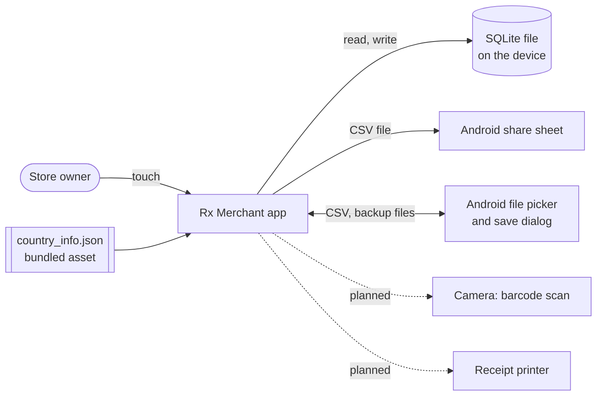
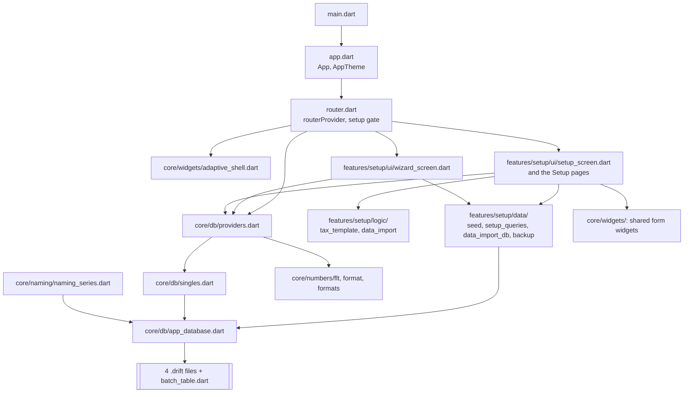
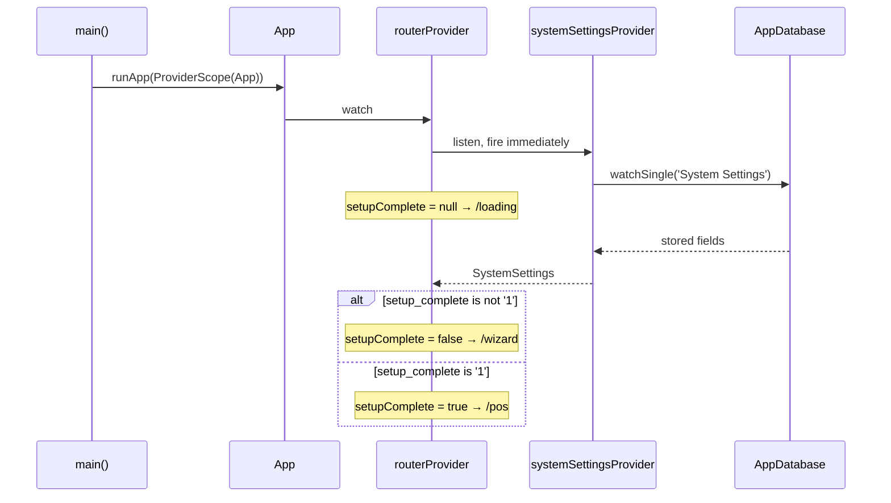

# Rx Merchant: System Documentation

## 0. Document control

| Item | Value |
|---|---|
| Title | Rx Merchant: System Documentation |
| System | Rx Merchant, an offline Android point-of-sale app |
| System version | 1.0.0+1 (`pubspec.yaml`) |
| Date of issue | 2026-11-16 |
| Status | Issued. Describes the system at the end of the Setup plan (R2): build steps SET-B1 to SET-B9, which are milestones M1, M4 and M9, on top of milestone M0. |
| Issuing organization | The Rx Merchant project (one owner, who is also the developer) |
| Prepared by | Claude (AI assistant), for the project owner |
| Approval | Pending the project owner's review |
| Location | `.claude/erpnext-planner/system-documentation.md` |

### Change history

| Issue | Date | Change |
|---|---|---|
| 1 | 2026-11-15 | First issue. Covers milestone M0: project setup, database schema version 1, settings access, rounding and formatting, naming series, theme, adaptive shell, wizard gate, shared widgets. |
| 2 | 2026-11-16 | Covers the Setup plan (R2), SET-B1 to B9: first-run wizard and seed, the Setup destination, settings pages, Currency, Price List, Naming Series, Mode of Payment, taxes, POS Profile, Data Import and Export, Backup and Restore, and "Restore from backup" on the wizard's first step. Sections 1, 3 to 6 and 8 to 13 updated; section 6.9 rewritten; section 7 changed only in 7.1, 7.2 and 7.6. |

### How this document follows ISO/IEC/IEEE 15289

ISO/IEC/IEEE 15289 defines what each life-cycle information item (document) must contain. It does not fix a layout, and it allows several items to be combined in one document. This document combines the items in the table below. Every section carries the generic content the standard asks of a description, report or specification: date of issue and status, scope, issuing organization, references, context, body, summary, glossary and change history.

| 15289 information item | Generic type | Section |
|---|---|---|
| Concept of operations | Description | 3 |
| System requirements specification | Specification | 4 |
| System architecture description | Description | 5 |
| Software design description | Description | 6 |
| Database design description | Description | 7 |
| Interface description | Description | 8 |
| Installation procedure; configuration status report | Procedure; Report | 9 |
| Test report (verification) | Report | 10 |
| User documentation | Description | 11 |
| Problem report | Report | 12 |

**Limit of this claim.** The text of the standard was not available when this document was written. The structure follows the standard's generic content elements (clause 7) and information-item names (clause 10) as the author knows them. Check it against a licensed copy before claiming formal conformance.

---

## 1. Scope

This document describes the Rx Merchant system as it exists in the repository on the date of issue. It records what the system is for, what it must do, how it is built, how its data is stored, how it is built and installed, how it was verified, and what is known to be wrong or missing.

It describes the current state only. Planned behaviour is listed in section 4.4 and section 12.3 so that a reader can tell built from not built. The feature plans in section 2.1 remain the source for planned behaviour.

### 1.1 System identification

| Item | Value |
|---|---|
| Product name | Rx Merchant |
| Dart package | `rx_merchant` |
| Android application ID | `com.rx_merchant.rx_merchant` |
| Launcher label | Rx Merchant |
| Version | 1.0.0, build 1 |
| Platform | Android only. Minimum SDK 24 (Android 7.0), target and compile SDK 36. |
| Form factors | Phones and tablets, portrait and landscape |
| Milestone state | M0 Foundation and the whole Setup plan (M1, M4, M9) complete. M2, M3 and M5 to M8 not started. |

### 1.2 What the system is

An Android app for one store run by one owner. It works with no internet connection. When complete it will keep the item catalogue and stock, sell at a cash register, print receipts and invoices, and show a sales dashboard. Its screens, field names and rules follow ERPNext, reduced to what one store owner needs.

At this issue the store can be set up completely. A first-run wizard creates the store and its default records; the Setup destination holds every settings page and master of the Setup plan; items can be imported from CSV; the data can be backed up and restored. The Register, Invoices, Stock and Dashboard destinations are still empty.

---

## 2. References, glossary and notation

### 2.1 References

| Ref | Document | Location |
|---|---|---|
| R1 | Overview and foundation plan (the M0 specification) | `.claude/erpnext-planner/Plans/00-overview-and-foundation.md` |
| R2 | Setup plan (rules SET-R1 to R18, build steps SET-B1 to B9, acceptance SET-A1 to A20) | `.claude/erpnext-planner/Plans/01-setup.md` |
| R3 | Stock plan | `.claude/erpnext-planner/Plans/02-stock.md` |
| R4 | Cash Register plan | `.claude/erpnext-planner/Plans/03-cash-register.md` |
| R5 | Sales Dashboard plan | `.claude/erpnext-planner/Plans/04-sales-dashboard.md` |
| R6 | Invoices and Receipts plan | `.claude/erpnext-planner/Plans/05-invoices-and-receipts.md` |
| R7 | ERPNext documentation, merged | `.claude/erpnext-planner/erpnext-docs-merged.md` |
| R8 | ISO/IEC/IEEE 15289:2019, Content of life-cycle information items (documentation) | Published standard |
| R9 | Material Design 3 guidelines (window size classes, navigation, sheets) | m3.material.io |
| R10 | Session reports: issue 1 `2026-11-15_09-47-00.txt`, issue 2 `2026-11-16_17-26-13.txt` | `.claude/commits/` |
| R11 | Frappe `frappe/geo/country_info.json` (MIT licence), source of `assets/country_info.json` | github.com/frappe/frappe |

### 2.2 Glossary

| Term | Meaning |
|---|---|
| Doctype | ERPNext's word for a record type, such as Item or Sales Invoice. |
| Single | A doctype with exactly one record: a settings page. Stored as key-value rows in the `singles` table. |
| Master | A record that other records point to, such as Item, Warehouse or Tax. |
| Document | A dated transaction that is saved, then submitted: Stock Entry, Sales Invoice and similar. |
| Child table | Rows that belong to one parent record, such as the items of an invoice. |
| Docstatus | The life-cycle state of a document: 0 Draft, 1 Submitted, 2 Cancelled. |
| Naming series | A pattern such as `ACC-SINV-.YYYY.-` that produces document names with a running number. |
| `flt` | The rounding function every calculated value passes through before it is stored. Named after the same function in ERPNext's framework. |
| Link field | A form field that picks one master record. |
| Store Profile | The single record describing the store. It replaces ERPNext's Company. |
| POS Profile | The configuration of the cash register: warehouse, price list, taxes, payment methods. |
| Wizard gate | The rule that only the first-run wizard is reachable until setup is complete. |
| Seed records | The records the wizard creates in one transaction (SET-R3): currency, warehouses, item groups, units, price list, payment modes, POS Profile, naming series, letter head and settings. |
| Refusal | A save, delete or restore the app declines with a stated reason, such as "used elsewhere, disable it instead" (section 6.9). |
| Sales Taxes and Charges Template | The ordered tax rows a sale copies (SET-R9, R10). |
| Item Tax Template | Per-item overrides of a tax's rate, or Not Applicable (SET-R12). |
| Window size class | Material 3's width bands: compact (under 600dp), medium (600 to 839dp), expanded (840dp and up). |
| dp | Density-independent pixel, Android's unit of layout size. |
| SLE | Stock Ledger Entry: one row per stock movement. |
| Bin | The current quantity and value of one item in one warehouse. |

### 2.3 Notation

- Diagrams use Mermaid.
- File paths are relative to the repository root.
- Table and column names are written as they appear in SQL.
- Requirement identifiers such as SET-R4 and SET-A1 come from the plans in section 2.1.
- In table catalogues, **PK** marks a primary key, **U** a unique column, and `a → b` a foreign key from column `a` to table `b`.

---

## 3. Concept of operations

### 3.1 Users

One person: the store owner. The owner sets the system up, maintains items and stock, sells, and reads the reports. There are no accounts, roles, permissions or login.

### 3.2 Operating environment

- One Android phone or tablet. The data lives on that device only.
- No network. The release build does not hold the Android `INTERNET` permission, so it cannot open a connection even if a library tries.
- Android's file picker and save dialog, for CSV import and export and for backups.
- Peripherals planned for later milestones: the device camera for barcode scanning, and a receipt printer.

### 3.3 Intended operation (when complete)

1. **First run.** A wizard collects the store name, country, currency and formats, then creates the default records.
2. **Setup.** The owner defines payment methods, taxes, price lists and the POS Profile.
3. **Stock.** The owner creates items and receives stock through Stock Entries and Stock Reconciliations.
4. **Selling.** The owner opens a cash-register session, sells to walk-in buyers who pay in full, and closes the session.
5. **Invoices.** Each sale is a Sales Invoice that can be printed, returned or cancelled.
6. **Dashboard.** Sales cards, charts and reports.

### 3.4 Operation at this issue

Steps 1 and 2 of the flow exist:

1. The app starts and reads System Settings.
2. On a fresh install it shows the first-run wizard. Nothing else is reachable. On its first step **Restore from backup** brings in another device's data instead, and the app opens on the restored store.
3. The owner picks the language, country and currency (the format preview shows how dates and numbers will look) and names the store.
4. On the last step the owner taps **Open Cash Register** or **Add your first item**. The app writes every seed record and marks setup complete in one transaction, then lands on the chosen destination.
5. In **Setup** the owner adjusts the store and formats, defines payment modes, taxes, tax templates, price lists and the POS Profile, edits naming series, imports or exports items, prices and barcodes, and backs up or restores the data.
6. Register, Invoices, Stock and Dashboard still show "This screen arrives in a later milestone."

### 3.5 What the system deliberately leaves out

Taken from R1, section 2. Each exclusion applies to every screen and table.

| Excluded | Consequence |
|---|---|
| Multiple companies | Exactly one Store Profile. No Company field anywhere. |
| Cost centers | Every Cost Center field is removed. |
| Fixed assets | No asset fields on Item. |
| Customers | No customer master. Every sale is to an anonymous walk-in buyer, paid in full. No credit sales, receivables or loyalty points. |
| Sales persons | No sales team, commission or targets. |
| Chart of accounts | No ledgers and no account fields. Sales tax is still calculated. |
| Staff | No users, roles or login. |
| Purchasing | No suppliers or purchase documents. Stock arrives through a Stock Entry of type Material Receipt. |
| Fiscal year | Naming series and reports use the calendar year. |

---

## 4. System requirements

### 4.1 Constraints

| ID | Constraint | Met by | Status |
|---|---|---|---|
| C-1 | Android only | Project created with `--platforms=android`; no other platform folder exists | Met |
| C-2 | Works fully offline; the release build holds no `INTERNET` permission | `android/app/src/release/AndroidManifest.xml` removes the permission even when a plugin declares it | Met, verified (section 10.4) |
| C-3 | SQLite is the only data store | `lib/core/db/app_database.dart` | Met |
| C-4 | Phones and tablets from the first build, in three window size classes | `WindowSize`, `AdaptiveShell`, `ListDetailPane`, `showRowEditor` | Met, verified (sections 10.2, 10.5) |
| C-5 | Material 3 only. Colours come from `ColorScheme` roles; the seed colour is the only literal. | `AppTheme` in `lib/app.dart` | Met |
| C-6 | Every user-visible label goes through localisation | `lib/l10n/app_en.arb`, generated `AppLocalizations` | Met for labels and messages. Stored option values (charge types, Mode of Payment types, Rounding Method) show as stored, in ERPNext's English (P-11). |
| C-7 | Three hops at most: screen, provider, query or pure function. No repository interfaces, use-case classes or mapper layers. | Code structure (section 5) | Met |
| C-8 | Numeric columns are `REAL`. Every calculated value is rounded by `flt` before it is stored. | Schema; `lib/core/numbers/flt.dart` | Met. The only calculation so far, the tax "Try it" panel, rounds every row with `flt`; it stores nothing. |
| C-9 | Foreign keys are enforced | `PRAGMA foreign_keys = ON` at every open | Met, verified |
| C-10 | Schema version 1 contains every table of every feature plan | 48 tables, 14 indexes | Met, verified |
| C-11 | ERPNext's labels and status names are used as is | Status values in the schema; localisation keys | Met for what exists |

### 4.2 Functional requirements implemented

| ID | Requirement | Implementation | Verified by |
|---|---|---|---|
| SET-R1 | Until setup is complete the app shows only the first-run wizard. Finishing it writes all seed data in one transaction. Afterwards the wizard is unreachable. | `redirect` in `lib/router.dart`; `completeSetup` in `lib/features/setup/data/seed.dart` | `test/app_test.dart`, group "wizard gate (SET-R1)"; `setup_db_test.dart` |
| SET-R2 | Default Currency and Currency Precision lock once any document is submitted; the form shows why | `anySubmittedDocument` in `setup_queries.dart`; `lockReason` in `settings_pages.dart` | `setup_db_test.dart` (SET-A13) |
| SET-R3 | The wizard seeds currency, warehouse tree, item groups, 13 UoMs, Standard Selling, three payment modes, the Main Counter POS Profile, seven naming series, a letter head and Stock Settings | `completeSetup` | `setup_db_test.dart` (SET-A12) |
| SET-R4 | Rounding follows the Rounding Method setting: Banker's Rounding (default) sends a midpoint to the nearest even digit; Commercial Rounding sends it away from zero. Binary float error must not change the result. | `flt` and `RoundingMethod` in `lib/core/numbers/flt.dart` | `test/core/numbers/flt_test.dart` |
| SET-R5 | Numbers, currency, dates and times are shown, and typed, in the formats chosen in System Settings. Stored values never change. | `lib/core/numbers/format.dart` (`parseNumber` for typing), `Formats` and `formatsProvider` | `test/core/numbers/format_test.dart`; System Settings preview on the emulator |
| SET-R6 | A naming series pattern resolves date parts from the posting date and keeps one counter per resolved prefix. A failed transaction does not consume a number. | `parseSeries` and `nextName` in `lib/core/naming/naming_series.dart` | `test/core/naming/naming_series_test.dart` |
| SET-R7 | The first pattern of a document is its default; Update Series sets a counter and refuses a number below one already used | `saveNamingSeries`, `highestUsedNumber`, `updateSeries`; `naming_series_page.dart` | `setup_db_test.dart` |
| SET-R8 | A disabled Mode of Payment cannot be chosen; one in use can be disabled but not deleted | Foreign keys through `deleteMaster`; `_refuseDisabled` | `setup_db_test.dart` |
| SET-R9 | Tax rows: order, Reference Row # rules, Actual and On Item Quantity, included-in-rate rules, one default template | `validateTaxRows`, `tryTaxes`, `removeTaxRow` in `logic/tax_template.dart`; `saveSalesTaxesTemplate` | `tax_template_test.dart` (SET-A8 to A11); `setup_db_test.dart` (SET-A15) |
| SET-R12 | An Item Tax Template row overrides the matching tax's rate; Not Applicable removes the tax | `effectiveRate`; `saveItemTaxTemplate` | `tax_template_test.dart` (worked example 61.88) |
| SET-R13 | A disabled Price List cannot be chosen; at least one stays enabled | `savePriceList`, `deleteMaster`, `_refuseDisabled` | `setup_db_test.dart` (SET-A14) |
| SET-R14 | POS Profile: non-group warehouse; exactly one default payment when there are any; exactly one enabled default profile; no edit while its session is open | `savePosProfile`, `deletePosProfile` | `setup_db_test.dart` (SET-A16 and two more) |
| SET-R15 | Monthly Sales Target on Store Profile; it blocks nothing | `StoreProfilePage` in `settings_pages.dart` (money field) | Field seen on the emulator; saving goes through `SinglesForm`, tested in `app_test.dart`. The dashboard use comes with M7. |
| SET-R16 | Data Import of Item, Item Price, Item Barcode: template, every row checked first, problems by row and column, one transaction, a result log; Data Export of the same columns | `logic/data_import.dart`, `data/data_import_db.dart`, `ui/data_pages.dart` | `data_import_test.dart`; `import_backup_test.dart` (SET-A17, 200 items) |
| SET-R17 | Backup by `VACUUM INTO`, named `{abbr}-backup-{YYYYMMDD-HHMMSS}.sqlite`, newest Number of Backups kept, Export outside the app | `takeBackup`, `listBackups` in `data/backup.dart`; `BackupsPage` | `import_backup_test.dart` (SET-A18); emulator. The automatic backup on POS Closing waits for M5. |
| SET-R18 | Restore checks the file, refuses with an open session, backs up first (skipped when setup was never finished), replaces the database and reopens it; available on the Backups page and on the wizard's first step | `checkRestorable`, `restoreDatabase`; `pickBackupCopy`, `restoreAndReopen`; `BackupsPage`, `WizardScreen` | `import_backup_test.dart` (SET-A19, fresh-install restore); emulator round trips (section 10.5) |
| R1 §6.5 | Settings pages are stored as key-value rows, with typed access and defaults | `lib/core/db/singles.dart` | `test/core/db/singles_test.dart` |
| R1 §7.2, §7.3 | Navigation is a bottom bar on compact windows, a rail on medium windows, a rail with labels on expanded windows; five destinations in fixed order | `lib/core/widgets/adaptive_shell.dart` | `test/app_test.dart`, group "adaptive shell" |
| R1 §7.1 | Shared form building blocks: list and detail panes, link field, child table with row editor, status chip, report table with CSV export | `lib/core/widgets/` | `test/core/widgets/` |
| R2 §5 | Setup workspace of grouped cards; one pane on phones, list beside page on expanded windows | `ui/setup_screen.dart`, `_setupRoute` in `lib/router.dart` | `test/app_test.dart`, group "Setup destination" |

### 4.3 Acceptance criteria met

| ID | Criterion | Result |
|---|---|---|
| SET-A1 | Banker's: `flt(2.345, 2)` is 2.34 and `flt(2.355, 2)` is 2.36 | Pass |
| SET-A2 | Commercial: `flt(2.345, 2)` is 2.35 | Pass |
| SET-A3 | Commercial: `flt(1.005, 2)` is 1.01 | Pass |
| SET-A4 | 12345.67 shows as `12,345.67` in `#,###.##` and `12.345,67` in `#.###,##` | Pass |
| SET-A5 | `ACC-SINV-.YYYY.-` used three times in 2026 gives `ACC-SINV-2026-00001`, `-00002`, `-00003` | Pass |
| SET-A6 | The same series in 2027 starts again at `ACC-SINV-2027-00001` | Pass |
| SET-A7 | `INV12.####` gives `INV120001` | Pass |
| M0 "done when" | The app starts on a phone and a tablet emulator, shows the wizard gate, and `flutter test` passes | Pass (section 10) |
| SET-A8 | A previous-row type in row 1 is rejected | Pass |
| SET-A9 | Reference Row # pointing at a later row is rejected | Pass |
| SET-A10 | An Actual row marked as included in basic rate is rejected | Pass |
| SET-A11 | "Try it" on 1,000: 25; 80; 1.60; 21.60; 10 | Pass |
| SET-A12 | After the wizard every SET-R3 record exists and `setup_complete` is 1 | Pass |
| SET-A13 | A submitted document locks Default Currency and Currency Precision | Pass |
| SET-A14 | Disabling the only enabled Price List is refused | Pass |
| SET-A15 | A second default template clears the first | Pass |
| SET-A16 | Editing a POS Profile during an open session is refused | Pass |
| SET-A17 | A CSV with one unknown Item Group imports nothing and names the row and column | Pass |
| SET-A18 | Five backups with Number of Backups = 3 leave the newest three | Pass |
| SET-A19 | Restoring a file that is not a backup is refused; data untouched | Pass |
| SET-A20 | Wizard and every Setup page on a phone and a tablet in both orientations | Pass on emulators (section 10.5) |
| SET-B1 to B9 runnable results | Wizard lands on the shell; formats change the preview; Try it reproduces the worked examples; a second profile can be made default; 200 items import; back up, wipe, restore brings the data back | Pass (sections 10.2, 10.5) |

### 4.4 Requirements not yet implemented

| Milestone | Contents | State |
|---|---|---|
| M0 Foundation | Project, database, settings access, rounding, naming series, theme, adaptive shell | **Done** |
| M1 Setup A | First-run wizard, Store Profile, System Settings, Global Defaults, Currency, Price List, Naming Series | **Done** |
| M2 Stock A | Warehouse, Item Group, UoM, Brand, Item, Item Price, Stock Settings | Not started |
| M3 Stock B | Stock ledger engine, Stock Entry, Stock Reconciliation, core stock reports | Not started |
| M4 Setup B | Mode of Payment, taxes, POS Profile, Selling Settings | **Done** |
| M5 Cash Register | Sessions, POS screen, totals engine, payment, submit | Not started |
| M6 Invoices | List, detail, print formats, PDF, thermal printing, returns, cancel | Not started |
| M7 Dashboard | Cards, charts, sales goal, reports | Not started |
| M8 Stock C | Variants, batches, serial numbers | Not started |
| M9 Setup C | Data import and export, backup and restore | **Done**, except the backup on POS Closing, which needs M5 |

---

## 5. System architecture

### 5.1 Context



The system has no server, no network peer and no other user. Dashed lines are interfaces that later milestones add.

### 5.2 Structure

The app is one Flutter program. Code is grouped by feature, with shared code under `core`. A screen reads a provider; a provider calls a database query or a pure function. There is no layer in between.



A screen reads a provider or calls a query method on `AppDatabase` (a Dart extension in the feature's `data/` folder); validation and calculation live in `logic/`, which imports neither Flutter nor the database.

### 5.3 Folder map

```
lib/
  main.dart                     entry point
  app.dart                      App widget, AppTheme
  router.dart                   routes, setup gate, placeholder screens
  core/
    db/
      app_database.dart         AppDatabase (drift)
      app_database.g.dart       generated by drift_dev
      singles.dart              settings access and typed settings classes
      providers.dart            database, settings, store currency, formats
    numbers/
      flt.dart                  rounding
      format.dart               number, currency, date, time formatting; typed-number parsing
      formats.dart              Formats: the display formats in force
    naming/
      naming_series.dart        naming series resolver and counter
    widgets/
      window_size.dart          WindowSize
      spacing.dart              AppSpacing
      adaptive_shell.dart       navigation frame
      list_detail_pane.dart     one-pane / two-pane layout
      link_field.dart           picker for one master record
      child_table.dart          child rows and the row editor sheet
      status_chip.dart          document status indicator
      report_table.dart         report table and CSV export
  features/
    setup/data/setup.drift      14 tables
    setup/data/country_info.dart  bundled country data
    setup/data/seed.dart        completeSetup: the wizard's seed transaction
    setup/data/setup_queries.dart reads and writes of the Setup pages, locks, naming admin
    setup/data/refusal.dart     refusal codes; constraint failures become refusals
    setup/data/data_import_db.dart import lookups, writer, export rows
    setup/data/backup.dart      backup, list, restore checks, restore
    setup/logic/tax_template.dart tax row checks, Try it, item rate, row removal
    setup/logic/data_import.dart import columns, header matching, row checks
    setup/ui/wizard_screen.dart first-run wizard
    setup/ui/setup_screen.dart  Setup workspace and page routing
    setup/ui/form_kit.dart      form page, problems dialog, field grid, master list
    setup/ui/settings_pages.dart Store Profile, System Settings, Global Defaults, Selling Settings
    setup/ui/simple_masters.dart Currency, Mode of Payment, Tax, Price List
    setup/ui/tax_template_pages.dart Sales Taxes and Charges Template, Item Tax Template
    setup/ui/pos_profile_page.dart POS Profile
    setup/ui/naming_series_page.dart Naming Series
    setup/ui/data_pages.dart    Data Import, Data Export, Backups
    stock/data/stock.drift      22 tables, 9 indexes
    stock/data/batch_table.dart the batch table, in Dart
    stock/logic/barcode.dart    EAN / UPC barcode check
    pos/data/pos.drift          8 tables, 5 indexes
    invoices/data/invoices.drift 3 tables
  l10n/
    app_en.arb                  227 messages, English
    app_localizations*.dart     generated by gen-l10n
assets/
  country_info.json             250 countries (R11)
test/                           140 tests (section 10.2)
android/                        Android host project
```

Size at this issue: 6,499 lines of hand-written Dart under `lib/` (5,254 of them in the Setup feature), 644 lines of schema, 2,021 lines of tests. The generated database code is unchanged.

### 5.4 Technology

| Concern | Choice | Resolved version |
|---|---|---|
| Framework | Flutter, stable channel | 3.50.0 |
| Language | Dart | 3.14.0 |
| UI toolkit | Material 3 from `package:material_ui` | 1.11.0 |
| Database | SQLite through `drift`, opened by `drift_flutter`; `sqlite3` also used directly to open a backup read-only | drift 2.35.4, drift_flutter 0.3.1, sqlite3 3.9.1 |
| State | `flutter_riverpod` | 3.5.0 |
| Routing | `go_router` | 18.1.4 |
| Localisation | `flutter_localizations`, `intl`, gen-l10n | intl 0.20.3 |
| CSV | `csv` | 8.0.0 |
| File sharing | `share_plus`, `path_provider` | 13.3.1, 2.1.6 |
| File picker and save dialog | `file_picker` | 13.3.3 |
| Country data | `assets/country_info.json`, trimmed from R11 | 250 countries |
| Code generation | `drift_dev`, `build_runner` | 2.35.3, 2.17.1 |
| Lints | `flutter_lints` | 6.0.0 |
| Android build | Gradle, Android Gradle Plugin, Kotlin, Java | 9.5.0, 9.3.1, 2.4.20, 17 |

Declared for later milestones and not yet imported by any code: `mobile_scanner` 7.5.0 (barcode), `pdf` 3.13.1 and `printing` 5.15.1 (documents), `fl_chart` 1.3.1 (dashboard), `image_picker` 1.2.4 (images). `cupertino_icons` 2.0.0 is present only for its icon font.

### 5.5 Start-up and the setup gate



The router holds one value, `setupComplete`, with three states. Every navigation passes through `redirect`:

| `setupComplete` | Where every location leads |
|---|---|
| `null` (settings not read yet) | `/loading` |
| `false` | `/wizard` |
| `true` | The requested location; `/loading` leads to `/pos`; `/wizard` leads to the location in its `?next=` parameter, or `/pos` |

The value is a `ValueNotifier` passed to the router as `refreshListenable`, so the redirect runs again the moment the setting changes. On the wizard's last step, **Open Cash Register** and **Add your first item** first move to `/wizard?next=/pos` or `/wizard?next=/stock`, then run `completeSetup`. When it commits, the settings stream emits and the router leaves the wizard for the `next` location. A failed seed writes nothing and the wizard stays. **Restore from backup** on the first step takes the other way out: the restored data has `setup_complete` set, so when the reopened database's settings stream emits, the router leaves the wizard for `/pos`.

If the settings cannot be read, `/loading` shows "The database could not be opened." and the error text.

### 5.6 Routes

| Path | Screen | Notes |
|---|---|---|
| `/loading` | Blank, or the start-up error | Shown only while settings are read |
| `/wizard` | First-run wizard | Outside the navigation frame; `?next=` names where to land |
| `/pos` | Cash Register placeholder | Branch 1, the home location |
| `/invoices` | Invoices placeholder | Branch 2 |
| `/stock` | Stock placeholder | Branch 3 |
| `/dashboard` | Dashboard placeholder | Branch 4 |
| `/setup` | Setup workspace | Branch 5 |
| `/setup/:page` | A Setup page, or a master's list (`page` is a slug such as `pos-profile`) | Expanded: the workspace stays on the left and the move does not animate |
| `/setup/:page/:id` | A master's form; `id` is the record id or `new` | Back returns to the list |

The five destinations are branches of one `StatefulShellRoute.indexedStack`, so each keeps its own navigation state when the owner switches between them.

### 5.7 Design decisions

| # | Decision | Reason | Cost |
|---|---|---|---|
| D-1 | Tables are written as SQL in `.drift` files, copied from the plans | The plans define the schema as SQL; copying avoids transcription errors across 48 tables | Flag columns are `int` 0/1 in Dart, not `bool` |
| D-2 | All 48 tables are created in schema version 1 | Later milestones add behaviour without a schema change | Empty tables exist from the first run |
| D-3 | The `batch` table is declared in Dart, not in `stock.drift` | A drift-file table named `batch` generates a getter that collides with drift's own `batch()` method | One table lives in a different file; `drift_dev` prints one warning (P-2) |
| D-4 | `series.current` is quoted in SQL; its row class is named `SeriesRow` | `CURRENT` is an SQL keyword; drift's default class name was `Sery` | None |
| D-5 | `setup.drift` and `stock.drift` import each other | Their tables reference each other; `drift_dev` accepts the cycle | None found |
| D-6 | `SystemSettings.roundingMethod` returns the stored text; `RoundingMethod.fromSetting` converts it | Keeps settings access free of a dependency on the numbers code | One conversion at each use |
| D-7 | Date and time formatting is pinned to the `en_US` locale | Stored date text must stay ASCII digits whatever the app language | Displayed dates never use native digits |
| D-8 | A `/loading` route is shown while settings are read | Without it a set-up store would flash the wizard at every launch | One extra route |
| D-9 | The bottom-bar label is "Register"; the screen title is "Cash Register" | "Cash Register" wraps to two lines on a 360dp-wide phone | Two messages for one destination |
| D-10 | `kotlin.incremental=false` in `android/gradle.properties` | The release build fails when the project and the pub cache are on different drives | Slower Kotlin recompiles |
| D-11 | Generated localisation files are excluded from analysis | The generated code refers to delegates deprecated in Flutter 3.47 | Real problems in generated code would go unreported |
| D-12 | The release manifest removes `INTERNET` with `tools:node="remove"` | A plugin that declares the permission cannot bring it back | Debug and profile builds keep it for hot reload |
| D-13 | Seed colour is `Colors.teal` | A placeholder; one constant in `lib/app.dart` | None |
| D-14 | The whole Setup plan was built at once (M1, M4, M9) | The prompt for this issue named the Setup plan, not a milestone | Pages exist before the stock and register plans that use them |
| D-15 | Country data comes from Frappe's `country_info.json` (R11), trimmed | ERPNext's own data; 250 countries | 11 countries use a number format the app lacks and were mapped to the nearest of the six |
| D-16 | Currency Precision is set from the currency at setup: 0 when the currency has no fraction, 3 for 1,000 fraction units, otherwise 2 | The yen and the dinars would otherwise round wrongly | None found |
| D-17 | One generic settings form (`SinglesForm`) for the four settings pages, one generic form for the name-and-switches masters | Fewer near-identical screens | A new field type is added in one place for all |
| D-18 | Deletes rely on SQLite's foreign keys; a FOREIGN KEY failure becomes "used elsewhere, disable it instead", a UNIQUE failure "a record with this name already exists" | No per-table "is it used" queries to keep in step with the schema | The message cannot say which record uses it |
| D-19 | Data and logic return refusal and problem codes; the UI turns them into messages | `logic/` stays free of Flutter; every message is in the ARB file | One code-to-message switch per kind |
| D-20 | Setup forms use `DropdownMenu` for short link lists; `LinkField` is used for long lists (country, currency) | A dropdown shows every choice at once | No "Create new" from inside a form (P-11) |
| D-21 | `FieldGrid` switches to two columns on the pane width (600dp), not the window width | A form in the expanded right pane is narrower than the window | Differs from the letter of R1 §7.2 |
| D-22 | A form loads all its choices before it is built | A `DropdownMenu` shows its initial selection only if its entries exist on the first build | A short loading indicator |
| D-23 | `sqlite3` is a direct dependency | To open a backup read-only before a restore | None: drift already pulled it in |
| D-24 | The database file is drift_flutter's default, `rx_merchant.sqlite` in the app documents directory; `backup.dart` reads the same path | No change to `AppDatabase` | The two must stay in step |
| D-25 | Data Import also applies three stock rules: an Item Price from Standard Selling Rate (STK-R5), the EAN check digit (STK-R8), no overlapping price validity (STK-R10) | An import must not write data the stock plan forbids | Beyond SET-R16's list of checks |
| D-26 | A typed number must have groups of the format's size; a format without decimals takes the other mark as decimal point | So "7.5" in `#.###` is refused instead of read as 75 | Typing "1,5" in `#,###.##` is refused rather than guessed |

---

## 6. Software design

### 6.1 Entry point and app: `lib/main.dart`, `lib/app.dart`

- `main()` runs `App` inside a `ProviderScope`.
- `App` is a `ConsumerWidget` that builds `MaterialApp.router` with the router from `routerProvider`, the light and dark themes, and the localisation delegates. The task-switcher title is the `appTitle` message. The locale follows System Settings' Language once it is read.
- `AppTheme.light` and `AppTheme.dark` build `ThemeData` from `ColorScheme.fromSeed` with one seed. The theme sets outlined borders for every form field through `inputDecorationTheme`. The device setting chooses light or dark.

### 6.2 Database: `lib/core/db/app_database.dart`

```dart
class AppDatabase extends _$AppDatabase {
  AppDatabase([QueryExecutor? executor]);   // default: driftDatabase(name: 'rx_merchant')
  int get schemaVersion => 1;
  MigrationStrategy get migration;          // beforeOpen: PRAGMA foreign_keys = ON
}
```

- Includes the four `.drift` files and the `Batches` Dart table.
- Tests pass `NativeDatabase.memory()` as the executor.
- `drift_dev` generates `app_database.g.dart`: one table class, one row class and one companion class per table.

### 6.3 Settings access: `lib/core/db/singles.dart`

```dart
extension SinglesAccess on AppDatabase {
  Future<Map<String, String>> readSingle(String doctype);
  Stream<Map<String, String>> watchSingle(String doctype);
  Future<void> writeSingle(String doctype, Map<String, Object?> values);
}
```

- `readSingle` returns the stored fields of one settings page. Keys that were never set, or were cleared, are absent.
- `watchSingle` emits the same map again whenever the `singles` table changes.
- `writeSingle` upserts each entry in one batch. A `bool` is stored as `'1'` or `'0'`. `null` clears the key, so its default applies again. Any other value is stored as its text.

Six classes give typed access with defaults: `StoreProfile`, `SystemSettings`, `GlobalDefaults`, `SellingSettings`, `StockSettings`, `PrintSettings`. Each wraps the map, names its doctype in a `doctype` constant, and has one getter per key. A missing key returns the default, so adding a setting needs no schema change. The keys and defaults are listed in section 7.6.

Two defaults are derived rather than fixed:

- `StoreProfile.abbr` defaults to the initials of the store name, also when the stored value is blank.
- `PrintSettings.rawCharsPerLine` defaults to 48 for 80mm paper and 32 for 58mm paper.

### 6.4 Providers: `lib/core/db/providers.dart`

| Provider | Type | Behaviour |
|---|---|---|
| `appDatabaseProvider` | `Provider<AppDatabase>` | Creates the one database and closes it on dispose. Tests override it. |
| `systemSettingsProvider` | `StreamProvider<SystemSettings>` | System Settings, emitted again on every change. |
| `singleProvider(doctype)` | `StreamProvider.family<Map<String, String>, String>` | The stored fields of one settings page. |
| `storeCurrencyProvider` | `StreamProvider<CurrencyData?>` | The Currency record of the store's Default Currency. |
| `formatsProvider` | `Provider<Formats>` | The display formats in force (section 6.6); defaults while settings load. |

A restore invalidates `appDatabaseProvider`, which closes the old connection and opens the restored file; every provider that reads the database follows.

### 6.5 Rounding: `lib/core/numbers/flt.dart`

```dart
enum RoundingMethod { bankers, commercial }       // fromSetting(String) converts the stored text
double flt(num value, int precision, [RoundingMethod method = RoundingMethod.bankers]);
```

A decimal such as 2.345 is stored in binary as 2.34499999999999997. Plain rounding would send it down under both methods. `flt` compares against the midpoint with a tolerance of one unit of binary float error, which is the approach of ERPNext's own `flt`.

1. `scaled = |value| × 10^precision`
2. `tolerance = scaled × 2⁻⁵²`
3. **Commercial:** round `scaled + tolerance` to the nearest whole number.
4. **Banker's:** if `scaled` is within `tolerance` of a midpoint, take the even neighbour; otherwise round to the nearest whole number.
5. Restore the sign and divide by `10^precision`.

Rounding works on the absolute value, so a negative amount mirrors the positive one: `flt(-2.345, 2)` is -2.34 under Banker's and -2.35 under Commercial. An unknown method text falls back to Banker's.

### 6.6 Formatting: `lib/core/numbers/format.dart`

```dart
String formatNumber(num value, String numberFormat, int precision);
String formatCurrency(num value, {required String numberFormat, required int precision,
    String? symbol, bool symbolOnRight = false, bool hideSymbol = false});
String formatDate(DateTime d, String dateFormat);
String formatTime(DateTime d, String timeFormat);
String toStorage(DateTime d);
```

`formatNumber` supports the six Number Format options:

| Format | 1234567.891 at precision 2 |
|---|---|
| `#,###.##` | `1,234,567.89` |
| `#.###,##` | `1.234.567,89` |
| `# ###.##` | `1 234 567.89` |
| `#,##,###.##` | `12,34,567.89` (Indian grouping: last three digits, then pairs) |
| `#,###` | `1,234,568` (no decimal part, whatever the precision) |
| `#.###` | `1.234.568` |

The group separator is the second character of the format; the decimal separator is the character before the final `##`. A negative value keeps its sign, except that a value which displays as zero shows no sign.

`formatCurrency` adds the symbol with one space: `$ 12,345.67`, or `12,345.67 $` when `symbolOnRight` is true. The sign stays on the number: `$ -5.00`. With `hideSymbol`, or no symbol, it returns the number alone.

`parseNumber(text, numberFormat)` reads a typed number: group separators are dropped and the format's decimal mark becomes `.`; a format with no decimals (`#,###`, `#.###`) takes the other mark as decimal point. Groups after the first must have the format's size (three digits; two in the middle of Indian grouping), so a mistyped decimal mark is refused rather than misread: `7.5` in `#.###` is null, `7,5` is 7.5. Non-finite text is null.

`Formats` (`lib/core/numbers/formats.dart`) bundles System Settings, Global Defaults and the store Currency, and offers `number`, `money`, `date`, `time`, `parse` and `rounding`. Every Setup screen formats through `formatsProvider`.

`formatDate` accepts ERPNext's Date Format text (`yyyy-mm-dd`, `dd-mm-yyyy`, `dd/mm/yyyy`, `dd.mm.yyyy`, `mm/dd/yyyy`, `mm-dd-yyyy`), where `mm` means month. `formatTime` accepts `HH:mm:ss` and `HH:mm`. `toStorage` produces the text stored in date-time columns, `yyyy-MM-dd HH:mm:ss` in local time, which `DateTime.parse` reads back.

### 6.7 Naming series: `lib/core/naming/naming_series.dart`

```dart
({String key, int digits, String suffix}) parseSeries(String pattern, DateTime postingDate);
extension NamingSeries on AppDatabase {
  Future<String> nextName(String pattern, DateTime postingDate);
}
```

`parseSeries` is a pure function:

1. Split the pattern on `.`.
2. Replace the parts `YYYY`, `YY`, `MM` and `DD` with parts of the posting date. Every other part is literal.
3. Join the parts.
4. The first run of `#` is the counter and its length is the digit count. With no `#`, a five-digit counter goes at the end.
5. `key` is the text before the counter; `suffix` is the text after it.

| Pattern | Posting date | Key | Digits | First name |
|---|---|---|---|---|
| `ACC-SINV-.YYYY.-` | 2026 | `ACC-SINV-2026-` | 5 | `ACC-SINV-2026-00001` |
| `INV12.####` | any | `INV12` | 4 | `INV120001` |
| `INV12####` | any | `INV12` | 4 | `INV120001` |
| `PRE-.MM.-.DD.-` | 2026-03-07 | `PRE-03-07-` | 5 | `PRE-03-07-00001` |
| `A-.###.-X` | any | `A-` | 3 | `A-001-X` |

`nextName` reads the counter stored in `series` under the key (0 when absent), adds one, upserts it, and returns key, padded number and suffix. It runs in its own transaction. Called inside a document's submit transaction it nests in that one, so a failed submit rolls the counter back. A counter that outgrows its digit count grows longer and is never cut: after 99999 comes 100000.

### 6.8 Shared widgets: `lib/core/widgets/`

| Widget | Signature | Behaviour |
|---|---|---|
| `WindowSize` | `WindowSize.of(context)` | Returns `compact`, `medium` or `expanded` from the window width. Never reads the device type or the orientation. |
| `AppSpacing` | `xs` 4, `sm` 8, `md` 16, `lg` 24 | The spacing scale, built from a unit of 4. |
| `AdaptiveShell` | `AdaptiveShell({navigationShell})` | The navigation frame (section 8.1). Tapping the destination already shown returns it to its first screen. |
| `ListDetailPane` | `ListDetailPane({list, detail})` | Expanded: a 360dp list, a divider, and the detail. Smaller: one pane, the detail when there is one, otherwise the list. |
| `LinkField<T>` | `LinkField({label, value, search, labelOf, onChanged, onCreateNew, mandatory, errorText})` | Opens a search view listing what `search` returns for the typed text, followed by "Create new" when `onCreateNew` is given. A mandatory field ends its label with `*` and has no clear button. An optional field with a value shows a clear button that reports `null`. |
| `showRowEditor<R>` | `showRowEditor(context, builder)` | Compact: a modal bottom sheet that stays above the keyboard. Wider: a 400dp side sheet that slides in from the trailing edge. Completes with the value the editor pops. |
| `ChildTable<T>` | `ChildTable({rows, rowBuilder, editorBuilder, readOnly})` | Lists the rows. Tapping one opens it in `showRowEditor`; "Add Row" opens the editor with no row. `readOnly` hides "Add Row"; rows still open. |
| `StatusChip` | `StatusChip(status)` | Shows the translated status in its colour role (section 8.1). An unknown status shows as is, in the neutral role. |
| `ReportTable` | `ReportTable({columns, rows, filters, exportName})` | A filter bar, a table that scrolls both ways, and a CSV export action. A column whose values are all numbers is right-aligned. |
| `toCsv` | `toCsv(columns, rows)` | A header line, then one line per row. Cells holding a comma or a quote are quoted. |

### 6.9 Setup feature: `lib/features/setup/`

**Data (`data/`).** Query methods are Dart extensions on `AppDatabase`; every write runs in one transaction.

| File | Contents |
|---|---|
| `country_info.dart` | `CountryInfo` (name, code, currency, symbol, fraction, fraction units, smallest fraction, date and number format, `currencyPrecision`, `toCurrency()`); `loadCountryInfo()` decodes the 57 KB asset directly (Flutter's `loadString` would hand it to another isolate). |
| `seed.dart` | `completeSetup(language, country, currencyOf, storeName, abbr)`: every SET-R3 record and the settings keys, then `setup_complete`, in one transaction. `defaultNamingSeries` holds the seven default patterns. |
| `setup_queries.dart` | `anySubmittedDocument` (SET-R2), `sessionOpen`; `upsert`, `deleteMaster`; saves for Currency, Mode of Payment, Tax, Price List, both tax templates and POS Profile, each with its rule; `posProfileLines`, `itemTaxTemplateRows`, `salesTaxesTemplateRows`; `saveNamingSeries`, `highestUsedNumber`, `updateSeries`; `addCurrency`. Updates set `modified_at`. |
| `refusal.dart` | `Refusal` codes and `RefusedException`; `refuseOnConstraint` turns SQLite UNIQUE / PRIMARY KEY failures (2067, 1555) into `duplicateName` and FOREIGN KEY failures (787) into `referenced`, also when drift wraps them in `DriftRemoteException`. |
| `data_import_db.dart` | `importLookups`, `runImport` (one transaction; returns a log), `exportRows` (template header and one row per record). |
| `backup.dart` | `databasePath`, `backupDirectory`, `listBackups`, `takeBackup` (`VACUUM INTO`, then prune), `checkRestorable`, `restoreDatabase` (the safety backup is skipped when setup was never finished: a fresh install holds nothing to keep; optional `target` and `backupDir` for tests). |

Post-conditions guard the rules that span records: after a Price List save or any delete, at least one Price List is enabled; after a POS Profile save or delete, exactly one enabled profile is the default. A failure rolls the transaction back.

**Logic (`logic/`), pure Dart.**

| Function | Rule |
|---|---|
| `validateTaxRows(rows)` | SET-R9: tax mandatory; no previous-row type in row 1; Reference Row # present and earlier; Actual not included; an included previous-row row needs an included reference. Returns (row, problem) pairs. |
| `tryTaxes(rows, net, qty, precision, method)` | Each row's Amount and running Total, in order, each rounded with `flt`. |
| `effectiveRate(row, itemTemplate)` | SET-R12: the item's override rate, null for Not Applicable. |
| `removeTaxRow(rows, n)` | Removes row n and renumbers later Reference Row #; a reference to the removed row is cleared. |
| `ImportRecordType`, `Col` | The three import templates and their column labels, mandatory columns and keys. |
| `matchHeaders`, `rowsOf` | Header matching ignoring case, spacing and `*`; data rows as column → cell. |
| `validateImport` | SET-R16 checks plus D-25: missing, duplicate, not found, unknown link, bad number, value or date, bad barcode, overlapping price. |
| `validBarcode` (`stock/logic/barcode.dart`) | EAN: 13 digits and a valid check digit; UPC: 12 digits. |

**Interface (`ui/`).**

| File | Screens |
|---|---|
| `wizard_screen.dart` | Language (with **Restore from backup** below the list), Region (country and currency pickers, format preview; the device's country preselected), Store (abbreviation suggested), Done. Compact: one step per screen; wider: a 560dp card. |
| `setup_screen.dart` | `setupPage(slug, id)` and `SetupScreen` (a `ListDetailPane` of `SetupHome` and the page). `SetupHome` lists six groups; pages owned by other plans are shown disabled. |
| `form_kit.dart` | `FormPage`, `SectionHeading`, `FieldGrid`, `LockNote`, `MasterList`, `showProblems`, `confirm`, `attempt` (runs a save and shows a refusal or any other error), `refusalText`. |
| `settings_pages.dart` | `SinglesForm` and its field spec; Store Profile, System Settings (live preview), Global Defaults, Selling Settings; `countryInfoProvider`, `submittedProvider`. |
| `simple_masters.dart` | Currency (live amount preview), `NamedMasterForm`; Mode of Payment, Tax, Price List lists and forms. |
| `tax_template_pages.dart` | Sales Taxes and Charges Template (rows, row editor, Try it), Item Tax Template; `NumberField`. |
| `pos_profile_page.dart` | POS Profile list and form, payment row editor. |
| `naming_series_page.dart` | Patterns per document, next-name example, Update Series. |
| `data_pages.dart` | Data Import, Data Export, Backups; `pickBackupCopy` (Android file picker, then a private copy) and `restoreAndReopen` (restore, then reopen the database whatever happened), shared by the Backups page and the wizard. |

### 6.10 Localisation: `lib/l10n/`

`app_en.arb` holds 227 English messages: the shell and widget labels of issue 1 and about 200 Setup labels, field names (ERPNext's words), refusal and problem messages. `languageName` holds each language's own name for the language lists. `l10n.yaml` sets `nullable-getter: false`, so `AppLocalizations.of(context)` needs no null check. English is the only locale.

---

## 7. Database design

### 7.1 Engine and location

| Item | Value |
|---|---|
| Engine | SQLite, bundled with the app by the `sqlite3` package |
| Access | `drift` |
| File | `rx_merchant.sqlite` in the app's documents directory, private to the app |
| Schema version | 1 |
| At every open | `PRAGMA foreign_keys = ON` |
| Backup | `{abbr}-backup-{YYYYMMDD-HHMMSS}.sqlite` in `backups/` beside the database, newest Number of Backups kept; Export copies one anywhere. Backups left only on the device are lost with it (section 6.9). |

### 7.2 Conventions

- Every numeric quantity, rate and amount is `REAL`.
- Flags are `INTEGER` 0 or 1.
- Date-times are `TEXT` in the form `YYYY-MM-DD HH:MM:SS`, local time.
- Documents carry `docstatus` with `CHECK (docstatus IN (0,1,2))`.
- Status columns hold ERPNext's English status names, constrained by `CHECK`.
- Masters and documents (24 tables) carry `created_at` and `modified_at`, both defaulting to the time of insert. Every update written by the Setup feature sets `modified_at`. Child tables, `singles`, `series` and the ledger tables have neither. See P-3.
- Child tables reference their parent by foreign key and order their rows with `idx` where order matters.

### 7.3 Where each table is defined

| File | Tables | Indexes |
|---|---|---|
| `lib/features/setup/data/setup.drift` | 14 | 0 |
| `lib/features/stock/data/stock.drift` | 22 | 9 |
| `lib/features/stock/data/batch_table.dart` | 1 (`batch`) | 0 |
| `lib/features/pos/data/pos.drift` | 8 | 5 |
| `lib/features/invoices/data/invoices.drift` | 3 | 0 |
| **Total** | **48** | **14** |

These files are the authoritative definition. The catalogue below summarises them and names the key columns; it does not repeat every column.

### 7.4 Table catalogue

**ts** marks a table with `created_at` and `modified_at`.

#### Setup (14)

| Table | Purpose | Keys and references |
|---|---|---|
| `singles` | Settings pages as key-value rows | PK (`doctype`, `field`) |
| `currency` ts | Currency master: symbol, fraction, smallest fraction value, symbol position | PK `code` |
| `naming_series_option` | The patterns offered for each doctype | U (`doctype`, `pattern`) |
| `series` | One counter per resolved naming prefix | PK `name`; column `current` |
| `mode_of_payment` ts | Payment methods and their type | U `name` |
| `tax` ts | Tax heads; replaces ERPNext's account head | U `name` |
| `sales_taxes_template` ts | A named set of tax rows applied to a sale | U `title` |
| `sales_taxes_template_row` | One tax row: charge type, rate or amount, reference row | `template_id` → `sales_taxes_template`, `tax_id` → `tax`; U (`template_id`, `idx`) |
| `item_tax_template` ts | Per-item tax rate overrides | U `title` |
| `item_tax_template_row` | One override: tax and rate | `template_id` → `item_tax_template`, `tax_id` → `tax`; U (`template_id`, `tax_id`) |
| `price_list` ts | Selling price lists | U `name` |
| `pos_profile` ts | Cash register configuration: warehouse, price list, taxes, discount rules, print settings | U `name`; → `warehouse`, `price_list`, `sales_taxes_template`, `letter_head`, `print_heading`, `terms_and_conditions`; `apply_discount_on` is `Grand Total` or `Net Total` |
| `pos_profile_payment` | Payment methods allowed on a profile | → `pos_profile`, `mode_of_payment`; U (`pos_profile_id`, `mode_of_payment_id`) |
| `pos_profile_item_group` | Item groups shown on a profile | PK (`pos_profile_id`, `item_group_id`) |

#### Stock (23)

| Table | Purpose | Keys and references |
|---|---|---|
| `warehouse` ts | Warehouse tree | U `name`; `parent_id` → `warehouse` |
| `item_group` ts | Item group tree, with a default item tax template | U `name`; `parent_id` → `item_group`; → `item_tax_template` |
| `uom` ts | Units of measure | U `name` |
| `brand` ts | Brands | U `name` |
| `item` ts | Item master: naming, group, units, pricing, valuation, variants, batch and serial settings | U `item_code`; → `item_group`, `uom` (stock and sales), `brand`, `warehouse`; `variant_of_id` → `item` |
| `item_barcode` | Barcodes of an item, each with an optional unit | U `barcode`; → `item`, `uom` |
| `item_uom` | Conversion factor of each extra unit | PK (`item_id`, `uom_id`) |
| `item_reorder` | Reorder level and quantity per warehouse | U (`item_id`, `warehouse_id`) |
| `item_tax` | Item tax template of an item, with a start date | → `item`, `item_tax_template` |
| `item_attribute` ts | Variant attributes such as Size | U `name` |
| `item_attribute_value` | Values of an attribute and their abbreviations | → `item_attribute`; U (`attribute_id`, `attribute_value`), U (`attribute_id`, `abbr`) |
| `item_variant_attribute` | The attribute values that define a variant | → `item`, `item_attribute`; U (`item_id`, `attribute_id`) |
| `batch` ts | Batches with manufacturing and expiry dates | U `batch_id`; `item_id` → `item` |
| `serial_no` ts | Serial numbers and where each is | U `serial_no`; → `item`, `warehouse`, `batch`; `status` is `Inactive`, `Available` or `Delivered` |
| `item_price` ts | Price of an item on a price list, per unit, with validity dates | → `item`, `price_list`, `uom`, `batch` |
| `stock_entry` ts | Stock movement document: receipt, issue or transfer | U `name`; `docstatus`; → `warehouse` (from and to); `amended_from_id` → `stock_entry` |
| `stock_entry_item` | Item rows of a stock entry | → `stock_entry`, `item`, `warehouse` (source and target), `uom` |
| `stock_entry_additional_cost` | Extra costs spread over a receipt | → `stock_entry` |
| `stock_reconciliation` ts | Counted stock document, also used for opening stock | U `name`; `docstatus`; → `warehouse`; `amended_from_id` → `stock_reconciliation` |
| `stock_reconciliation_item` | Counted quantity and rate per item and warehouse | → `stock_reconciliation`, `item`, `warehouse`; U (`stock_reconciliation_id`, `item_id`, `warehouse_id`) |
| `serial_and_batch_entry` | Serial numbers and batches moved by one document row | → `item`, `serial_no`, `batch`; at least one of serial or batch is required |
| `stock_ledger_entry` | One row per stock movement: quantity, running balance, rates, value | → `item`, `warehouse`, `batch` |
| `bin` | Current quantity, rate and value of an item in a warehouse | PK (`item_id`, `warehouse_id`) |

#### Cash Register (8)

| Table | Purpose | Keys and references |
|---|---|---|
| `pos_opening_entry` ts | A cash register session | U `name`; `docstatus`; `status` is `Draft`, `Open`, `Closed` or `Cancelled`; → `pos_profile` |
| `pos_opening_entry_detail` | Opening amount per payment method | → `pos_opening_entry`, `mode_of_payment`; U (`pos_opening_entry_id`, `mode_of_payment_id`) |
| `pos_closing_entry` ts | The close of a session, with totals | U `name`; `docstatus`; → `pos_opening_entry`, `pos_profile` |
| `pos_closing_entry_detail` | Expected and counted amount per payment method | → `pos_closing_entry`, `mode_of_payment`; U (`pos_closing_entry_id`, `mode_of_payment_id`) |
| `sales_invoice` ts | A sale or a return, with totals, discount, rounding and print settings | U `name`; `docstatus`; `status` is `Draft`, `Paid`, `Return`, `Credit Note Issued` or `Cancelled`; → `pos_profile`, `pos_opening_entry`, `warehouse`, `price_list`, `sales_taxes_template`, `letter_head`, `print_heading`, `terms_and_conditions`; `return_against_id` → `sales_invoice` |
| `sales_invoice_item` | Item rows of an invoice | → `sales_invoice`, `item`, `uom`, `item_tax_template`, `warehouse`; `sales_invoice_item_id` → `sales_invoice_item` (the row a return row refers to) |
| `sales_invoice_tax` | Tax rows of an invoice | → `sales_invoice`, `tax` |
| `sales_invoice_payment` | Amount paid per payment method | → `sales_invoice`, `mode_of_payment` |

#### Invoices and Receipts (3)

| Table | Purpose | Keys |
|---|---|---|
| `letter_head` ts | Header and footer for printed documents | U `name` |
| `print_heading` ts | Alternative titles for printed documents | U `name` |
| `terms_and_conditions` ts | Reusable terms text | U `title` |

### 7.5 Indexes (14)

| Index | Table (columns) | Serves |
|---|---|---|
| `item_group_idx` | `item` (`item_group_id`) | Items of a group |
| `item_variant_of_idx` | `item` (`variant_of_id`) | Variants of a template |
| `serial_item_status_idx` | `serial_no` (`item_id`, `status`, `warehouse_id`) | Available serial numbers of an item |
| `item_price_lookup_idx` | `item_price` (`item_id`, `price_list_id`, `uom_id`) | Price lookup |
| `sbe_voucher_idx` | `serial_and_batch_entry` (`voucher_type`, `voucher_detail_id`) | Serials and batches of a document row |
| `sbe_serial_idx` | `serial_and_batch_entry` (`serial_no_id`) | History of a serial number |
| `sle_chain_idx` | `stock_ledger_entry` (`item_id`, `warehouse_id`, `posting_datetime`, `id`) | The ordered ledger of an item in a warehouse |
| `sle_voucher_idx` | `stock_ledger_entry` (`voucher_type`, `voucher_id`) | Ledger rows of a document |
| `sle_batch_idx` | `stock_ledger_entry` (`batch_id`, `warehouse_id`) | Stock of a batch |
| `one_open_session_idx` | `pos_opening_entry` (`status`) `WHERE status = 'Open'`, unique | At most one open session |
| `si_posting_idx` | `sales_invoice` (`docstatus`, `posting_datetime`) | Invoice list and sales reports |
| `si_session_idx` | `sales_invoice` (`pos_opening_entry_id`) | Invoices of a session |
| `si_return_idx` | `sales_invoice` (`return_against_id`) | Returns against an invoice |
| `sii_item_idx` | `sales_invoice_item` (`item_id`) | Sales of an item |

### 7.6 Settings keys

Stored in `singles` under the doctype shown. A key that is absent takes the default.

**Store Profile**

| Key | Default |
|---|---|
| `store_name` | empty |
| `abbr` | initials of the store name (also when blank) |
| `country` | none |
| `default_currency` | none |
| `monthly_sales_target` | 0 (goal off) |

**System Settings**

| Key | Default |
|---|---|
| `country` | none |
| `language` | `en` |
| `date_format` | `yyyy-mm-dd` |
| `time_format` | `HH:mm:ss` |
| `number_format` | `#,###.##` |
| `first_day_of_week` | `Monday` |
| `float_precision` | 3 |
| `currency_precision` | 2 |
| `rounding_method` | `Banker's Rounding` |
| `number_of_backups` | 3 |
| `setup_complete` | 0 |

**Global Defaults**

| Key | Default |
|---|---|
| `hide_currency_symbol` | 0 |
| `disable_rounded_total` | 0 |
| `disable_in_words` | 0 |

**Selling Settings**

| Key | Default |
|---|---|
| `selling_price_list` | `Standard Selling` |
| `fallback_to_default_price_list` | 0 |
| `editable_price_list_rate` | 0 |
| `validate_selling_price` | 0 |

**Stock Settings**

| Key | Default |
|---|---|
| `item_naming_by` | `Item Code` |
| `item_group` | `Products` |
| `stock_uom` | `Nos` |
| `default_warehouse` | `Stores` |
| `valuation_method` | `FIFO` |
| `show_barcode_field` | 1 |
| `auto_insert_price_list_rate_if_missing` | 1 |
| `allow_negative_stock` | 0 |
| `auto_indent` (show low-stock alerts) | 1 |
| `stock_frozen_upto` | none |
| `enable_serial_and_batch_no_for_item` | 0 |
| `pick_serial_and_batch_based_on` | `FIFO` |
| `auto_create_serial_and_batch_bundle_for_outward` | 1 |

**Print Settings**

| Key | Default |
|---|---|
| `pdf_page_size` | `A4` |
| `repeat_header_footer` | 1 |
| `with_letterhead` | 1 |
| `compact_item_print` | 1 |
| `allow_print_for_draft` | 1 |
| `add_draft_heading` | 1 |
| `allow_print_for_cancelled` | 0 |
| `print_taxes_with_zero_amount` | 0 |
| `enable_raw_printing` | 0 |
| `raw_printer_name` | none |
| `raw_printer_address` | none |
| `raw_paper_width` | `80mm` |
| `raw_chars_per_line` | 48 for 80mm, 32 for 58mm |
| `raw_cut_paper` | 1 |
| `raw_open_cash_drawer` | 0 |

### 7.7 Migration policy

The schema is at version 1 and no data exists outside test devices. No migration code and no schema snapshot exist yet. Before any change to a table after the app holds real data: export a schema snapshot with `dart run drift_dev make-migrations`, raise `schemaVersion`, write the step, and run the generated migration tests.

---

## 8. Interfaces

### 8.1 User interface

**Navigation frame.** The window width decides the frame.

| Window size class | Width | Navigation | Labels |
|---|---|---|---|
| Compact | under 600dp | `NavigationBar` at the bottom | Shown |
| Medium | 600 to 839dp | `NavigationRail` on the leading edge | Hidden |
| Expanded | 840dp and up | `NavigationRail` on the leading edge | Shown |

The rail scrolls when a short landscape window cannot hold it. Rotating a device moves between the classes with no reload.

**Destinations**, in fixed order:

| # | Label | Screen title | Route | Icon |
|---|---|---|---|---|
| 1 | Register | Cash Register | `/pos` | point of sale |
| 2 | Invoices | Invoices | `/invoices` | receipt |
| 3 | Stock | Stock | `/stock` | inventory |
| 4 | Dashboard | Dashboard | `/dashboard` | dashboard |
| 5 | Setup | Setup | `/setup` | settings |

Each destination shows an outlined icon, and a filled one when selected.

**Status colours.** `StatusChip` maps a status to a colour role, so both themes stay consistent.

| Status | Role |
|---|---|
| Draft | secondary container |
| Submitted, Paid | primary container |
| Return, Credit Note Issued | surface container highest |
| Cancelled | error container |
| Any other | surface container highest |

**Theme.** Material 3, light and dark, from one seed colour. The device setting chooses between them. Form fields are outlined.

**First-run wizard.** Four steps with "Step n of 4" and a progress bar; Back and Next. Step 1 also offers **Restore from backup**. Phone: full screen. Tablet: a centred 560dp card.

**Setup destination.**

| Group | Pages |
|---|---|
| Store | Store Profile, System Settings, Global Defaults, Currency |
| Selling | POS Profile, Mode of Payment, Price List, Selling Settings |
| Taxes | Tax, Sales Taxes and Charges Template, Item Tax Template |
| Stock | Stock Settings (disabled: later milestone) |
| Printing | Print Settings, Letter Head, Print Heading, Terms and Conditions (disabled: later milestone) |
| Data | Naming Series, Data Import, Data Export, Backups |

Compact and medium: the workspace fills the screen and a link pushes the page. Expanded: the workspace is a 360dp left pane with the chosen link highlighted; the page fills the right pane.

**Forms.** A title, Delete (existing masters) and a Save button in the app bar; sections with headings; fields in two columns from 600dp of pane width. Mandatory labels end with `*`. A failed save opens a dialog listing each problem and keeps the form. A locked field shows a lock icon and its reason. Master lists have a search bar, an Add button and an empty state that offers the same action. Child rows open in a bottom sheet on phones and a side sheet on tablets.

### 8.2 Software interfaces

The system calls no remote service. Its interfaces to other software are the packages of section 5.4 and the Android platform.

| Interface | Used for | Used now |
|---|---|---|
| `drift`, `sqlite3` | All data access | Yes |
| `flutter_riverpod` | Providing the database and settings to screens | Yes |
| `go_router` | Routes and the setup gate | Yes |
| `intl` | Date and time formatting | Yes |
| `csv`, `path_provider`, `share_plus` | Report export; CSV import and export | Yes |
| `file_picker` | Choosing an import or restore file; saving templates, exports and backups | Yes |
| `sqlite3` | Opening a backup read-only before a restore | Yes |
| `mobile_scanner`, `pdf`, `printing`, `fl_chart`, `image_picker` | Later milestones | No |

### 8.3 Device and operating-system interfaces

| Interface | Direction | Detail |
|---|---|---|
| App documents directory | Read, write | The database file; `backups/` with the backup files |
| App temporary directory | Write | `restore.sqlite`, a private copy of the file chosen for a restore |
| Android file picker | In | A CSV to import; a backup to restore |
| Android save dialog | Out | Import templates and exports (`text/csv`); exported backups |
| App asset bundle | In | `assets/country_info.json` |
| App cache directory | Write | `<exportName>.csv`, written before sharing |
| Android share sheet | Out | Receives the CSV file with MIME type `text/csv` |
| Camera | In | Declared by the barcode plugin; no code uses it yet |

### 8.4 Android permissions

Permissions in the merged release manifest:

| Permission | Source | Needed |
|---|---|---|
| `android.permission.CAMERA` | `mobile_scanner` plugin | For barcode scanning, in a later milestone |
| `android.permission.ACCESS_NETWORK_STATE` | Added by a plugin | Not by this app; left in place (P-4) |
| `com.rx_merchant.rx_merchant.DYNAMIC_RECEIVER_NOT_EXPORTED_PERMISSION` | AndroidX | App-private; grants nothing |

`android.permission.INTERNET` is **absent** from the release build. Debug and profile builds keep it, because Flutter's hot reload needs it.

### 8.5 Network interfaces

None.

---

## 9. Build, installation and configuration

### 9.1 Prerequisites

| Tool | Version used |
|---|---|
| Flutter SDK, stable | 3.50.0 (Dart 3.14.0) |
| Android SDK | Platform 36, build tools, platform tools |
| Java | 17 |
| Gradle | 9.5.0, through the wrapper in `android/` |

### 9.2 Procedure

Run from the repository root.

| Step | Command | Expected result |
|---|---|---|
| 1. Fetch packages | `flutter pub get` | Packages resolved; localisation code generated |
| 2. Generate database code | `dart run build_runner build` | `lib/core/db/app_database.g.dart` written; one warning (P-2) |
| 3. Check | `flutter analyze` | `No issues found!` |
| 4. Test | `flutter test` | `All tests passed!` (140) |
| 5. Build | `flutter build apk --release` | `build/app/outputs/flutter-apk/app-release.apk` |
| 6. Install | `adb install -r build/app/outputs/flutter-apk/app-release.apk` | `Success` |

Step 2 is needed only after a `.drift` file or `batch_table.dart` changes; the generated file is kept in the repository tree. Localisation code is regenerated on every build because `pubspec.yaml` sets `generate: true`; `flutter gen-l10n` does it on demand.

The release build is signed with the debug key, as the Flutter template sets it. It can be installed directly but cannot be published.

### 9.3 Notes for the development machine

- `android/gradle.properties` sets `kotlin.incremental=false`. The project is on drive `B:` and the pub cache on `C:`; Kotlin's incremental cache fails across drives.
- Run the Gradle build with nothing else heavy running. Run alongside the test suite it exhausted memory and the build daemon crashed.
- On this machine the Android emulator's hardware GPU mode can drop text on the app's first launch (P-1). Start the emulator with `-gpu swiftshader_indirect` when checking screens.

### 9.4 Configuration items

| Item | Location |
|---|---|
| Application source | `lib/` |
| Schema | `lib/features/*/data/*.drift`, `lib/features/stock/data/batch_table.dart` |
| Messages | `lib/l10n/app_en.arb` |
| Bundled data | `assets/country_info.json` |
| Tests | `test/` |
| Dependencies | `pubspec.yaml`, `pubspec.lock` |
| Analysis rules | `analysis_options.yaml` |
| Localisation settings | `l10n.yaml` |
| Android host | `android/`, including `android/app/src/release/AndroidManifest.xml` |
| Plans | `.claude/erpnext-planner/Plans/` |
| This document | `.claude/erpnext-planner/system-documentation.md` |
| Code graph for navigation | `graphify-out/`, built with `graphify update .`; scope set by `.graphifyignore` |

### 9.5 Configuration status

| Commit | Date | Subject |
|---|---|---|
| `a425ed9` | 2026-11-15 00:54 +08:00 | First Commit (the `flutter create` template) |
| `fafec23` | 2026-11-15 01:12 +08:00 | Added Claude Directory (plans and agent skills) |
| `97bfd33` | 2026-11-15 09:49 +08:00 | Milestone M0 and its session report |

On the date of issue, all of the Setup plan is in the working tree and **not yet committed**. The project owner commits. The session report for this issue (R10) lists every added, changed and deleted file.

---

## 10. Verification report

### 10.1 Summary

| Check | Result |
|---|---|
| Static analysis, `flutter analyze` | No issues |
| Formatting, `dart format` | All 56 files formatted |
| Fixes, `dart fix --dry-run` | Nothing to fix |
| Automated tests, `flutter test` | 140 of 140 pass |
| Release build | Builds; 75.3 MB APK |
| Release manifest | No `INTERNET` permission |
| Phone emulator, 360dp wide | Wizard, Setup pages, backup / wipe / restore round trip |
| Tablet emulator | Wizard card; Setup in one pane (portrait) and two panes (landscape); side-sheet row editor |
| Real device | **Not tested** |

All checks were run on 2026-11-16, after the last code change. Issue 1's checks (launcher label, 411dp phone, `aapt2` badging) were not repeated.

### 10.2 Automated tests

| File | Tests | Covers |
|---|---|---|
| `test/app_test.dart` | 13 | Wizard gate: fresh install shows only the wizard, with Restore from backup; Language, Region (device country preselected), Store (abbreviation suggested), Done lands on the Cash Register; a set-up store never sees the wizard. Shell: bottom bar with five destinations in order; boundaries at 599, 600, 839 and 840dp; switching destinations; rotation. Setup: workspace then pushed page on compact (later-milestone links disabled); workspace beside the page on expanded; a settings page saves to `singles`. |
| `test/core/db/schema_test.dart` | 4 | Exactly the 48 tables; the 14 indexes; foreign keys on; a child row with a missing parent is refused. |
| `test/core/db/singles_test.dart` | 13 | Defaults of all six settings pages; derived defaults, including a blank abbreviation; write then read; one row per key; clearing a key; the stream emits after a write; the same field under two doctypes stays separate. |
| `test/core/numbers/flt_test.dart` | 13 | SET-A1 to A3; negative midpoints; whole-number midpoints; zero; integers; nine decimals; the setting-to-method mapping. |
| `test/core/numbers/format_test.dart` | 17 | SET-A4; all six number formats; precision; padding; negative values; a negative value that rounds to zero; currency symbol placement; all date and time formats; storage text round trip; `parseNumber` round trip, plain typing, mistyped decimal marks, non-numbers. |
| `test/core/naming/naming_series_test.dart` | 11 | SET-A5 to A7; date parts; hashes without a dot; suffix; a counter past its digit count; a failed transaction does not consume a number. |
| `test/core/widgets/list_detail_pane_test.dart` | 5 | Two panes when expanded; one pane at 400 and 839dp; nothing selected. |
| `test/core/widgets/status_chip_test.dart` | 7 | Colour role and label of each status; an unknown status. |
| `test/core/widgets/child_table_test.dart` | 5 | Rows listed; bottom sheet when compact; side sheet when wider; Add Row; read-only. |
| `test/core/widgets/link_field_test.dart` | 7 | Label and value; matches and Create new; narrowing and picking; mandatory mark and error; clear button rules. |
| `test/core/widgets/report_table_test.dart` | 5 | CSV header and rows; quoting; empty cells; headers, cells and export action; sideways scroll. |
| `test/features/setup/logic/tax_template_test.dart` | 13 | SET-A8 to A11; included-reference rule; missing tax; SET-R12 worked example (61.88); row removal renumbering; stored type values. |
| `test/features/setup/logic/data_import_test.dart` | 9 | Header matching; blank rows; SET-A17 problem position; insert and update checks; barcode ownership; EAN / UPC; price validity overlap; `validBarcode`. |
| `test/features/setup/data/setup_db_test.dart` | 11 | SET-A12; a failed wizard writes nothing; SET-A13 to A16; delete of a used master refused; duplicate name; default profile and payment rules; group warehouse; disabled choices; Update Series below a used number and the next name; naming series order. |
| `test/features/setup/data/import_backup_test.dart` | 7 | 200 items imported with price and barcode, exported, updated; SET-A17 at database level; Item Price and Item Barcode insert and update; SET-A18; SET-A19; restore onto a fresh install takes no safety backup, onto a set-up store one; Number of Backups below 1. |
| **Total** | **140** | |

Database tests run against an in-memory SQLite database with the real schema. Widget tests run the real widgets inside the app's theme and localisation. No test uses a mock.

### 10.3 Requirement trace

| Requirement | Test |
|---|---|
| SET-R1 | `app_test.dart`, "wizard gate (SET-R1)" |
| SET-R4, SET-A1 to A3 | `flt_test.dart` |
| SET-R5, SET-A4 | `format_test.dart` |
| SET-R6, SET-A5 to A7 | `naming_series_test.dart` |
| SET-R1, R3, A12 | `setup_db_test.dart`; `app_test.dart` wizard walk-through |
| SET-R2, A13; R7; R8; R13, A14; R9, A15; R14, A16 | `setup_db_test.dart` |
| SET-R9, A8 to A11; R12 | `tax_template_test.dart` |
| SET-R16, A17 | `data_import_test.dart`, `import_backup_test.dart` |
| SET-R17, A18; R18, A19 | `import_backup_test.dart`; emulator round trip (10.5) |
| SET-A20 | Emulator checks (10.5) |
| C-4 | `app_test.dart` "adaptive shell"; `list_detail_pane_test.dart`; `child_table_test.dart` |
| C-9, C-10 | `schema_test.dart` |
| C-2 | Release manifest inspection (10.4) |

### 10.4 Build verification

- `flutter build apk --release` completed and wrote `app-release.apk`, 75.3 MB (68.9 MB at issue 1).
- The merged release manifest contains `android.permission.INTERNET` zero times. Its `uses-permission` entries are unchanged from issue 1: `ACCESS_NETWORK_STATE`, `CAMERA`, `DYNAMIC_RECEIVER_NOT_EXPORTED_PERMISSION`.

### 10.5 Device verification

Emulators only, started with `-gpu swiftshader_indirect` (P-1). Issue 2 checks:

| Device | Window | Observed |
|---|---|---|
| `Medium_Phone_API_36.1` | 360dp wide | Wizard: device country preselected; country search finds Philippines; currency follows; abbreviation RCS suggested; "Add your first item" lands on Stock. Relaunch skips the wizard. System Settings: Date Format changed, preview follows, Save shows "Saved". Tax created; template with a 12% row: Try it shows 120.00 on 1,000.00. POS Profile shows the seeded values; template chosen and saved. Backups: Back up now lists the backup in the chosen date format. |
| `Medium_Phone_API_36.1` | 360dp wide | SET-B9 round trip: Export to Downloads (454,656 bytes); app data cleared; wizard run with another store name; Restore from the exported file. The live database then held the original store name, template "VAT 12" and the POS Profile's link to it; a safety backup of the replaced data was taken first; Store Profile opened normally. |
| `Medium_Phone_API_36.1` | 360dp wide | Restore from the wizard: app data cleared; step 1 shows Restore from backup; the file picker opened; picking the exported backup landed on the Cash Register. The live database held the restored store, template and POS Profile; no backups folder was created. |
| `Medium_Tablet`, portrait | medium, 800dp | Wizard as a card; rail without labels; POS Profile form in two columns. |
| `Medium_Tablet`, landscape | expanded, 1280dp | Rail with labels; Setup workspace on the left, page on the right, chosen link highlighted; payment row editor as a side sheet. |

Logcat showed no Flutter error on either device. Four defects found in these checks were fixed before issue (section 10.6).

### 10.6 Code review

| Check | Tool | Result |
|---|---|---|
| Fallow (the project's named review tool) | `fallow dead-code`, `dupes`, `health` | "No issues found". Not meaningful: Fallow analyses TypeScript and JavaScript only. It found one file to analyse, the generated `graphify-out/graph.html`, and no Dart. |
| Unused code | `flutter analyze`, `dart fix --dry-run` | No issues; nothing to fix |
| Unused public declarations | Script over `lib/` | No dead code found. Every public declaration with no caller elsewhere in `lib/` is foundation code awaiting its feature milestone, and is covered by tests, directly or through the widget that uses it. |
| Unused dependencies | Script over `pubspec.yaml` | Six packages declared for later milestones (section 5.4); kept by design |
| Import cycles | Script over `lib/` | None between Dart files. `setup.drift` and `stock.drift` import each other (D-5). |
| Over-engineering | Manual audit of all hand-written code | Nothing worth cutting. One unused constant, `AppSpacing.xs`, kept as part of the spacing scale. |
| Formatting | `dart format` | One test file reformatted |

Issue 2. The project names "flutter review" and Ponytail. No tool by that name exists, so the review was `flutter analyze`, `dart fix`, and the code-review skill: two independent reviewers of the working tree against `97bfd33`, one for standards (R1 sections 5 to 7 and a code-smell list), one against R2. Findings were fixed with the smallest change at the cause.

| Finding | Fix |
|---|---|
| Currency form saved Smallest Currency Fraction Value as 1 in `#.###,##` stores | The field shows the value in the Number Format |
| "7.5" typed in a `#.###` store saved 75 | `parseNumber` checks group sizes (D-26) |
| Deleting a tax row left later Reference Row # on the wrong row | `removeTaxRow` renumbers |
| Backups page offered 1 to 20 backups; System Settings allows more | Range follows the stored value |
| Errors other than refusals were not shown; a failed restore could leave the database closed | `attempt` shows any error; restore always reopens the database |
| A blank Abbreviation named backups "-backup-…" | `StoreProfile.abbr` falls back to initials |
| `.FY.` accepted in a naming series | Refused with a message |
| `modified_at` not set on three updates | Set |
| Screens queried the database directly; the Currency mapping existed twice | Query methods; `CountryInfo.toCurrency()` |
| Raw error text untranslated | Through a message |
| Emulator: wizard card filled the tablet height; Price List blank on first open; a Back arrow beside pages on tablets; Try it Total off a 360dp screen | Fixed (D-22 for the second) |

Left as they are, with reasons: link fields as dropdowns (D-20, P-11); stored option values untranslated (P-11); `FieldGrid` on pane width (D-21); the import log lists imported records only; the extra stock checks in Data Import (D-25); judgement-call code smells (three similar master pages, page slugs listed twice, short names).

---

## 11. User documentation

What the store owner can do with this build.

**Install.** Install the APK on an Android 7.0 or later phone or tablet.

**First start.** The app opens on the **Welcome** wizard.

1. **Language.** English is the only language. Tap **Next**. Moving from another device? Tap **Restore from backup** and pick a backup file instead; the app opens on that store and skips the other steps.
2. **Region.** Your device's country is filled in. Tap **Country** to search for another. The currency follows the country; tap **Currency** to change it. The preview shows how dates and amounts will look. Tap **Next**.
3. **Your store.** Type the store name. The abbreviation is suggested from its initials; it names your backup files. Tap **Next**.
4. **All set.** Tap **Open Cash Register** or **Add your first item**. The app creates the store's starting records: the currency, the "Stores" warehouse, item groups, units, the "Standard Selling" price list, the Cash, Credit Card and Wire Transfer payment modes, and the "Main Counter" POS Profile. Sales are tax-free until a tax template is chosen on the POS Profile.

**Navigation.** The app shows five destinations. On a phone they are in a bar at the bottom. On a tablet they are in a rail at the side; in landscape the rail also shows labels.

| Destination | Today |
|---|---|
| Register | Shows "This screen arrives in a later milestone." |
| Invoices | Same |
| Stock | Same |
| Dashboard | Same |
| Setup | Every setup page; see below |

**Setup.** Grouped links: Store, Selling, Taxes, Stock, Printing, Data. Greyed links arrive with later milestones. On a tablet in landscape the links stay on the left and the page opens on the right.

| To | Go to |
|---|---|
| Rename the store, set the monthly sales target | Store Profile |
| Change date, time or number formats, rounding, how many backups to keep | System Settings; the preview shows the result before you save |
| Hide the currency symbol | Global Defaults |
| Change the symbol or its side | Currency |
| Add a payment mode such as GCash | Mode of Payment, then add it to the POS Profile's Payment Methods |
| Charge VAT | Tax: add "VAT". Sales Taxes and Charges Template: add a template with a row "On Net Total", tax VAT, rate 12; check it in **Try it**. POS Profile: choose the template under Taxes and Charges. |
| Exempt some items from a tax | Item Tax Template: Not Applicable for that tax (assigning it to items comes with the Stock milestone) |
| Change how invoices are numbered | Naming Series; Update Series moves the counter |
| Load many items | Data Import: Download Template, fill it in a spreadsheet, Choose File, Start Import. Problems are listed by row and column; nothing is imported until all are fixed. |
| Keep a copy of the data | Backups: Back up now, then the save icon to store the file somewhere other than the device |
| Bring data back | Backups: Restore from file; the current data is backed up first. On a new device, tap **Restore from backup** on the wizard's first page instead of setting up. |

A record that is in use cannot be deleted: disable it instead.

**Later starts.** The app opens on the Register destination. The Welcome screen does not appear again.

**Start again from scratch.** Clear the app's storage in Android settings, or uninstall and reinstall. This deletes all data.

**Dark theme.** Follows the device setting.

Selling, invoices, stock movements and the dashboard are not available yet.

---

## 12. Problem report

### 12.1 Open problems

| ID | Problem | Effect | Status |
|---|---|---|---|
| P-1 | On the development machine's Android emulator in hardware GPU mode, the first app launch after the emulator boots, or after the display density changes, can draw the first screen after the wizard with text missing: once the app-bar title, twice part of the body text, once (on the tablet) rail icons and labels. It clears on the next repaint. | Cosmetic, on the emulator. | Open. Follows the emulator's GPU path: 2 of 2 trigger launches showed it in hardware mode (AMD integrated GPU); 0 of 3 trigger launches and 0 of 6 launches overall in software mode (`-gpu swiftshader_indirect`), same APK; 6 warm relaunches in hardware mode were clean. Small samples. The cause inside the emulator is not known. **Not checked on a real device.** |
| P-2 | `dart run build_runner build` prints one warning: `item` cannot be found for the foreign key of the `batch` table. | None. The SQL constraint is correct and the schema test passes. | Accepted (D-3). |
| P-3 | `modified_at` must be set by every update. | None: every update the Setup feature writes sets it. | Open as a rule for later milestones. |
| P-4 | The release build carries `ACCESS_NETWORK_STATE`, added by a plugin. | None: without `INTERNET` the app cannot connect. | Accepted. Removing it risks a crash in a plugin's background job. |
| P-5 | (Issue 1: the wizard was a placeholder.) | — | **Closed** at issue 2: the real wizard replaces it. |
| P-6 | The release build is signed with the debug key. | It cannot be published. | By design: the app is not being published. |
| P-7 | Generated localisation code is excluded from analysis. | A real problem in it would go unreported. | Accepted (D-11). |
| P-8 | No real device has been used. | Behaviour on real hardware is unverified. | Open. |
| P-9 | Restoring onto a fresh install needed the wizard first, because Setup is behind the wizard gate. | — | **Closed** in issue 2: the wizard's first step offers Restore from backup. |
| P-10 | Leaving a form with unsaved changes discards them without asking. | Edits can be lost by a stray Back. | Open. |
| P-11 | Two deviations from R1 §7.1 and §4: Setup link fields are dropdowns without "Create new" (D-20); stored option values show in English as stored. | Owner must create a master from its own page first; a second language would leave those values untranslated. | Accepted for now. |
| P-12 | The automatic backup on POS Closing submit (SET-R17) is not wired. | Backups are taken only on demand. | Waits for M5; `takeBackup()` is ready. |

### 12.2 Limits of this issue

- English is the only language.
- Backups kept only on the device are lost with it; Export copies them elsewhere.
- No migration path exists yet (section 7.7).

### 12.3 Not built yet

Beyond the milestones in section 4.4, these foundation pieces were left for the milestone that first needs them:

- Docstatus rules for documents (save, submit, cancel, amend)
- Amount in words
- Camera and Bluetooth permission declarations of the app itself
- A thermal printing package
- From the Setup plan, waiting on other plans: the POS Closing backup hook (M5); the Stock Settings page (R3); Print Settings, Letter Head, Print Heading and Terms and Conditions pages (R6); assigning Item Tax Templates to items and groups (R3)

---

## 13. Summary

Rx Merchant is an offline Android point-of-sale app for one store owner, modelled on ERPNext. At this issue, milestone M0 and the whole Setup plan are complete: a first-run wizard that seeds the store in one transaction; the Setup destination with Store Profile, System Settings, Global Defaults, Selling Settings, Currency, Mode of Payment, Tax, Price List, Sales Taxes and Charges Template with its "Try it" panel, Item Tax Template, POS Profile and Naming Series; Data Import and Export of items, prices and barcodes; and Backup and Restore, also from the wizard's first step on a new device. The schema is unchanged. 140 automated tests pass, analysis is clean, the release build carries no internet permission, and the wizard, Setup pages and a backup-wipe-restore round trip were checked on phone and tablet emulators. The work is not yet committed and no real device has been tested. Selling, invoices, stock and the dashboard come next (M2, M3, M5 to M8).
