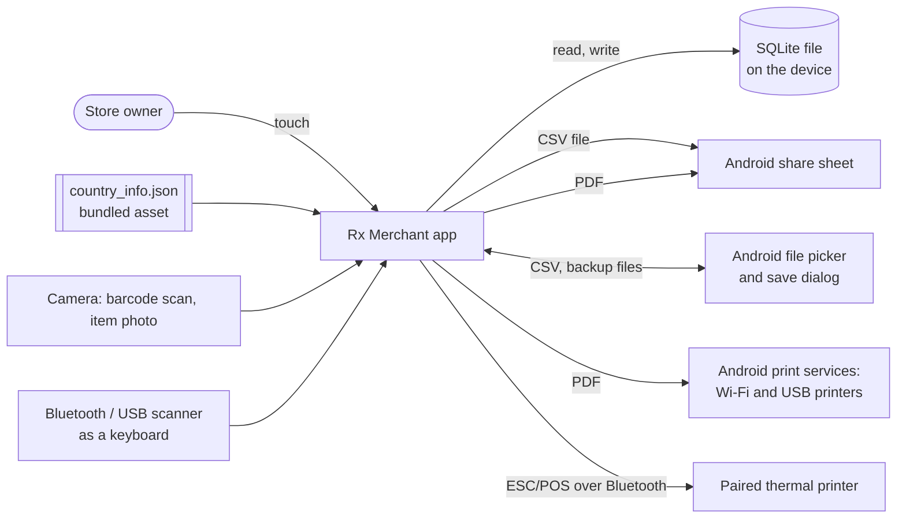
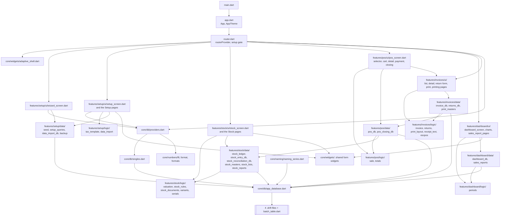
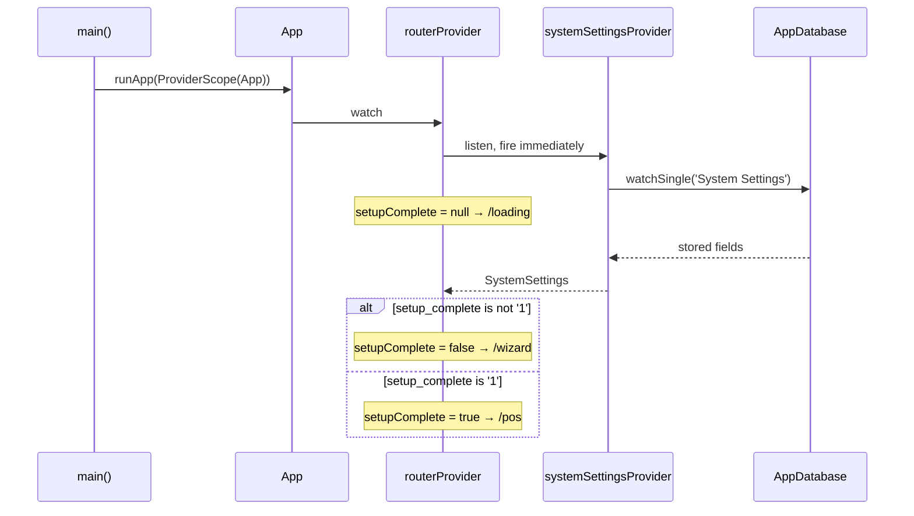

# Rx Merchant: System Documentation

## 0. Document control

| Item | Value |
|---|---|
| Title | Rx Merchant: System Documentation |
| System | Rx Merchant, an offline Android point-of-sale app |
| System version | 1.0.0+1 (`pubspec.yaml`) |
| Date of issue | 2026-11-18 |
| Status | Issued. Describes the system at the end of the Invoices and Receipts plan (R6), build steps INV-B1 to INV-B9 (milestone M6), on top of M0 and the whole Setup (M1, M4, M9), Stock (M2, M3, M8), Cash Register (M5) and Sales Dashboard (M7) plans. Every milestone of R1 is built. |
| Issuing organization | The Rx Merchant project (one owner, who is also the developer) |
| Prepared by | Claude (AI assistant), for the project owner |
| Approval | Pending the project owner's review |
| Location | `.claude/erpnext-planner/system-documentation.md` |

### Change history

| Issue | Date | Change |
|---|---|---|
| 1 | 2026-11-15 | First issue. Covers milestone M0: project setup, database schema version 1, settings access, rounding and formatting, naming series, theme, adaptive shell, wizard gate, shared widgets. |
| 2 | 2026-11-16 | Covers the Setup plan (R2), SET-B1 to B9: first-run wizard and seed, the Setup destination, settings pages, Currency, Price List, Naming Series, Mode of Payment, taxes, POS Profile, Data Import and Export, Backup and Restore, and "Restore from backup" on the wizard's first step. Sections 1, 3 to 6 and 8 to 13 updated; section 6.9 rewritten; section 7 changed only in 7.1, 7.2 and 7.6. |
| 3 | 2026-11-16 | POS Profile removed: the app serves one owner with one register. Tables `pos_profile`, `pos_profile_payment` and `pos_profile_item_group` and the `pos_profile_id` columns of `pos_opening_entry`, `pos_closing_entry` and `sales_invoice` deleted from schema version 1 in place (no migration, by the owner's decision). The register's options moved to a new **POS Settings** page (`singles`); its warehouse, price list, taxes and letter head are the store defaults. The Default Price List of Selling Settings must stay enabled and follows a rename. Plans 00, 01, 02, 03 and 05 updated to match. Sections 0, 2.2, 3, 4, 5.3, 5.6, 5.7, 6.3, 6.9, 6.10, 7, 8.1, 9, 10, 11, 12 and 13 updated. |
| 4 | 2026-11-17 | The Stock plan (R3), STK-B1 to B13: the Stock destination; Warehouse and Item Group trees, UOM, Brand, Item Attribute; Item with barcodes, units, re-order, tax, image, variants; Item Price and the price and item tax lookups; Stock Settings; the stock ledger engine (FIFO, Moving Average, serial cost, negative-stock, backdating, freeze); Stock Entry; Stock Reconciliation; batches and serial numbers with the inline Serial / Batch editor; seven stock reports and the low-stock badge. Schema unchanged. Every section updated except 2.3, 5.5, 6.1 to 6.7 and 7.7; new section 6.11. |
| 5 | 2026-11-18 | The Cash Register plan (R4), POS-B1 to B9: the POS Opening Entry, the POS screen (item selector, cart, item detail, number pad, payment, order summary, recent orders) in three window size classes, the totals engine (item and additional discounts, taxes on net total, previous rows, quantity and fixed amounts, taxes included in the rate, item tax overrides, rounding to the smallest coin, In Words), Submit with the stock ledger, held orders, the POS Closing Entry with its backup, and serial numbers and batches at the counter. The sale-side stock rules left by issue 4 (D-34, P-16) are wired, except the cost of a sale return, which comes with returns (R6). Printing and returns stay with R6. Schema unchanged. Every section updated except 2.3, 5.5, 6.1 to 6.5, 7.1, 7.3 to 7.7 and 8.4; new section 6.12. |
| 6 | 2026-11-18 | The Sales Dashboard plan (R5), DSH-B1 to B5: the Dashboard destination with its period bar (Today to This Year, Custom), eight number cards with the change against the previous period, the monthly sales goal, four charts (Sales Trend, Sales by Item Group, Top Items, Payment Modes) with table alternatives, and three reports (Sales Analytics, Item-wise Sales, Gross Profit) with drill-down links and CSV export headed by the filters. Three indexes added to schema version 1 in place (owner's decision): an invoice's lines, taxes and payments by `sales_invoice_id`, which the dashboard needs at 20,000 invoices. The links into R6's invoice list stay out until R6 (owner's decision). Every section updated except 2.3, 5.5, 6.1 to 6.7, 7.1, 7.2, 7.4, 7.6 and 8.3 to 8.5; new section 6.13. |
| 7 | 2026-11-18 | The Invoices and Receipts plan (R6), INV-B1 to B9: the Invoices destination (list with status, date and name filters and receipt scan; read-only invoice), Return / Credit Note with stock back at the cost it went out at, Cancel for sales and returns, two print formats as PDF (Standard and POS Receipt) with preview, Print and Share, raw printing to a Bluetooth thermal printer with an in-house ESC/POS builder, Setup › Printing (Print Settings, Letter Head, Print Heading, Terms and Conditions), In Words in lakh and crore. The links left by R4 and R5 are wired (D-52 closed). Schema unchanged. One new package, `print_bluetooth_thermal`. Every section updated except 2.3, 5.5, 6.1, 6.2, 6.4, 6.5, 6.7, 6.9, 6.11, 6.13, 7.1, 7.2, 7.4 to 7.7; new section 6.14. |

### How this document follows ISO/IEC/IEEE 15289

ISO/IEC/IEEE 15289 defines what each life-cycle information item (document) must contain. It does not fix a layout, and it allows several items to be combined in one document. This document combines the items in the table below. Every section carries the generic content the standard asks of a description, report or specification: date of issue and status, scope, issuing organization, references, context, body, summary, glossary and change history.

| 15289 information item | Generic type | Section |
|---|---|---|
| Concept of operations | Description | 3 |
| System requirements specification | Specification | 4 |
| System architecture description | Description | 5 |
| Software design description | Description | 6 |
| Database design description | Description | 7 |
| Interface description | Description | 8 |
| Installation procedure; configuration status report | Procedure; Report | 9 |
| Test report (verification) | Report | 10 |
| User documentation | Description | 11 |
| Problem report | Report | 12 |

**Limit of this claim.** The text of the standard was not available when this document was written. The structure follows the standard's generic content elements (clause 7) and information-item names (clause 10) as the author knows them. Check it against a licensed copy before claiming formal conformance.

---

## 1. Scope

This document describes the Rx Merchant system as it exists in the repository on the date of issue. It records what the system is for, what it must do, how it is built, how its data is stored, how it is built and installed, how it was verified, and what is known to be wrong or missing.

It describes the current state only. Planned behaviour is listed in section 4.4 and section 12.3 so that a reader can tell built from not built. The feature plans in section 2.1 remain the source for planned behaviour.

### 1.1 System identification

| Item | Value |
|---|---|
| Product name | Rx Merchant |
| Dart package | `rx_merchant` |
| Android application ID | `com.rx_merchant.rx_merchant` |
| Launcher label | Rx Merchant |
| Version | 1.0.0, build 1 |
| Platform | Android only. Minimum SDK 24 (Android 7.0), target and compile SDK 36. |
| Form factors | Phones and tablets, portrait and landscape |
| Milestone state | Every milestone complete: M0, Setup (M1, M4, M9), Stock (M2, M3, M8), Cash Register (M5), Invoices and Receipts (M6), Sales Dashboard (M7). |

### 1.2 What the system is

An Android app for one store run by one owner. It works with no internet connection. When complete it will keep the item catalogue and stock, sell at a cash register, print receipts and invoices, and show a sales dashboard. Its screens, field names and rules follow ERPNext, reduced to what one store owner needs.

At this issue the store can be set up completely, its stock kept, goods sold at the register, and the sales read on a dashboard. A first-run wizard creates the store and its default records; the Setup destination holds every settings page and master of the Setup plan; the Stock destination holds the item catalogue, prices, warehouses, stock movements (receipts, issues, transfers, counts), batches, serial numbers and the stock reports; the Register destination opens a cash-register session, sells with taxes and discounts, takes cash, card or split payments, holds orders, and closes the session with a cash count and a backup; items can be imported from CSV; the data can be backed up and restored; the Dashboard destination shows the period's sales, profit, taxes, returns and stock value, the monthly sales goal, four charts and three sales reports; the Invoices destination lists every sale and return, prints them as a full-page invoice or a till receipt (PDF, or raw to a Bluetooth thermal printer), takes goods back with a Return / Credit Note and cancels a mistaken sale.

---

## 2. References, glossary and notation

### 2.1 References

| Ref | Document | Location |
|---|---|---|
| R1 | Overview and foundation plan (the M0 specification) | `.claude/erpnext-planner/Plans/00-overview-and-foundation.md` |
| R2 | Setup plan (rules SET-R1 to R18, build steps SET-B1 to B9, acceptance SET-A1 to A20) | `.claude/erpnext-planner/Plans/01-setup.md` |
| R3 | Stock plan | `.claude/erpnext-planner/Plans/02-stock.md` |
| R4 | Cash Register plan | `.claude/erpnext-planner/Plans/03-cash-register.md` |
| R5 | Sales Dashboard plan | `.claude/erpnext-planner/Plans/04-sales-dashboard.md` |
| R6 | Invoices and Receipts plan | `.claude/erpnext-planner/Plans/05-invoices-and-receipts.md` |
| R7 | ERPNext documentation, merged | `.claude/erpnext-planner/erpnext-docs-merged.md` |
| R8 | ISO/IEC/IEEE 15289:2019, Content of life-cycle information items (documentation) | Published standard |
| R9 | Material Design 3 guidelines (window size classes, navigation, sheets) | m3.material.io |
| R10 | Session reports: issue 1 `2026-11-15_09-47-00.txt`, issue 2 `2026-11-16_17-26-13.txt`, issue 3 `2026-11-16_22-00-06.txt`, issue 4 `2026-11-17_14-38-00.txt`, issue 5 `2026-11-18_00-48-56.txt`, issue 6 `2026-11-18_01-59-10.txt`, issue 7 `2026-11-18_17-32-05.txt` | `.claude/commits/` |
| R11 | Frappe `frappe/geo/country_info.json` (MIT licence), source of `assets/country_info.json` | github.com/frappe/frappe |

### 2.2 Glossary

| Term | Meaning |
|---|---|
| Doctype | ERPNext's word for a record type, such as Item or Sales Invoice. |
| Single | A doctype with exactly one record: a settings page. Stored as key-value rows in the `singles` table. |
| Master | A record that other records point to, such as Item, Warehouse or Tax. |
| Document | A dated transaction that is saved, then submitted: Stock Entry, Sales Invoice and similar. |
| Child table | Rows that belong to one parent record, such as the items of an invoice. |
| Docstatus | The life-cycle state of a document: 0 Draft, 1 Submitted, 2 Cancelled. |
| Naming series | A pattern such as `ACC-SINV-.YYYY.-` that produces document names with a running number. |
| `flt` | The rounding function every calculated value passes through before it is stored. Named after the same function in ERPNext's framework. |
| Link field | A form field that picks one master record. |
| Store Profile | The single record describing the store. It replaces ERPNext's Company. |
| POS Settings | The options of the one cash register (ERPNext keeps them on a POS Profile, which this app does not have): Default Mode of Payment, the POS configuration switches, Apply Discount On, Print Format, Print Heading, Terms and Conditions. |
| Wizard gate | The rule that only the first-run wizard is reachable until setup is complete. |
| Seed records | The records the wizard creates in one transaction (SET-R3): currency, warehouses, item groups, units, price list, payment modes, naming series, letter head and settings. |
| Refusal | A save, delete or restore the app declines with a stated reason, such as "used elsewhere, disable it instead" (section 6.9). |
| Sales Taxes and Charges Template | The ordered tax rows a sale copies (SET-R9, R10). |
| Item Tax Template | Per-item overrides of a tax's rate, or Not Applicable (SET-R12). |
| Window size class | Material 3's width bands: compact (under 600dp), medium (600 to 839dp), expanded (840dp and up). |
| dp | Density-independent pixel, Android's unit of layout size. |
| SLE | Stock Ledger Entry: one row per stock movement. |
| Bin | The current quantity and value of one item in one warehouse. |
| Chain | All ledger entries of one item in one warehouse, in posting order. The engine replays a chain to recompute its balances (section 6.11). |
| FIFO | First In, First Out valuation: stock is a queue of layers `[qty, rate]`; an issue consumes the oldest layers first (STK-R30). |
| Moving Average | Valuation by one average rate per item and warehouse, recomputed on every receipt (STK-R31). |
| Stock Entry | A stock movement document: Material Receipt, Material Issue or Material Transfer (STK-R38). |
| Stock Reconciliation | A document that sets the balance to a counted quantity and rate, also used for opening stock (STK-R42). |
| Serial / Batch Entries | The serial numbers and batches chosen for one document line (ERPNext's Serial and Batch Bundle), rows of `serial_and_batch_entry`. |
| Template, Variant | An item with Has Variants is a template that is never transacted; its variants are the sellable items, one per combination of attribute values (STK-R14 to R17). |
| Low stock | An item whose quantity in a warehouse is at or below its Re-order Level (STK-R12). |
| Session | A period of selling between a submitted POS Opening Entry and its POS Closing Entry. At most one is Open. |
| POS Opening Entry | Opens a session with the cash (and other) amounts in the drawer (POS-R2). |
| POS Closing Entry | Closes a session: its sales and returns, the amount expected per payment mode, the amount counted, and the difference (POS-R20). |
| Held order | A sale saved as a draft (Save as Draft): no name and no stock effect until it is completed (POS-R18). |
| Amount to pay | The Rounded Total when rounding is on, otherwise the Grand Total (POS-R14). |
| Additional discount | A discount on the whole sale, on Net Total or on Grand Total (POS-R13), beside each line's own discount. |
| In Words | The amount to pay spelled out, for example "PHP Seven Hundred And Fifty-Four and Ninety Centavo only." |
| Period | The span the dashboard shows: Today, Yesterday, This Week, This Month, This Year (each up to today) or a Custom range (DSH-R3). |
| Previous period | What a card compares with: the same days one day, week, month or year back; a custom range, as many days just before it (D-50). |
| Net Sales | Σ Net Total of submitted invoices, returns as negatives (DSH-R4). |
| Gross Profit | Net Sales − Cost of Goods Sold, the cost being Σ stock quantity × the line's `incoming_rate` (DSH-R4). |
| Achievement % | Total Monthly Sales ÷ Monthly Sales Target × 100 (DSH-R5). |
| Bucket | One step of a chart or of Sales Analytics' columns: a day, week, month, quarter or year (DSH-R6, R7). |
| Drill-down | A card, bar or table row that opens the report explaining it, for the same period (DSH-R10). |
| Return / Credit Note | A Sales Invoice with Is Return, Return Against the sale, negative quantities and a refund (INV-R5 to R8). |
| Price-only credit | A return with Update Stock off: nothing comes back into stock; only the price is credited (INV-R6). |
| Print Format | Standard (a full page) or POS Receipt (a till roll), both laid out from the same print blocks (INV-R12). |
| Letter Head | The logo, header lines and footer printed on an invoice; one is the Default (INV-R14). |
| Print Heading | A title a sale prints under instead of "Sales Invoice" (INV-R15). |
| Raw printing | Sending ESC/POS commands straight to a thermal printer instead of a PDF (INV-R22). |

### 2.3 Notation

- Diagrams use Mermaid.
- File paths are relative to the repository root.
- Table and column names are written as they appear in SQL.
- Requirement identifiers such as SET-R4 and SET-A1 come from the plans in section 2.1.
- In table catalogues, **PK** marks a primary key, **U** a unique column, and `a → b` a foreign key from column `a` to table `b`.

---

## 3. Concept of operations

### 3.1 Users

One person: the store owner. The owner sets the system up, maintains items and stock, sells, and reads the reports. There are no accounts, roles, permissions or login.

### 3.2 Operating environment

- One Android phone or tablet. The data lives on that device only.
- No network. The release build does not hold the Android `INTERNET` permission, so it cannot open a connection even if a library tries.
- Android's file picker and save dialog, for CSV import and export and for backups.
- The device camera, for barcode scanning and item photos. A Bluetooth or USB barcode scanner works as a keyboard.
- A printer: any printer Android's print services reach (Wi-Fi, USB) through a PDF, or a Bluetooth thermal printer paired in Android's settings.

### 3.3 Intended operation (when complete)

1. **First run.** A wizard collects the store name, country, currency and formats, then creates the default records.
2. **Setup.** The owner defines payment methods, taxes, price lists and the POS Settings of the register.
3. **Stock.** The owner creates items and receives stock through Stock Entries and Stock Reconciliations.
4. **Selling.** The owner opens a cash-register session, sells to walk-in buyers who pay in full, and closes the session.
5. **Invoices.** Each sale is a Sales Invoice that can be printed, returned or cancelled.
6. **Dashboard.** Sales cards, charts and reports.

### 3.4 Operation at this issue

All six steps of the flow exist:

1. The app starts and reads System Settings.
2. On a fresh install it shows the first-run wizard. Nothing else is reachable. On its first step **Restore from backup** brings in another device's data instead, and the app opens on the restored store.
3. The owner picks the language, country and currency (the format preview shows how dates and numbers will look) and names the store.
4. On the last step the owner taps **Open Cash Register** or **Add your first item**. The app writes every seed record and marks setup complete in one transaction, then lands on the chosen destination.
5. In **Setup** the owner adjusts the store and formats, defines payment modes, taxes, tax templates, price lists and POS Settings, edits naming series, imports or exports items, prices and barcodes, and backs up or restores the data.
6. In **Stock** the owner keeps the catalogue (items, groups, units, brands, attributes and variants, prices, barcodes), the warehouses and Stock Settings; brings stock in, moves it and writes it off with Stock Entries; counts it with Stock Reconciliations; tracks batches and serial numbers; and reads the stock reports. A badge on Stock counts the items at or below their re-order level.
7. In **Register** the owner opens a session with the opening cash, sells (scan, search or tap items; change quantity, unit, rate and discounts; take one or several payments; see the change), holds orders and completes them later, and closes the session: the app shows the expected amount per payment mode against the counted amount, and takes a backup.
8. In **Dashboard** the owner picks a period and reads the cards (each against the previous period), the monthly sales goal and four charts; a card, bar or table row opens the report behind it (Sales Analytics, Item-wise Sales, Gross Profit, or a stock report), and every report exports to CSV.
9. In **Invoices** the owner finds any sale or return (status chips, a date range, the name, or a scanned receipt), opens it read-only, prints it as a full-page invoice or a till receipt, shares the PDF, makes a Return / Credit Note against a sale (stock back, refund paid out), or cancels a mistaken sale or return while its session is open. The register prints the receipt after a sale when POS Settings says so.

### 3.5 What the system deliberately leaves out

Taken from R1, section 2. Each exclusion applies to every screen and table.

| Excluded | Consequence |
|---|---|
| Multiple companies | Exactly one Store Profile. No Company field anywhere. |
| Cost centers | Every Cost Center field is removed. |
| Fixed assets | No asset fields on Item. |
| Customers | No customer master. Every sale is to an anonymous walk-in buyer, paid in full. No credit sales, receivables or loyalty points. |
| Sales persons | No sales team, commission or targets. |
| Chart of accounts | No ledgers and no account fields. Sales tax is still calculated. |
| Staff | No users, roles or login. |
| Purchasing | No suppliers or purchase documents. Stock arrives through a Stock Entry of type Material Receipt. |
| Fiscal year | Naming series and reports use the calendar year. |
| POS Profile | One owner, one device, one register. The register sells from Stock Settings' Default Warehouse at Selling Settings' Default Price List, with the default tax template and default letter head; its other options are on POS Settings. Every enabled Mode of Payment is offered. |

---

## 4. System requirements

### 4.1 Constraints

| ID | Constraint | Met by | Status |
|---|---|---|---|
| C-1 | Android only | Project created with `--platforms=android`; no other platform folder exists | Met |
| C-2 | Works fully offline; the release build holds no `INTERNET` permission | `android/app/src/release/AndroidManifest.xml` removes the permission even when a plugin declares it (the printer plugin does) | Met, verified (section 10.4) |
| C-3 | SQLite is the only data store | `lib/core/db/app_database.dart` | Met |
| C-4 | Phones and tablets from the first build, in three window size classes | `WindowSize`, `AdaptiveShell`, `ListDetailPane`, `showRowEditor` | Met, verified (sections 10.2, 10.5) |
| C-5 | Material 3 only. Colours come from `ColorScheme` roles; the seed colour is the only literal. | `AppTheme` in `lib/app.dart` | Met |
| C-6 | Every user-visible label goes through localisation | `lib/l10n/app_en.arb`, generated `AppLocalizations` | Met for labels and messages. Stored option values (charge types, Mode of Payment types, Rounding Method, valuation methods, purposes in lists) show as stored, in ERPNext's English (P-11). |
| C-7 | Three hops at most: screen, provider, query or pure function. No repository interfaces, use-case classes or mapper layers. | Code structure (section 5) | Met |
| C-8 | Numeric columns are `REAL`. Every calculated value is rounded by `flt` before it is stored. | Schema; `lib/core/numbers/flt.dart` | Met. Stock values round to Currency Precision, quantities to Float Precision, valuation rates to 9 decimals (`logic/valuation.dart`). Sale amounts and taxes round to Currency Precision in the totals engine (`pos/logic/totals.dart`), always with the Rounding Method in force. |
| C-9 | Foreign keys are enforced | `PRAGMA foreign_keys = ON` at every open | Met, verified |
| C-10 | Schema version 1 contains every table of every feature plan | 45 tables, 17 indexes (three added at issue 6, D-51) | Met, verified |
| C-11 | ERPNext's labels and status names are used as is | Status values in the schema; localisation keys | Met for what exists |

### 4.2 Functional requirements implemented

| ID | Requirement | Implementation | Verified by |
|---|---|---|---|
| SET-R1 | Until setup is complete the app shows only the first-run wizard. Finishing it writes all seed data in one transaction. Afterwards the wizard is unreachable. | `redirect` in `lib/router.dart`; `completeSetup` in `lib/features/setup/data/seed.dart` | `test/app_test.dart`, group "wizard gate (SET-R1)"; `setup_db_test.dart` |
| SET-R2 | Default Currency and Currency Precision lock once any document is submitted; the form shows why | `anySubmittedDocument` in `setup_queries.dart`; `lockReason` in `settings_pages.dart` | `setup_db_test.dart` (SET-A13) |
| SET-R3 | The wizard seeds currency, warehouse tree, item groups, 13 UoMs, Standard Selling, three payment modes, seven naming series, a letter head and Stock Settings; POS Settings needs no seed | `completeSetup` | `setup_db_test.dart` (SET-A12) |
| SET-R4 | Rounding follows the Rounding Method setting: Banker's Rounding (default) sends a midpoint to the nearest even digit; Commercial Rounding sends it away from zero. Binary float error must not change the result. | `flt` and `RoundingMethod` in `lib/core/numbers/flt.dart` | `test/core/numbers/flt_test.dart` |
| SET-R5 | Numbers, currency, dates and times are shown, and typed, in the formats chosen in System Settings. Stored values never change. | `lib/core/numbers/format.dart` (`parseNumber` for typing), `Formats` and `formatsProvider` | `test/core/numbers/format_test.dart`; System Settings preview on the emulator |
| SET-R6 | A naming series pattern resolves date parts from the posting date and keeps one counter per resolved prefix. A failed transaction does not consume a number. | `parseSeries` and `nextName` in `lib/core/naming/naming_series.dart` | `test/core/naming/naming_series_test.dart` |
| SET-R7 | The first pattern of a document is its default; Update Series sets a counter and refuses a number below one already used | `saveNamingSeries`, `highestUsedNumber`, `updateSeries`; `naming_series_page.dart` | `setup_db_test.dart` |
| SET-R8 | A disabled Mode of Payment cannot be chosen as the Default Mode of Payment; one in use can be disabled but not deleted | POS Settings lists enabled modes only; foreign keys through `deleteMaster` | `setup_db_test.dart` |
| SET-R9 | Tax rows: order, Reference Row # rules, Actual and On Item Quantity, included-in-rate rules, one default template | `validateTaxRows`, `tryTaxes`, `removeTaxRow` in `logic/tax_template.dart`; `saveSalesTaxesTemplate` | `tax_template_test.dart` (SET-A8 to A11); `setup_db_test.dart` (SET-A15) |
| SET-R12 | An Item Tax Template row overrides the matching tax's rate; Not Applicable removes the tax | `effectiveRate`; `saveItemTaxTemplate` | `tax_template_test.dart` (worked example 61.88) |
| SET-R13 | The Default Price List of Selling Settings (the register's) exists and stays enabled, which keeps at least one enabled; renaming it renames it in Selling Settings; only enabled lists can be the default | `savePriceList`, `_checkPriceLists` (also run by `deleteMaster`); `SellingSettingsPage` | `setup_db_test.dart` (SET-A14, SET-A16) |
| SET-R14 | POS Settings: Default Mode of Payment (Cash), the eight configuration switches, Action on New Invoice, Apply Discount On, Print Format, Print Heading, Terms and Conditions | `PosSettings` in `singles.dart`; `PosSettingsPage` in `settings_pages.dart` | `singles_test.dart` (defaults, blank "None"); saving goes through `SinglesForm`, tested in `app_test.dart` |
| SET-R15 | Monthly Sales Target on Store Profile; it blocks nothing | `StoreProfilePage` in `settings_pages.dart` (money field) | Field seen on the emulator; saving goes through `SinglesForm`, tested in `app_test.dart`. Read by the dashboard's goal card (DSH-R5). |
| SET-R16 | Data Import of Item, Item Price, Item Barcode: template, every row checked first, problems by row and column, one transaction, a result log; Data Export of the same columns | `logic/data_import.dart`, `data/data_import_db.dart`, `ui/data_pages.dart` | `data_import_test.dart`; `import_backup_test.dart` (SET-A17, 200 items) |
| SET-R17 | Backup by `VACUUM INTO`, named `{abbr}-backup-{YYYYMMDD-HHMMSS}.sqlite`, newest Number of Backups kept, Export outside the app | `takeBackup`, `listBackups` in `data/backup.dart`; `BackupsPage` | `import_backup_test.dart` (SET-A18); emulator. Also taken after every POS Closing Entry (`submitClosing`): `pos_db_test.dart` (POS-A22), emulator. |
| SET-R18 | Restore checks the file, refuses with an open session, backs up first (skipped when setup was never finished), replaces the database and reopens it; available on the Backups page and on the wizard's first step | `checkRestorable`, `restoreDatabase`; `pickBackupCopy`, `restoreAndReopen`; `BackupsPage`, `WizardScreen` | `import_backup_test.dart` (SET-A19, fresh-install restore); emulator round trips (section 10.5) |
| R1 §6.5 | Settings pages are stored as key-value rows, with typed access and defaults | `lib/core/db/singles.dart` | `test/core/db/singles_test.dart` |
| R1 §7.2, §7.3 | Navigation is a bottom bar on compact windows, a rail on medium windows, a rail with labels on expanded windows; five destinations in fixed order | `lib/core/widgets/adaptive_shell.dart` | `test/app_test.dart`, group "adaptive shell" |
| R1 §7.1 | Shared form building blocks: list and detail panes, link field, child table with row editor, status chip, report table with CSV export | `lib/core/widgets/` | `test/core/widgets/` |
| R2 §5 | Setup workspace of grouped cards; one pane on phones, list beside page on expanded windows | `ui/setup_screen.dart`, `_setupRoute` in `lib/router.dart` | `test/app_test.dart`, group "Setup destination" |
| STK-R1 | Warehouse tree; a group holds no stock; a warehouse with ledger entries cannot become a group; the Default Warehouse stays enabled and non-group, cannot be deleted, and a rename follows into Stock Settings | `saveWarehouse`, `deleteWarehouse` in `stock/data/stock_masters.dart`; `ui/tree_masters.dart` | `stock_db_test.dart` |
| STK-R2 | Item Group tree; unique names; a group in use cannot be deleted (foreign keys) | `saveItemGroup`; `deleteMaster` | Emulator |
| STK-R3 | A fraction in a whole-number unit is refused: "Quantity cannot be a fraction at row 1" | `checkEntryLines` in `logic/stock_documents.dart`; `lineProblemMessage` | `stock_db_test.dart` (STK-A7) |
| STK-R4, R5 | Item Code or Naming Series; Item Name pre-filled; on create, Standard Selling Rate becomes an Item Price and Opening Stock a submitted Material Receipt (Is Opening); defaults from Stock Settings | `saveItem`, `_openItem`; `ui/item_pages.dart` | `stock_db_test.dart`; `stock_ui_test.dart`; emulator |
| STK-R6 | Disabled, past End of Life, template or non-stock items cannot be moved | `checkEntryLines` | `stock_db_test.dart` (template) |
| STK-R7 | Maintain Stock, Has Batch No, Has Serial No, Valuation Method and Default UOM freeze after the first ledger entry | `_checkItemChange`; form locks | `stock_db_test.dart`; emulator |
| STK-R8 | Barcode: EAN 13 digits with check digit, UPC 12; owned by one item; may name a unit; found by scan or typing | `validBarcode`, `_checkBarcodes`, `itemByBarcode`; `ui/scan.dart` | `stock_logic_test.dart` (STK-A14); emulator |
| STK-R9 | Units with conversion factors; a unit used on a document keeps its factor | `stockQty`; `_checkItemChange` | `stock_db_test.dart` (STK-A6, unit lock) |
| STK-R10 | Price lookup: exact unit and batch, then the stock-unit price (times the factor when Price Not UOM Dependent), then the default list when the fallback is on; no overlapping validity | `pickPrice`, `validityOverlaps` (`logic/stock_rules.dart`); `priceFor`, `saveItemPrice` | `stock_logic_test.dart` (STK-A13); `stock_db_test.dart` |
| STK-R12 | Low stock by re-order level; badge on Stock and on the Low Stock link | `lowStockReport`, `watchLowStockCount`; router, `AdaptiveShell.stockBadge` | `stock_db_test.dart`; `stock_ui_test.dart`; emulator |
| STK-R13 | Item tax: the item's row with the latest Valid From, else up the item group tree | `itemTaxTemplateFor`; `itemTaxTemplateOf` | `stock_logic_test.dart` (STK-A15); `stock_db_test.dart` |
| STK-R14 to R17 | Templates are never transacted and have no price; numeric and text attributes; Single and Multiple Variants with codes such as TSHIRT-RED-S, existing combinations skipped; template saves update variants | `logic/variants.dart`; `createVariants`, `_updateVariants`; item form Variants tab | `stock_logic_test.dart` (STK-A9, A10); `stock_db_test.dart` (STK-A10) |
| STK-R18 to R22 | Batches when enabled; status derived from expiry; expiry mandatory and defaulted for Has Expiry Date; batch from a series on receipt; batches required on every movement; an expired batch leaves only by Material Issue | `saveBatch`, `createBatch`, `_fillEntries`, `_checkEntries`; `batchStatus` | `stock_db_test.dart` (STK-A12, A18, A25, expiry) |
| STK-R23 to R25, R32 | Serial numbers: one unit each, never listed twice; Inactive / Available / Delivered moved only by stock documents; series and ranges; each unit leaves at its own cost | `_moveSerials`, `_setEntryRates`, `serialRange`; engine | `stock_logic_test.dart` (STK-A5, A11); `stock_db_test.dart` (STK-A24, series, duplicate) |
| STK-R27 | Inline Serial / Batch editor: add, edit, delete, Auto Fetch by FIFO, LIFO or Expiry, Scan, Range, CSV, 10 per page, draft only; empty outgoing lines filled at submit when the setting is on | `ui/serial_batch_editor.dart`; `availableEntries`, `autoPick` | `stock_logic_test.dart`; `stock_db_test.dart` (STK-A25 auto pick) |
| STK-R28 to R37 | The ledger engine: one entry per line, side and batch; FIFO, Moving Average, serial cost; negative stock refused from the changed point on (never for batch or serial items); backdating and cancelling recompute the chain; transfer rate passed on; Stock Frozen Upto | `data/stock_ledger.dart`, `logic/valuation.dart` | `stock_logic_test.dart` (STK-A1 to A5); `stock_db_test.dart` (STK-A16 to A21, A26, A27) |
| STK-R38 to R41 | Stock Entry: purposes and warehouses, read-only rate on outgoing lines, additional costs spread by basic amount, opening stock, cancel and amend (`name-1`) | `data/stock_entry_db.dart`; `ui/stock_entry_page.dart` | `stock_db_test.dart` (STK-A8, A23, amend); emulator |
| STK-R42 | Stock Reconciliation: Opening Stock and counts; current values as of the posting time; unchanged rows dropped; Fetch Items, Scan Mode, CSV with exact headers; batch and serial items refused | `data/stock_reconciliation_db.dart`; `ui/stock_reconciliation_page.dart` | `stock_db_test.dart` (STK-A22); emulator |
| STK-R43 | Stock Ledger, Stock Balance, Quick Stock Balance, Batch-wise Balance History, Serial No Ledger, Item Price Stock, Low Stock; cancelled entries left out; CSV export | `data/stock_reports.dart`; `ui/report_pages.dart` | `stock_db_test.dart`; `stock_ui_test.dart`; emulator |
| R3 §5 | Stock workspace of grouped cards; with a record open on an expanded window its list takes the left pane | `ui/stock_screen.dart`; `_workspaceRoute` in `lib/router.dart` | `stock_ui_test.dart`; emulator |
| STK-R11, R22, R24, R26, R27 on a sale | A sold item with no Item Price in the sale's list gets one, once; an expired batch is never sold; only Available serial numbers in the sale's warehouse are sold and become Delivered with their warranty expiry; empty batch / serial lines are picked at Submit when the setting is on | `submitSale`, `_checkSaleEntries`, `_deliverSerials`, `_insertMissingPrices` in `pos/data/pos_db.dart`; `fillOutwardEntries` | `pos_db_test.dart` (POS-A25, STK-R22, STK-R11) |
| POS-R1, R2 | Nothing is sold without an Open POS Opening Entry; it records an Opening Amount per enabled mode; only one session is Open | `openSessionWith`, `watchOpenSession` (`pos/data/pos_db.dart`); `OpeningForm`; unique index `one_open_session_idx` | `pos_db_test.dart` (POS-A21); `pos_ui_test.dart`; emulator |
| POS-R2a | A new sale copies the Default Warehouse, the Default Price List, the default enabled tax template's rows, Apply Discount On, the default Letter Head, Print Heading and Terms | `newSale` | `pos_db_test.dart` (POS-A23); emulator |
| POS-R3, R4 | The selector lists enabled, non-template sales items not past End of Life, with price and stock in the sale's warehouse; search by name, code, barcode or serial; group filter with subgroups; Hide images, Hide unavailable Items, Automatically Add Filtered Item To Cart; an exact barcode adds in its unit; equal lines merge; a short stock item is refused | `watchRegisterItems`; `ItemSelector`; `addToSale` (`pos/logic/sale.dart`); `CartNotifier.add` | `sale_test.dart`; `pos_ui_test.dart` (barcode); emulator |
| POS-R5 to R8 | Unit with its factor and price; Price List Rate editable only with Selling Settings' permission; rate and discounts only with POS Settings' permissions; a typed rate below the list rate is a discount; a discount above Max Discount refused as it is typed and at Submit | `newLine`, `setUnit`, `reprice`; `linePrice`; `CartNotifier.setPrice`; `ItemDetail`; number pad | `totals_test.dart` (POS-A9); `pos_db_test.dart` (POS-A10, A15); emulator |
| POS-R9 to R14 | The totals engine: item values; taxes included in the rate worked back; tax rows of all five types with item overrides and Not Applicable; additional discount on Net Total or Grand Total; Grand Total; Rounded Total by the smallest coin; In Words | `computeTotals`, `roundToFraction` (`pos/logic/totals.dart`); `moneyInWords` (`core/numbers/in_words.dart`) | `totals_test.dart` (POS-A1 to A8, A11 to A13, A16, Grand Total discount remainder); `in_words_test.dart` |
| POS-R15 | Every enabled mode; the default mode pre-filled with the amount to pay; split payments; change; a card or bank amount above what is due refused; no partial payment | `settle`; `PaymentPanel`, `defaultMode` | `totals_test.dart` (POS-A14); `pos_db_test.dart` (POS-A20); emulator |
| POS-R16, R17 | Submit checks reported together; Submit names the sale, posts the ledger, records each line's cost, delivers serial numbers, inserts a missing price and sets Paid, in one transaction; a refused Submit leaves the cart usable | `saleProblems`, `submitSale` (`_keepOnFailure`); `RefusedAll` | `pos_db_test.dart` (POS-A17, A19, A20, A25, retry after a refusal) |
| POS-R18, R19 | Save as Draft (no name, no stock); Action on New Invoice; a held order is repriced when reopened and joins the session it is completed in; Recent Orders with Draft, Paid and Return filters and search; drafts edit or delete | `saveSale`, `loadSale`, `deleteSale`, `watchRecentOrders`; `RecentOrders`; `_replaceCart` | `pos_db_test.dart` (POS-A18, A24); emulator (a held order survives a restart) |
| POS-R20 | POS Closing Entry: period, sales and returns, totals, expected amount per mode (opening + received − change), counted amount, difference, remarks; it closes the session and takes a backup; the latest closing can be cancelled while nothing newer exists | `closingDraft`, `submitClosing`, `cancellableClosing`, `cancelLastClosing` (`pos/data/pos_closing_db.dart`); `ClosingPage` | `pos_db_test.dart` (POS-A22, A24); emulator |
| POS-R21 | A scanned serial number adds its unit; the line's Serial / Batch Entries in the item detail, with Auto Fetch; auto pick at Submit, or refusal | `availableSerial`; `addToSale`; `SerialBatchEditor` in `ItemDetail`; `fillOutwardEntries` | `sale_test.dart`; `pos_db_test.dart` (POS-A25, STK-R22) |
| R4 §5 | The POS screen in three layouts: phone in two steps with a bottom sheet for the item detail and the opening as an AlertDialog; Medium with selector and cart, item detail and payment as side sheets over the selector; Expanded with item detail and payment in the selector pane and a number pad under the cart | `PosScreen`, `OpeningForm`, `CartPanel`, `PaymentPanel`, `OrderSummary` | `pos_ui_test.dart` (phone, Medium, tablet); emulator |
| DSH-R1, R2 | Only submitted invoices count, returns as negatives; every figure uses the invoice's posting date | `submittedIn`, `spanArgs` (`dashboard/data/dashboard_db.dart`) | `dashboard_db_test.dart` (DSH-A1 to A10, A19) |
| DSH-R3 | Today, Yesterday, This Week, This Month, This Year, Custom; the week starts on the First Day of the Week; each card against the previous period | `spanOf`, `weekStart`, `previousOf` (`dashboard/logic/periods.dart`); `_PeriodBar`, `_NumberCard` | `periods_test.dart` (DSH-A18) |
| DSH-R4 | Net Sales, Taxes, Total Sales, Invoices, Returns, Average Sale, Items Sold, Cost of Goods Sold, Gross Profit and %, Stock Value, Low Stock | `figures`, `stockValue`; `lowStockCountProvider` | `dashboard_db_test.dart` (DSH-A1 to A8) |
| DSH-R5 | Sales goal for the current calendar month; hidden at target 0 and replaced by a link to Store Profile | `monthlySales`, `achievement`; `_GoalCard` | `dashboard_db_test.dart` (DSH-A11, A12); `dashboard_ui_test.dart` (DSH-A13) |
| DSH-R6 | Sales Trend (days up to 31 days, weeks up to 26 weeks, months beyond; Value or Quantity), Sales by Item Group (top 8 and Other), Top Items (top 10), Payment Modes (change off the cash mode) | `trendRange`, `bucketsOf`; `trend`, `salesByGroup`, `topItems`, `paymentModes`; `LinesChart`, `BarsChart`, `ChartCard` | `periods_test.dart`; `dashboard_db_test.dart` (DSH-A9, top 8, change) |
| DSH-R7 | Sales Analytics: Item or Item Group (tree sums), Value or Quantity, date range, Range; a chart of the chosen rows; Total first on phones | `salesAnalytics`; `SalesReportPage` | `dashboard_db_test.dart` (DSH-A14, A15); `dashboard_ui_test.dart` |
| DSH-R8 | Item-wise Sales: one row per line, tax from the item-wise detail with the invoice's remainder on its last line; filters date range, Item, Item Group; totals | `itemWiseSales` | `dashboard_db_test.dart` (DSH-A16, a two-line split) |
| DSH-R9 | Gross Profit by Invoice, Item, Item Group or Brand; by Item also Average Selling Rate and Valuation Rate; a stock item sold at no cost is flagged | `grossProfit` | `dashboard_db_test.dart` (DSH-A17, the flag); `dashboard_ui_test.dart` (totals %) |
| DSH-R10 | Cards, bars and chart table rows open their report for the same period; Stock Value and Low Stock open the stock reports; Invoices, Average Sale and Returns open the invoice list; Item-wise Sales' Invoice cell opens the invoice | `reportLink`, `invoicesIn`; `ChartCard.onRowTap`; `/dashboard/:page` | Emulator (10.5) |
| DSH-R11 | Amounts in Currency Precision, the Number Format and Hide Currency Symbol; percentages with one decimal; CSV headed by the filters, values rounded as shown | `Formats`, `percent`; `ReportTable.exportPreamble`, `toCsv` | `report_table_test.dart`; emulator (exported CSVs read back) |
| DSH-R12 | A completed sale shows on the dashboard without a refresh | `salesTickProvider` (drift `tableUpdates`) | `dashboard_ui_test.dart` |
| R5 §5 | Dashboard: period bar, cards 2 per row on phones and 4 otherwise, goal, charts one per row (Compact), 2 per row (Medium), goal beside the trend and 3 per row (Expanded), report links; states for no sale yet and no sales in the period | `DashboardScreen` | `dashboard_ui_test.dart` (phone, tablet, no sale yet); emulator |
| INV-R1 | Every invoice newest first; status chips, a date range, search by name, scan a receipt to open it; a POS session filter for the closing entry's link | `watchInvoices`, `InvoiceFilters` (`invoices/data/invoice_db.dart`); `InvoiceList`, `openScanned` | `invoices_db_test.dart` (INV-R1); `invoices_ui_test.dart`; emulator |
| INV-R2 | Read-only invoice: header, items, taxes and totals, payments, terms, Return Against and Returns; Print, Create › Return / Credit Note, Stock Ledger, Cancel; a draft opens in the register | `invoiceView`; `InvoiceDetail`; `/pos?heldOrder=` | `invoices_ui_test.dart`; emulator |
| INV-R3, R4 | Draft, Paid, Credit Note Issued, Return, Cancelled; a sale is Credit Note Issued while a submitted return exists; names from the Sales Invoice and Sales Invoice Return series, never reused | `_setStatus`, `submitReturn`, `cancelInvoice` (`invoices/data/returns_db.dart`) | `invoices_db_test.dart` (INV-A15, A16, A22) |
| INV-R5 to R8 | A return of what is still returnable at the original's rate, unit, discount, item tax and tax rows; quantities only down; Update Stock (receiving warehouse) or a price-only credit with a lowered rate; serials and batches sold on the line; refund in full in any enabled mode; one transaction: return series, +stock at the original cost, serials Available, statuses | `returnDraft`, `returnProblems`, `submitReturn`; `scaleReturn`, `takeBatches` (`invoices/logic/returns.dart`); `ReturnForm` | `invoices_db_test.dart` (INV-A10 to A15, A17 to A19, D-62) |
| INV-R9 | After a return, New Order starts the replacement sale in the same session | `OrderSummary` (a return's summary) | Emulator |
| INV-R10, R11 | Cancel a sale while its session is open and no submitted return exists; cancel a return while its session is open, refused when its stock was sold since; serials back; statuses recalculated | `cancelInvoice` | `invoices_db_test.dart` (INV-A16, A20 to A22, INV-R11) |
| INV-R12, R13 | Standard and POS Receipt from one layout; the print screen starts on POS Settings' Print Format; drafts and cancelled invoices print only when Print Settings allows | `layoutInvoice`, `mayPrint` (`invoices/logic/print_layout.dart`); `PrintPage` | `print_layout_test.dart` (INV-A9, R13) |
| INV-R14 to R16 | Letter head (the invoice's own, else the default; logo, header, footer; switch on the print screen); Print Heading or Sales Invoice / Credit Note; terms copied into the sale and printed after the totals | `invoiceView`; `layoutInvoice`; `newSale` (POS-R2a); `saveLetterHead`, `savePrintHeading`, `saveTerms` | `invoices_db_test.dart` (INV-A24, R14); `print_layout_test.dart` |
| INV-R17 to R20 | Compact 4-column or full 9-column item table, the receipt always compact; totals in order with included taxes marked and zero taxes left out unless asked; Rounded Total unless disabled; In Words (lakh and crore for `#,##,###.##`); amounts in the Number Format and currency symbol | `layoutInvoice`; `moneyInWords` (`indian`) | `print_layout_test.dart` (INV-A3 to A5); `in_words_test.dart` (INV-A1, A2) |
| INV-R21 | Preview, Print through Android's print dialog, Share the PDF | `invoiceDocument` (`invoices/ui/invoice_pdf.dart`); `PrintPage` (`printing`) | `invoice_pdf_test.dart`; emulator |
| INV-R22 | Raw printing: paired printer, ESC/POS commands wrapped to Characters per line, symbol as currency code, cut and drawer kick, Test print, the PDF when the printer cannot be reached | `escPosJob`, `printable`, `rulerLines` (`invoices/logic/escpos.dart`); `receiptLines`; `receiptJob`, `printRaw` (`print_page.dart`); `pairedPrinters`, `sendRaw` (`raw_printer.dart`); `PrintSettingsPage` | `print_layout_test.dart` (INV-A6 to A8); emulator (no printer: states only) |
| INV-R23 | The receipt ends with the invoice name as Code 128; scanning it in the list or Recent Orders opens the invoice | `invoiceDocument` (`pw.BarcodeWidget`), `escPosJob` (`GS k`); `openScanned` | `invoices_db_test.dart` (`invoiceIdByName`); emulator (preview) |
| INV-R24 | Print Receipt on Order Complete: the saved receipt printer, else the preview; any invoice can be reprinted | `printAfterSale`; Print Receipt on `OrderSummary` and in `RecentOrders` | Emulator |

### 4.3 Acceptance criteria met

| ID | Criterion | Result |
|---|---|---|
| SET-A1 | Banker's: `flt(2.345, 2)` is 2.34 and `flt(2.355, 2)` is 2.36 | Pass |
| SET-A2 | Commercial: `flt(2.345, 2)` is 2.35 | Pass |
| SET-A3 | Commercial: `flt(1.005, 2)` is 1.01 | Pass |
| SET-A4 | 12345.67 shows as `12,345.67` in `#,###.##` and `12.345,67` in `#.###,##` | Pass |
| SET-A5 | `ACC-SINV-.YYYY.-` used three times in 2026 gives `ACC-SINV-2026-00001`, `-00002`, `-00003` | Pass |
| SET-A6 | The same series in 2027 starts again at `ACC-SINV-2027-00001` | Pass |
| SET-A7 | `INV12.####` gives `INV120001` | Pass |
| M0 "done when" | The app starts on a phone and a tablet emulator, shows the wizard gate, and `flutter test` passes | Pass (section 10) |
| SET-A8 | A previous-row type in row 1 is rejected | Pass |
| SET-A9 | Reference Row # pointing at a later row is rejected | Pass |
| SET-A10 | An Actual row marked as included in basic rate is rejected | Pass |
| SET-A11 | "Try it" on 1,000: 25; 80; 1.60; 21.60; 10 | Pass |
| SET-A12 | After the wizard every SET-R3 record exists and `setup_complete` is 1 | Pass |
| SET-A13 | A submitted document locks Default Currency and Currency Precision | Pass |
| SET-A14 | Disabling or deleting the Default Price List is refused, also while another list is enabled | Pass |
| SET-A15 | A second default template clears the first | Pass |
| SET-A16 | Renaming the Default Price List leaves Selling Settings holding the new name | Pass |
| SET-A17 | A CSV with one unknown Item Group imports nothing and names the row and column | Pass |
| SET-A18 | Five backups with Number of Backups = 3 leave the newest three | Pass |
| SET-A19 | Restoring a file that is not a backup is refused; data untouched | Pass |
| SET-A20 | Wizard and every Setup page on a phone and a tablet in both orientations | Pass on emulators (section 10.5) |
| SET-B1 to B9 runnable results | Wizard lands on the shell; formats change the preview; Try it reproduces the worked examples; POS Settings saves and the Default Price List cannot be disabled; 200 items import; back up, wipe, restore brings the data back | Pass (sections 10.2, 10.5) |
| STK-A1 to A5 | FIFO and Moving Average worked examples (costs 1,600 / 1,650 / 1,600 / 1,700; serial 55,000) | Pass |
| STK-A6 to A15 | Units, fraction refusal, additional cost spread 30 / 20, numeric attribute values, 6 variants, serial range, batch series `5x1SCR00001`, Box price 100 / 10, EAN check digit, item tax by date | Pass |
| STK-A16 to A19 | Negative stock refused (nothing written) or allowed per item; batch items never negative; an issue dated before the receipt refused | Pass |
| STK-A20, A21 | A backdated receipt recosts a later issue to 1,450; cancelling a receipt the issue needs is refused and names the issue (tested on the A20 receipts without the backdated one; with it, enough stock remains) | Pass |
| STK-A22 to A27 | Reconciliation −2 / −160 / 840; transfer keeps total value; a receipt whose serial was sold cannot be cancelled; expired batch: transfer refused, issue allowed; bin rebuilt from the ledger is identical; Stock Frozen Upto | Pass |
| STK-B1 to B13 runnable results | Masters nest and disable; an item is found by its barcode; the item strip shows prices; defaults flow into new items; receive, issue, transfer, count; reports match the ledger and export; 6 T-shirt variants; batch by earliest expiry, blocked when expired; units go out at their own cost; 50 serials from one range | Pass (tests and emulator, sections 10.2, 10.5) |
| POS-A1 to A8 | Tax 55.92 and Grand Total 754.92; 108 with 8% included is 100 + 8; item templates give 61.88 on 947; Not Applicable stored as "NA"; previous row amount 80 + 1.60, previous row total 80 + 21.60; Actual 25; On Item Quantity 10 | Pass |
| POS-A9 to A16 | 200 less 10% is 180, 360 for two; 25% against a 20% Max Discount refused; the four discount cells (972 / 972 / 1,026 / 1,030); 754.92 rounds to 754.92 / 754.90 / 755, and 754.93 to 754.95; change 245.10 and 45.10, card 800 refused; 3 Cartons are 30; two lines at 54 with 8% included give exactly 108.00 | Pass |
| POS-A17 to A25 | A sale of 2 posts −2 at cost 100, Paid, `ACC-SINV-2026-00001`; deleted drafts leave no gap; overselling refused with nothing written; short payment refused; a second session refused; the closing example (cash 1,401.80, card 500, difference −1.80); a later template edit leaves the sale alone; a held order joins the later session; a Delivered serial cannot be sold | Pass |
| POS-B1 to B9 runnable results | A session is asked for, then the register opens; every worked example passes; items scanned into a cart with live totals; unit, rate and discounts change the totals; change right for cash and split, card overpayment refused; a sale reduces stock and appears in the Stock Ledger; a held order survives an app restart and is completed; the closing example reproduces; a serialised unit is sold by its serial number | Pass (tests and emulator, sections 10.2, 10.5) |
| DSH-A1 to A8 | Days 1 to 2: Net Sales 600; Taxes 48; Total Sales 648; Invoices 2, Returns 1 worth 108; Average Sale 378; Items Sold 2; Cost of Goods Sold 410; Gross Profit 190, 31.7% | Pass |
| DSH-A9, A10 | Payment Modes Cash 108, Card 540; day 1 only Net Sales 700 | Pass |
| DSH-A11 to A13 | Target 1,296: Total Monthly Sales 648, Achievement 50.0%; 13,949 of 100,000 is 13.949%; target 0 hides the goal card | Pass |
| DSH-A14, A15 | Sales Analytics by Item, Daily: A 200, −100, total 100; B 500, 0, 500; columns 700, −100, 600. By Item Group: Products and All Item Groups equal those columns | Pass |
| DSH-A16, A17 | Item-wise Sales: Net 600, Tax 48, Total 648. Gross Profit by Item: A 100 / 60 / 40, B 500 / 350 / 150, total 190 | Pass |
| DSH-A18 | This Week with First Day of the Week Sunday, then Monday: the week starts one day later | Pass |
| DSH-A19 | Cancelling Invoice 2 takes its amounts away from the figures, the group chart, the trend and the payment modes; nothing else changes | Pass |
| DSH-B1 to B5 runnable results | The fixture returns the expected figures; cards follow the period and a new sale; goal and charts match the cards; report totals equal the cards; cards, bars and table rows open their report; exports read back with their filter lines | Pass (tests and emulator, sections 10.2, 10.5) |
| R5 §3 ceiling | 20,000 invoices: the dashboard's queries in under 500 ms and the three reports in under 2 s, in memory | Pass: about 80 ms and 160 ms on the development machine |
| INV-A1, A2 | In Words for 108.00 and 754.90 in USD: `USD One Hundred And Eight only.`, `USD Seven Hundred And Fifty-Four and Ninety Cent only.` (Frappe's wording, D-66) | Pass |
| INV-A3 to A9 | 4 / 9 columns; a zero tax row absent / present; no rounding lines with Disable Rounded Total; a 60-character name wrapped at 32 with amounts right-aligned; raw commands start with initialise and end with cut, no drawer; the currency code for a symbol the printer cannot print; DRAFT in a draft's heading | Pass |
| INV-A10 to A19 | Return of 10 offers −10, then −7 after 3; 8 refused; 108 with 8% included: −100 / −8 / −108; stock back at cost 100 after the cost changed, profit nets to zero; Return status and series name, the sale Credit Note Issued; cancelling it restores Paid and the stock; a price-only credit moves no stock but counts; a disabled mode refused; a returned serial Available at its cost | Pass |
| INV-A20 to A24 | Cancel refused with a return; refused after the session closed (a return still possible); cancel in the open session: Cancelled, ledger cancelled, stock restored, name not reused; a cancelled invoice not printed without Allow Print for Cancelled; a later terms edit leaves the sale alone | Pass |
| INV-B1 to B9 runnable results | Every sale found and read; new sales carry the chosen terms; Print Settings save and reload; layout tests; PDFs print and share; the receipt barcode opens its invoice (scan in tests only); ESC/POS commands (no printer here); a partial return puts stock back and refunds; a cancelled sale leaves stock, dashboard and expected cash | Pass (tests and emulator, sections 10.2, 10.5), except INV-B7's real printer (P-18) |

### 4.4 Requirements not yet implemented

| Milestone | Contents | State |
|---|---|---|
| M0 Foundation | Project, database, settings access, rounding, naming series, theme, adaptive shell | **Done** |
| M1 Setup A | First-run wizard, Store Profile, System Settings, Global Defaults, Currency, Price List, Naming Series | **Done** |
| M2 Stock A | Warehouse, Item Group, UoM, Brand, Item, Item Price, Stock Settings | **Done** |
| M3 Stock B | Stock ledger engine, Stock Entry, Stock Reconciliation, core stock reports | **Done** |
| M4 Setup B | Mode of Payment, taxes, POS Settings, Selling Settings | **Done** |
| M5 Cash Register | Sessions, POS screen, totals engine, payment, submit | **Done** |
| M6 Invoices | List, detail, print formats, PDF, thermal printing, returns, cancel | **Done** (INV-B1 to B9); raw printing not tried on a real printer (P-18) |
| M7 Dashboard | Cards, charts, sales goal, reports | **Done** (DSH-B1 to B5), with the links into the invoice list since issue 7 |
| M8 Stock C | Variants, batches, serial numbers across stock documents and the Cash Register | **Done** (STK-B10 to B13, POS-B9) |
| M9 Setup C | Data import and export, backup and restore | **Done**, including the backup on POS Closing |

---

## 5. System architecture

### 5.1 Context



The system has no server, no network peer and no other user.

### 5.2 Structure

The app is one Flutter program. Code is grouped by feature, with shared code under `core`. A screen reads a provider; a provider calls a database query or a pure function. There is no layer in between.



A screen reads a provider or calls a query method on `AppDatabase` (a Dart extension in the feature's `data/` folder); validation and calculation live in `logic/`, which imports neither Flutter nor the database.

### 5.3 Folder map

```
lib/
  main.dart                     entry point
  app.dart                      App widget, AppTheme
  router.dart                   routes of the five destinations, setup gate
  core/
    db/
      app_database.dart         AppDatabase (drift)
      app_database.g.dart       generated by drift_dev
      singles.dart              settings access and typed settings classes
      providers.dart            database, settings, store currency, formats
    numbers/
      flt.dart                  rounding
      format.dart               number, currency, date, time formatting; typed-number parsing
      formats.dart              Formats: the display formats in force
      in_words.dart             amount in words (In Words)
    naming/
      naming_series.dart        naming series resolver and counter
    widgets/
      window_size.dart          WindowSize
      spacing.dart              AppSpacing
      adaptive_shell.dart       navigation frame
      list_detail_pane.dart     one-pane / two-pane layout
      link_field.dart           picker for one master record
      child_table.dart          child rows and the row editor sheet (trailing or leading side)
      status_chip.dart          document status indicator
      report_table.dart         report table, CSV export headed by the filters, ReportFilters
      date_field.dart           date and date-time picker field
  features/
    setup/data/setup.drift      11 tables
    setup/data/country_info.dart  bundled country data
    setup/data/seed.dart        completeSetup: the wizard's seed transaction
    setup/data/setup_queries.dart reads and writes of the Setup pages, locks, naming admin
    setup/data/refusal.dart     refusal codes; constraint failures become refusals
    setup/data/data_import_db.dart import lookups, writer, export rows
    setup/data/backup.dart      backup, list, restore checks, restore
    setup/logic/tax_template.dart tax row checks, Try it, item rate, row removal
    setup/logic/data_import.dart import columns, header matching, row checks
    setup/ui/wizard_screen.dart first-run wizard
    setup/ui/setup_screen.dart  Setup workspace and page routing
    setup/ui/form_kit.dart      form page, problems dialog, field grid, master list
    setup/ui/settings_pages.dart Store Profile, System Settings, Global Defaults, Selling Settings, POS Settings
    setup/ui/simple_masters.dart Currency, Mode of Payment, Tax, Price List
    setup/ui/tax_template_pages.dart Sales Taxes and Charges Template, Item Tax Template
    setup/ui/naming_series_page.dart Naming Series
    setup/ui/data_pages.dart    Data Import, Data Export, Backups
    stock/data/stock.drift      22 tables, 9 indexes
    stock/data/batch_table.dart the batch table, in Dart
    stock/data/stock_ledger.dart the ledger engine: post, cancel, repost, bin
    stock/data/stock_entry_db.dart Stock Entry; batches; Serial / Batch Entries
    stock/data/stock_reconciliation_db.dart Stock Reconciliation
    stock/data/stock_masters.dart warehouse, item, variants, item price, lookups
    stock/data/stock_lists.dart the lists the stock screens show
    stock/data/stock_reports.dart the seven reports, low-stock count
    stock/logic/barcode.dart    EAN / UPC barcode check
    stock/logic/valuation.dart  FIFO, Moving Average, serial cost
    stock/logic/stock_rules.dart units, cost spread, price and tax pick, batch status, auto pick
    stock/logic/stock_documents.dart document lines and their checks
    stock/logic/variants.dart   attribute values, combinations, variant codes
    stock/logic/serials.dart    serial number ranges
    stock/ui/stock_screen.dart  Stock workspace and page routing
    stock/ui/stock_providers.dart shared stock streams and lookups
    stock/ui/item_pages.dart    Item list and form
    stock/ui/tree_masters.dart  Warehouse, Item Group
    stock/ui/stock_masters_pages.dart UOM, Brand, Item Attribute, Item Price, Stock Settings, Batch, Serial No
    stock/ui/stock_entry_page.dart Stock Entry
    stock/ui/stock_reconciliation_page.dart Stock Reconciliation
    stock/ui/serial_batch_editor.dart inline Serial / Batch editor
    stock/ui/report_pages.dart  the seven reports
    stock/ui/scan.dart          camera barcode scan
    pos/data/pos.drift          8 tables, 8 indexes
    pos/data/pos_db.dart        sessions, register items, the sale (new, lines, units, prices), held orders, checks, Submit
    pos/data/pos_closing_db.dart POS Closing Entry: draft, submit with backup, cancel the latest
    pos/logic/sale.dart         Sale and SaleLine (the cart), adding a line, item tax rates as JSON
    pos/logic/totals.dart       the totals engine, line prices, rounding to the smallest coin, payments
    pos/ui/pos_screen.dart      the register: opening gate, three layouts, menu, Action on New Invoice
    pos/ui/pos_providers.dart   POS and Selling Settings, session, items, cart (CartNotifier) and totals
    pos/ui/opening_form.dart    POS Opening Entry
    pos/ui/item_selector.dart   search, scan, group filter, item grid or list
    pos/ui/cart_panel.dart      cart lines, totals, Add Discount, Checkout, number pad
    pos/ui/item_detail.dart     quantity, unit, rate, discounts, Serial / Batch Entries
    pos/ui/payment_panel.dart   payment modes, number pad, change, Complete Order
    pos/ui/order_summary.dart   the submitted sale
    pos/ui/recent_orders.dart   Recent Orders
    pos/ui/closing_page.dart    POS Closing Entry
    pos/ui/pos_widgets.dart     LiveNumberField, TotalRow, NumberPad
    dashboard/logic/periods.dart periods, previous period, buckets of a range
    dashboard/data/dashboard_db.dart the dashboard's figures, goal, chart data
    dashboard/data/sales_reports.dart Sales Analytics, Item-wise Sales, Gross Profit
    dashboard/ui/dashboard_providers.dart period, the sales tick, the dashboard's data
    dashboard/ui/dashboard_screen.dart the Dashboard: period bar, cards, goal, charts, report links
    dashboard/ui/dashboard_charts.dart ChartCard, LinesChart, BarsChart (fl_chart), bucket labels
    dashboard/ui/sales_report_pages.dart the three sales reports
    invoices/data/invoices.drift 3 tables
    invoices/data/invoice_db.dart InvoiceFilters, the invoice list, the invoice view, name lookup
    invoices/data/returns_db.dart return draft, checks, submit; cancel of sales and returns
    invoices/data/print_masters.dart Letter Head, Print Heading, Terms and Conditions saves
    invoices/logic/invoice.dart  Invoice, InvoiceLine, InvoiceTax: an invoice as the screens and the print read it
    invoices/logic/returns.dart  scaleReturn, takeBatches
    invoices/logic/print_layout.dart PrintDoc: the one layout step of both formats; mayPrint
    invoices/logic/receipt_text.dart the receipt as fixed-width lines
    invoices/logic/escpos.dart   ESC/POS commands, printable text, Test print's ruler
    invoices/ui/invoice_providers.dart paths and links, the list and invoice streams
    invoices/ui/invoices_screen.dart the Invoices destination: list (filters, scan) beside the record
    invoices/ui/invoice_detail.dart the read-only invoice and its actions
    invoices/ui/return_form.dart Return / Credit Note
    invoices/ui/print_page.dart  the print screen; print options, raw job, print after a sale
    invoices/ui/invoice_pdf.dart Standard and POS Receipt as PDF; bundled fonts
    invoices/ui/raw_printer.dart the Bluetooth printer (the only caller of print_bluetooth_thermal); Android settings
    invoices/ui/printing_pages.dart Setup › Print Settings, Letter Head, Print Heading, Terms and Conditions
  l10n/
    app_en.arb                  641 messages, English
    app_localizations*.dart     generated by gen-l10n
assets/
  country_info.json             250 countries (R11)
  fonts/                        Roboto Regular and Bold (Apache 2.0), embedded in printed PDFs
test/                           282 tests (section 10.2)
android/                        Android host project
```

Size at this issue: about 25,600 lines of hand-written Dart under `lib/` (3,542 of them in the Invoices feature, 1,984 in the Dashboard, about 4,000 in the Cash Register, about 9,200 in Stock, about 4,800 in Setup), 600 lines of schema (unchanged), about 5,600 lines of tests (820 of them for Invoices).

### 5.4 Technology

| Concern | Choice | Resolved version |
|---|---|---|
| Framework | Flutter, stable channel | 3.50.0 |
| Language | Dart | 3.14.0 |
| UI toolkit | Material 3 from `package:material_ui` | 1.11.0 |
| Database | SQLite through `drift`, opened by `drift_flutter`; `sqlite3` also used directly to open a backup read-only | drift 2.35.4, drift_flutter 0.3.1, sqlite3 3.9.1 |
| State | `flutter_riverpod` | 3.5.0 |
| Routing | `go_router` | 18.1.4 |
| Localisation | `flutter_localizations`, `intl`, gen-l10n | intl 0.20.3 |
| CSV | `csv` | 8.0.0 |
| File sharing | `share_plus`, `path_provider` | 13.3.1, 2.1.6 |
| File picker and save dialog | `file_picker` | 13.3.3 |
| Country data | `assets/country_info.json`, trimmed from R11 | 250 countries |
| Code generation | `drift_dev`, `build_runner` | 2.35.3, 2.17.1 |
| Lints | `flutter_lints` | 6.0.0 |
| Android build | Gradle, Android Gradle Plugin, Kotlin, Java | 9.5.0, 9.3.1, 2.4.20, 17 |

Used since issue 4: `mobile_scanner` 7.5.0 (camera barcode scan; its default bundled ML Kit model needs no download) and `image_picker` 1.2.4 (item photo, at most 512 px). Used since issue 6: `fl_chart` 1.3.1 (the dashboard's charts; horizontal bars by `rotationQuarterTurns`). Used since issue 7: `pdf` 3.13.1 (the two print formats; its `BarcodeWidget` draws Code 128), `printing` 5.15.1 (preview, Android's print dialog, Share) and `print_bluetooth_thermal` 1.2.5 (paired printers, connect, write bytes; it brings `win_ble`, unused on Android). Roboto (Apache 2.0) is copied from the Flutter SDK into `assets/fonts/` for PDFs. `cupertino_icons` 2.0.0 is present only for its icon font.

### 5.5 Start-up and the setup gate



The router holds one value, `setupComplete`, with three states. Every navigation passes through `redirect`:

| `setupComplete` | Where every location leads |
|---|---|
| `null` (settings not read yet) | `/loading` |
| `false` | `/wizard` |
| `true` | The requested location; `/loading` leads to `/pos`; `/wizard` leads to the location in its `?next=` parameter, or `/pos` |

The value is a `ValueNotifier` passed to the router as `refreshListenable`, so the redirect runs again the moment the setting changes. On the wizard's last step, **Open Cash Register** and **Add your first item** first move to `/wizard?next=/pos` or `/wizard?next=/stock`, then run `completeSetup`. When it commits, the settings stream emits and the router leaves the wizard for the `next` location. A failed seed writes nothing and the wizard stays. **Restore from backup** on the first step takes the other way out: the restored data has `setup_complete` set, so when the reopened database's settings stream emits, the router leaves the wizard for `/pos`.

If the settings cannot be read, `/loading` shows "The database could not be opened." and the error text.

### 5.6 Routes

| Path | Screen | Notes |
|---|---|---|
| `/loading` | Blank, or the start-up error | Shown only while settings are read |
| `/wizard` | First-run wizard | Outside the navigation frame; `?next=` names where to land |
| `/pos` | Cash Register: the POS Opening Entry until a session is open, then the register; `?heldOrder=<id>` loads that held order (a draft chosen in the invoice list) | Branch 1, the home location |
| `/pos/closing` | POS Closing Entry of the open session | Back returns to the register; after Submit the opening form shows |
| `/invoices` | Invoice list; filters as query parameters (`status` comma-separated, `from`, `to`, `q`, `session`) | Branch 2 |
| `/invoices/invoice/:id` | An invoice | Expanded: beside the list, which keeps its filters |
| `/invoices/return/:id` | A Return / Credit Note against sale `id` | As above |
| `/stock` | Stock workspace | Branch 3 |
| `/dashboard` | Dashboard | Branch 4; full width, no list pane |
| `/dashboard/:page` | A sales report: `sales-analytics`, `item-wise-sales` or `gross-profit`; filters as query parameters (`from`, `to`, `item`, `group`, `qty=1`) | Opens over the dashboard; Back returns to it. An unknown slug shows the dashboard |
| `/setup` | Setup workspace | Branch 5 |
| `/setup/:page` | A Setup page, or a master's list (`page` is a slug such as `pos-settings`) | Expanded: the workspace stays on the left and the move does not animate |
| `/setup/:page/:id` | A master's form; `id` is the record id or `new` | Back returns to the list |
| `/stock/:page` | A stock page, master list or report (`page` is a slug such as `item`, `stock-entry`, `stock-ledger`); report filters come as query parameters (`warehouse`, `item`, `voucher`, `from`, `to`) | As Setup; expanded with a record open, the record's list takes the left pane |
| `/stock/:page/:id` | A stock master or document; `id` is the record id or `new` (`?parent=` on a tree's Add Child, `?item=` on Add Price) | Back returns to the list |

The five destinations are branches of one `StatefulShellRoute.indexedStack`, so each keeps its own navigation state when the owner switches between them.

The print screen is not a route: `openPrint` pushes it on the root navigator over any destination (D-70).

### 5.7 Design decisions

| # | Decision | Reason | Cost |
|---|---|---|---|
| D-1 | Tables are written as SQL in `.drift` files, copied from the plans | The plans define the schema as SQL; copying avoids transcription errors across 45 tables | Flag columns are `int` 0/1 in Dart, not `bool` |
| D-2 | All 45 tables are created in schema version 1 | Later milestones add behaviour without a schema change | Empty tables exist from the first run |
| D-3 | The `batch` table is declared in Dart, not in `stock.drift` | A drift-file table named `batch` generates a getter that collides with drift's own `batch()` method | One table lives in a different file; `drift_dev` prints one warning (P-2) |
| D-4 | `series.current` is quoted in SQL; its row class is named `SeriesRow` | `CURRENT` is an SQL keyword; drift's default class name was `Sery` | None |
| D-5 | `stock.drift` imports `setup.drift`; `setup.drift` imports nothing | Until issue 3 they imported each other because `pos_profile` pointed at stock and invoice tables; with it gone the cycle ended | None |
| D-6 | `SystemSettings.roundingMethod` returns the stored text; `RoundingMethod.fromSetting` converts it | Keeps settings access free of a dependency on the numbers code | One conversion at each use |
| D-7 | Date and time formatting is pinned to the `en_US` locale | Stored date text must stay ASCII digits whatever the app language | Displayed dates never use native digits |
| D-8 | A `/loading` route is shown while settings are read | Without it a set-up store would flash the wizard at every launch | One extra route |
| D-9 | The bottom-bar label is "Register"; the screen title is "Cash Register" | "Cash Register" wraps to two lines on a 360dp-wide phone | Two messages for one destination |
| D-10 | `kotlin.incremental=false` in `android/gradle.properties` | The release build fails when the project and the pub cache are on different drives | Slower Kotlin recompiles |
| D-11 | Generated localisation files are excluded from analysis | The generated code refers to delegates deprecated in Flutter 3.47 | Real problems in generated code would go unreported |
| D-12 | The release manifest removes `INTERNET` with `tools:node="remove"` | A plugin that declares the permission cannot bring it back | Debug and profile builds keep it for hot reload |
| D-13 | Seed colour is `Colors.teal` | A placeholder; one constant in `lib/app.dart` | None |
| D-14 | The whole Setup plan was built at once (M1, M4, M9) | The prompt for this issue named the Setup plan, not a milestone | Pages exist before the stock and register plans that use them |
| D-15 | Country data comes from Frappe's `country_info.json` (R11), trimmed | ERPNext's own data; 250 countries | 11 countries use a number format the app lacks and were mapped to the nearest of the six |
| D-16 | Currency Precision is set from the currency at setup: 0 when the currency has no fraction, 3 for 1,000 fraction units, otherwise 2 | The yen and the dinars would otherwise round wrongly | None found |
| D-17 | One generic settings form (`SinglesForm`) for the four settings pages, one generic form for the name-and-switches masters | Fewer near-identical screens | A new field type is added in one place for all |
| D-18 | Deletes rely on SQLite's foreign keys; a FOREIGN KEY failure becomes "used elsewhere, disable it instead", a UNIQUE failure "a record with this name already exists" | No per-table "is it used" queries to keep in step with the schema | The message cannot say which record uses it |
| D-19 | Data and logic return refusal and problem codes; the UI turns them into messages | `logic/` stays free of Flutter; every message is in the ARB file | One code-to-message switch per kind |
| D-20 | Setup forms use `DropdownMenu` for short link lists; `LinkField` is used for long lists (country, currency) | A dropdown shows every choice at once | No "Create new" from inside a form (P-11) |
| D-21 | `FieldGrid` switches to two columns on the pane width (600dp), not the window width | A form in the expanded right pane is narrower than the window | Differs from the letter of R1 §7.2 |
| D-22 | A form loads all its choices before it is built | A `DropdownMenu` shows its initial selection only if its entries exist on the first build | A short loading indicator |
| D-23 | `sqlite3` is a direct dependency | To open a backup read-only before a restore | None: drift already pulled it in |
| D-24 | The database file is drift_flutter's default, `rx_merchant.sqlite` in the app documents directory; `backup.dart` reads the same path | No change to `AppDatabase` | The two must stay in step |
| D-25 | Data Import also applies three stock rules: an Item Price from Standard Selling Rate (STK-R5), the EAN check digit (STK-R8), no overlapping price validity (STK-R10) | An import must not write data the stock plan forbids | Beyond SET-R16's list of checks |
| D-26 | A typed number must have groups of the format's size; a format without decimals takes the other mark as decimal point | So "7.5" in `#.###` is refused instead of read as 75 | Typing "1,5" in `#,###.##` is refused rather than guessed |
| D-27 | No POS Profile. The register's warehouse, price list, taxes and letter head are the store defaults (Stock Settings, Selling Settings, the default tax template, the default Letter Head); its own options are a `singles` page, POS Settings, with ERPNext's POS Profile field names as keys | One owner with one register has no profile to choose; a list of one record, a default-profile rule and a session lock were overhead | A second register would need the profile back (R2 §8) |
| D-28 | All enabled Modes of Payment are offered for sales and refunds; one Default Mode of Payment. "Allow in Returns" and the Item Groups filter are dropped | Owner's decision; both exist to tell registers apart | A refund can go to any enabled mode |
| D-29 | Schema version 1 was edited in place, without a migration | Owner's decision; nothing had been sold yet | Databases and backups made before issue 3 do not match the schema (P-13) |
| D-30 | The Default Price List is kept by name in Selling Settings; `savePriceList` carries a rename across, and `_checkPriceLists` refuses a save or delete that leaves it missing or disabled | It replaces the foreign key the POS Profile had to its price list | The check reads Selling Settings on every price list save and delete |
| D-31 | `ReportTable` builds rows lazily in two synced lists (a pinned first column and the rest) instead of a `DataTable` | R3 asks for a pinned first column and smooth scrolling of 5,000 rows; a `DataTable` builds every cell at once and cannot pin | Fixed column widths (160 / 128dp); a deviation from R1 §7.1's "DataTable" |
| D-32 | "Edit Posting Date and Time" is not stored: a draft saved with it off has posting time = modified time; `postingSetByHand` reads the switch back, and Submit moves an unedited posting to the moment of submit | No schema change (D-29 is not repeated) | The rule couples two columns; documented in `stock_documents.dart` |
| D-33 | The engine replays each changed item-warehouse chain from its first entry and refuses negative stock only from the changed posting onward; a transfer's target chain is replayed when its incoming rate changes | Simple and always correct; R3 states the ceiling | Linear in an item's history (P-15) |
| D-34 | Rules that only apply to a sale (STK-R11, R26, the sale side of R22 and R27, the rate of a sale return) were left for the Cash Register plan; the engine is voucher-type generic and `priceFor`, `itemTaxTemplateOf`, `availableEntries` were ready | Owner's decision; the sale is plan 03's | Wired at issue 5, except the rate of a sale return, which comes with returns (R6) |
| D-35 | A template's numeric range is narrowed by ticking values in Create > Multiple Variants | No columns for a template range in schema version 1 | The narrowing is not stored on the template |
| D-36 | Opening stock from the item form is a Material Receipt (Is Opening) for every stock item (STK-R5); STK-R40's reconciliation route also works | R5 says so | Two ways to enter opening stock |
| D-37 | Material Issue may take expired batches (the write-off of STK-R22); Material Transfer may not | R22 and R21 read together | — |
| D-38 | The low-stock count reaches the shell from the router (`AdaptiveShell.stockBadge`) | `core` must not import a feature | The router watches two stock providers |
| D-39 | Complete Order and the POS Opening Entry's Open submit without a confirmation dialog | ERPNext's POS submits on Complete Order; the button is itself the confirmation, and a cashier makes it many times a day. The POS Closing Entry and every cancel still confirm | A deviation from R1 §6.1's "Submit asks for confirmation" |
| D-40 | The cart is one `Sale` object held by a Riverpod `AsyncNotifier` (`cartProvider`), changed in place and redrawn with `ref.notifyListeners()`; only Save as Draft writes it | It survives rotation and the switch between layouts; R4 asks that a sale killed mid-way is offered again only if it was saved | A new pattern beside the stream providers; the cart's objects are mutable |
| D-41 | The totals engine follows ERPNext's `taxes_and_totals` order. Two rounding remainders go to the last tax row: the one that makes a sale with taxes included in the rate total what was entered (POS-R12), and the one left by a discount on Grand Total (POS-R13) | Net Total + taxes then always equals the Grand Total | The last row can differ by a cent from its own rate × base |
| D-42 | `sales_invoice_tax.item_wise_tax_detail` is keyed by `sales_invoice_item.id`, with `[rate, amount]` and "NA" for Not Applicable | R4's column comment; the item code can repeat on two lines | The ids change each time a draft is saved, because its lines are rewritten |
| D-43 | Change is charged to the sale's first payment of a Cash-type mode when the closing entry computes expected amounts; a card or bank amount above what is still due is refused | Change is cash (R4 POS-R15, R20) | A sale with two cash modes takes the change from the first |
| D-44 | A sale line's `incoming_rate` is re-read from its ledger entries whenever its chain is replayed, not only at Submit | Gross Profit (R5) must follow a backdated receipt, as the ledger does | One query per replay that touches a sale; beyond the letter of POS-R17 |
| D-45 | A closed session is reopened by "Cancel POS-CLO-…" on the opening form; there is no list of closing entries | R4 allows cancelling the latest closing only, so one button covers it | Older closing entries are seen only in the database and backups until R6 lists documents |
| D-46 | `insertEntry` and `fillOutwardEntries` of the Stock Entry code became public and take the voucher type, so a Sales Invoice uses them | One copy of the serial / batch resolution and auto pick | Stock Entry behaviour unchanged |
| D-47 | On a Medium window the item detail and payment open as side sheets on the leading edge (`showRowEditor(leading: true)`) | R4: "side sheets over the selector", so the cart on the trailing side stays visible | One more option on a shared widget |
| D-48 | Tapping a payment mode that holds nothing fills it with the amount still due; the number pad then types over it | Split payments in two taps, as in ERPNext's POS | Beyond the letter of POS-R15 |
| D-49 | Sale lines are checked with the Stock Entry line checks (Material Issue) minus "not a stock item", plus not a sales item, Max Discount, valuation rate, stock and payment; all are reported together. Serial and batch checks run inside Submit and report one problem at a time | One set of line rules for every outgoing document | A serial or batch problem shows alone, after the others are fixed |
| D-50 | A card's previous period covers the same days one unit back: This Month on the 18th against the 1st to 18th of last month (cut to a shorter month), This Week against the same weekdays last week, This Year against the same days last year; Today, Yesterday and a custom range against as many days just before. No change line when the previous figure is 0 | R5 asks for "the previous period of the same length"; a month to date against a whole month would always look down | Not ERPNext's number-card rule, which compares whole periods |
| D-51 | Three indexes added to schema version 1 in place: `sii_invoice_idx`, `sit_invoice_idx`, `sip_invoice_idx` on the invoice's lines, taxes and payments by `sales_invoice_id` | Owner's decision. Without them each invoice scanned whole child tables: 16 to 29 s for the dashboard at 20,000 invoices; with them about 80 ms | Databases created before issue 6 lack them until reinstalled (P-17); R5 §3 named only two indexes |
| D-52 | The links into R6's invoice list were left out at issue 6 | Owner's decision then | **Closed** at issue 7: wired (owner's decision) |
| D-53 | The Taxes card opens Item-wise Sales, which has the Tax column | R5 names no target for Taxes | — |
| D-54 | The dashboard is refreshed by one drift `tableUpdates` stream on the invoice tables and `bin` (`salesTickProvider`), which a `FutureProvider` watches; the queries stay `Future`s | One trigger for twelve queries; the queries stay plain and testable | Any write to those tables re-runs every query, about 80 ms at 20,000 invoices |
| D-55 | Item-wise Sales takes a line's tax from `item_wise_tax_detail` (`json_each`) and puts the invoice's rounding remainder on its last line | ERPNext's Item-wise Sales Register reads the same detail; with the remainder the Tax column adds up to the Taxes card (DSH-B4) | The last line can carry a cent more than its own rate gives |
| D-56 | Sales by Item Group shows the sales of the items directly in each group; its drill-down filter, like ERPNext's Item Group filter, includes subgroups | Bars that included subgroups would count a sale in every ancestor | A group that has both its own items and subgroups with sales shows less on its bar than in the report |
| D-57 | Gross Profit flags a row when a stock item in it was sold (not returned) at no cost; the flag is an extra column, "Check" | `ReportTable` has no row styling; a price-only credit note rightly has no cost (R5 DSH-R4) | One more column |
| D-58 | Sales Analytics draws the first five rows until the owner taps others; a tapped row toggles, marked with ●. Its chart colours are primary, tertiary, secondary and the primary and tertiary containers | R5 asks for "a line chart of the selected rows" without a default; colours from R5 §5 | Lines in the container colours are pale |
| D-59 | A chart's table alternative lists its data; the group and item tables open Item-wise Sales on a row tap, and the bars' touch area is widened to 48dp | R1 §7.2's 48dp touch target; a 14dp bar is too small to aim at | — |
| D-60 | The phone filter sheet of the stock reports became a shared widget, `ReportFilters`, now used by the stock and the sales reports | The sales reports needed the same sheet | Beyond R5's letter; the stock reports behave as before |
| D-61 | A return is never held: it lives on the return form until Submit, which saves and submits it in one transaction | One fewer state; a return is made with the goods on the counter | No Draft return to come back to |
| D-62 | A partial return refunds the original's additional discount and Actual (fixed) tax charges in proportion to the line amounts returned (a percentage discount is proportional by itself); a full return refunds exactly what was paid | R6 says a return is taxed as the sale was; ERPNext negates the whole charge on any return | A rounding cent can sit on the last partial return |
| D-63 | The refund must equal the amount in full; no change on a refund; payments stored negative | R6 INV-R7; the closing entry nets them | A refund cannot be split with change |
| D-64 | A return comes back in at the original line's `incoming_rate` at the moment of the return | STK-R33; the dashboard's profit is reversed exactly | A later backdated recost of the sale does not follow (marked `ponytail:`) |
| D-65 | A batch line's return takes its quantity from the original's batches in the order they were sold | R6 "the batch is the one sold" without saying which | The owner cannot pick the batch |
| D-66 | In Words keeps Frappe's wording built at issue 5: "Fifty-Four", the Currency's Fraction name as stored ("Cent"); lakh and crore added for `#,##,###.##` | ERPNext's own output; R6's examples ("Fifty Four … Cents") differ from it | INV-A2 is checked against Frappe's text |
| D-67 | PDFs embed Roboto from the Flutter SDK; a currency symbol it lacks prints as the currency code | The PDF standard fonts lack ₱ and similar; Google Fonts would need the internet | 340 KB of fonts in the APK |
| D-68 | Raw text is printable ASCII: the currency symbol becomes its code, × becomes x, anything else ?; the barcode is the printer's own Code 128 command | Printers' code pages differ; ASCII prints everywhere | Accented names print with ? |
| D-69 | `roundToFraction` works on the size of the amount, so a return's negative total rounds as the sale's did | A remainder of exactly half rounded the two ways differently | Shared with the register; tested by the POS tests |
| D-70 | The print screen is a full-screen route on the root navigator (`openPrint`), not a URL | The register, Recent Orders and the invoice open it alike, from any destination | It has no deep link |
| D-71 | A draft tapped in the invoice list opens in the register (`/pos?heldOrder=<id>`), through the same Action on New Invoice as Recent Orders' Edit | R6 INV-R2: "A draft opens in the Cash Register instead" | Leaves the Invoices destination |
| D-72 | The list's filters ride in the route's query; a new query starts the list afresh; a session filter (a removable chip) serves the closing entry's link, which also names the submitted statuses | Links from the dashboard and the closing entry land on the right list; opening a record keeps them | — |
| D-73 | Renaming a Print Heading or Terms and Conditions writes the new name into POS Settings, which keeps them by name | As D-30 does for the Default Price List | One extra read on those saves |
| D-74 | Android's Bluetooth or app settings are opened through a small MethodChannel in `MainActivity.kt` | R6's states ask for a link to the system setting; no package for two intents | Native code in the host project |
| D-75 | One Bluetooth connection per print job, closed after | No stale connection to manage | A little slower per receipt (marked `ponytail:`) |
| D-76 | Print Settings asks for Android's Nearby devices permission when it opens, since it lists the paired printers; the saved printer stays a choice while Bluetooth is off | The plugin asks on its first call; saving another setting must not forget the printer | The prompt appears on the first visit |

---

## 6. Software design

### 6.1 Entry point and app: `lib/main.dart`, `lib/app.dart`

- `main()` runs `App` inside a `ProviderScope`.
- `App` is a `ConsumerWidget` that builds `MaterialApp.router` with the router from `routerProvider`, the light and dark themes, and the localisation delegates. The task-switcher title is the `appTitle` message. The locale follows System Settings' Language once it is read.
- `AppTheme.light` and `AppTheme.dark` build `ThemeData` from `ColorScheme.fromSeed` with one seed. The theme sets outlined borders for every form field through `inputDecorationTheme`. The device setting chooses light or dark.

### 6.2 Database: `lib/core/db/app_database.dart`

```dart
class AppDatabase extends _$AppDatabase {
  AppDatabase([QueryExecutor? executor]);   // default: driftDatabase(name: 'rx_merchant')
  int get schemaVersion => 1;
  MigrationStrategy get migration;          // beforeOpen: PRAGMA foreign_keys = ON
}
```

- Includes the four `.drift` files and the `Batches` Dart table.
- Tests pass `NativeDatabase.memory()` as the executor.
- `drift_dev` generates `app_database.g.dart`: one table class, one row class and one companion class per table.

### 6.3 Settings access: `lib/core/db/singles.dart`

```dart
extension SinglesAccess on AppDatabase {
  Future<Map<String, String>> readSingle(String doctype);
  Stream<Map<String, String>> watchSingle(String doctype);
  Future<void> writeSingle(String doctype, Map<String, Object?> values);
}
```

- `readSingle` returns the stored fields of one settings page. Keys that were never set, or were cleared, are absent.
- `watchSingle` emits the same map again whenever the `singles` table changes.
- `writeSingle` upserts each entry in one batch. A `bool` is stored as `'1'` or `'0'`. `null` clears the key, so its default applies again. Any other value is stored as its text.

Seven classes give typed access with defaults: `StoreProfile`, `SystemSettings`, `GlobalDefaults`, `SellingSettings`, `PosSettings`, `StockSettings`, `PrintSettings`. Each wraps the map, names its doctype in a `doctype` constant, and has one getter per key. A missing key returns the default, so adding a setting needs no schema change. The keys and defaults are listed in section 7.6.

Two defaults are derived rather than fixed:

- `StoreProfile.abbr` defaults to the initials of the store name, also when the stored value is blank.
- `PrintSettings.rawCharsPerLine` defaults to 48 for 80mm paper and 32 for 58mm paper; `rawPaperMm` gives the width as 58 or 80.

`PosSettings.selectPrintHeading` and `tcName` read a blank value (the form's "None") as null.

### 6.4 Providers: `lib/core/db/providers.dart`

| Provider | Type | Behaviour |
|---|---|---|
| `appDatabaseProvider` | `Provider<AppDatabase>` | Creates the one database and closes it on dispose. Tests override it. |
| `systemSettingsProvider` | `StreamProvider<SystemSettings>` | System Settings, emitted again on every change. |
| `singleProvider(doctype)` | `StreamProvider.family<Map<String, String>, String>` | The stored fields of one settings page. |
| `storeCurrencyProvider` | `StreamProvider<CurrencyData?>` | The Currency record of the store's Default Currency. |
| `formatsProvider` | `Provider<Formats>` | The display formats in force (section 6.6); defaults while settings load. |

A restore invalidates `appDatabaseProvider`, which closes the old connection and opens the restored file; every provider that reads the database follows.

### 6.5 Rounding: `lib/core/numbers/flt.dart`

```dart
enum RoundingMethod { bankers, commercial }       // fromSetting(String) converts the stored text
double flt(num value, int precision, [RoundingMethod method = RoundingMethod.bankers]);
```

A decimal such as 2.345 is stored in binary as 2.34499999999999997. Plain rounding would send it down under both methods. `flt` compares against the midpoint with a tolerance of one unit of binary float error, which is the approach of ERPNext's own `flt`.

1. `scaled = |value| × 10^precision`
2. `tolerance = scaled × 2⁻⁵²`
3. **Commercial:** round `scaled + tolerance` to the nearest whole number.
4. **Banker's:** if `scaled` is within `tolerance` of a midpoint, take the even neighbour; otherwise round to the nearest whole number.
5. Restore the sign and divide by `10^precision`.

Rounding works on the absolute value, so a negative amount mirrors the positive one: `flt(-2.345, 2)` is -2.34 under Banker's and -2.35 under Commercial. An unknown method text falls back to Banker's.

### 6.6 Formatting: `lib/core/numbers/format.dart`

```dart
String formatNumber(num value, String numberFormat, int precision);
String formatCurrency(num value, {required String numberFormat, required int precision,
    String? symbol, bool symbolOnRight = false, bool hideSymbol = false});
String formatDate(DateTime d, String dateFormat);
String formatTime(DateTime d, String timeFormat);
String toStorage(DateTime d);
```

`formatNumber` supports the six Number Format options:

| Format | 1234567.891 at precision 2 |
|---|---|
| `#,###.##` | `1,234,567.89` |
| `#.###,##` | `1.234.567,89` |
| `# ###.##` | `1 234 567.89` |
| `#,##,###.##` | `12,34,567.89` (Indian grouping: last three digits, then pairs) |
| `#,###` | `1,234,568` (no decimal part, whatever the precision) |
| `#.###` | `1.234.568` |

The group separator is the second character of the format; the decimal separator is the character before the final `##`. A negative value keeps its sign, except that a value which displays as zero shows no sign.

`formatCurrency` adds the symbol with one space: `$ 12,345.67`, or `12,345.67 $` when `symbolOnRight` is true. The sign stays on the number: `$ -5.00`. With `hideSymbol`, or no symbol, it returns the number alone.

`parseNumber(text, numberFormat)` reads a typed number: group separators are dropped and the format's decimal mark becomes `.`; a format with no decimals (`#,###`, `#.###`) takes the other mark as decimal point. Groups after the first must have the format's size (three digits; two in the middle of Indian grouping), so a mistyped decimal mark is refused rather than misread: `7.5` in `#.###` is null, `7,5` is 7.5. Non-finite text is null.

`Formats` (`lib/core/numbers/formats.dart`) bundles System Settings, Global Defaults and the store Currency, and offers `number`, `money`, `date`, `time`, `parse` and `rounding`. Every Setup screen formats through `formatsProvider`.

`moneyInWords(amount, code, fraction, precision)` (`lib/core/numbers/in_words.dart`) writes an amount as Frappe's `money_in_words` does: the currency code, the whole part in title-cased English words with "And" after hundreds and commas between thousands groups, then "and" with the fraction in words and the currency's Fraction name, then "only.": `PHP Seven Hundred And Fifty-Four and Ninety Centavo only.`; a zero whole part gives the fraction alone. With `indian` (the Number Format `#,##,###.##`) it counts in thousand, lakh and crore: `INR Twelve Lakh, Thirty-Four Thousand, Five Hundred And Sixty-Seven only.`

`formatDate` accepts ERPNext's Date Format text (`yyyy-mm-dd`, `dd-mm-yyyy`, `dd/mm/yyyy`, `dd.mm.yyyy`, `mm/dd/yyyy`, `mm-dd-yyyy`), where `mm` means month. `formatTime` accepts `HH:mm:ss` and `HH:mm`. `toStorage` produces the text stored in date-time columns, `yyyy-MM-dd HH:mm:ss` in local time, which `DateTime.parse` reads back.

### 6.7 Naming series: `lib/core/naming/naming_series.dart`

```dart
({String key, int digits, String suffix}) parseSeries(String pattern, DateTime postingDate);
extension NamingSeries on AppDatabase {
  Future<String> nextName(String pattern, DateTime postingDate);
}
```

`parseSeries` is a pure function:

1. Split the pattern on `.`.
2. Replace the parts `YYYY`, `YY`, `MM` and `DD` with parts of the posting date. Every other part is literal.
3. Join the parts.
4. The first run of `#` is the counter and its length is the digit count. With no `#`, a five-digit counter goes at the end.
5. `key` is the text before the counter; `suffix` is the text after it.

| Pattern | Posting date | Key | Digits | First name |
|---|---|---|---|---|
| `ACC-SINV-.YYYY.-` | 2026 | `ACC-SINV-2026-` | 5 | `ACC-SINV-2026-00001` |
| `INV12.####` | any | `INV12` | 4 | `INV120001` |
| `INV12####` | any | `INV12` | 4 | `INV120001` |
| `PRE-.MM.-.DD.-` | 2026-03-07 | `PRE-03-07-` | 5 | `PRE-03-07-00001` |
| `A-.###.-X` | any | `A-` | 3 | `A-001-X` |

`nextName` reads the counter stored in `series` under the key (0 when absent), adds one, upserts it, and returns key, padded number and suffix. It runs in its own transaction. Called inside a document's submit transaction it nests in that one, so a failed submit rolls the counter back. A counter that outgrows its digit count grows longer and is never cut: after 99999 comes 100000.

### 6.8 Shared widgets: `lib/core/widgets/`

| Widget | Signature | Behaviour |
|---|---|---|
| `WindowSize` | `WindowSize.of(context)` | Returns `compact`, `medium` or `expanded` from the window width. Never reads the device type or the orientation. |
| `AppSpacing` | `xs` 4, `sm` 8, `md` 16, `lg` 24 | The spacing scale, built from a unit of 4. |
| `AdaptiveShell` | `AdaptiveShell({navigationShell})` | The navigation frame (section 8.1). Tapping the destination already shown returns it to its first screen. |
| `ListDetailPane` | `ListDetailPane({list, detail})` | Expanded: a 360dp list, a divider, and the detail. Smaller: one pane, the detail when there is one, otherwise the list. |
| `LinkField<T>` | `LinkField({label, value, search, labelOf, onChanged, onCreateNew, mandatory, errorText})` | Opens a search view listing what `search` returns for the typed text, followed by "Create new" when `onCreateNew` is given. A mandatory field ends its label with `*` and has no clear button. An optional field with a value shows a clear button that reports `null`. |
| `showRowEditor<R>` | `showRowEditor(context, builder, {leading})` | Compact: a modal bottom sheet that stays above the keyboard. Wider: a 400dp side sheet that slides in from the trailing edge, or from the leading edge with `leading` (D-47). Completes with the value the editor pops. |
| `ChildTable<T>` | `ChildTable({rows, rowBuilder, editorBuilder, readOnly})` | Lists the rows. Tapping one opens it in `showRowEditor`; "Add Row" opens the editor with no row. `readOnly` hides "Add Row"; rows still open. |
| `StatusChip` | `StatusChip(status)`; `statusLabel(l, status)` | Shows the translated status in its colour role (section 8.1). An unknown status shows as is, in the neutral role. `statusLabel` is shared with the invoice list's filter chips. |
| `ReportTable` | `ReportTable({columns, rows, filters, exportName, totals, cell, onRowTap, emptyText, exportPreamble})` | A filter bar, a table whose rows are built as they scroll into view, a first column that stays put while the others scroll sideways, an optional totals row, and a CSV export action. Values past the last column are carried for `onRowTap` and are neither shown nor exported. `cell` formats a value for display; the export keeps raw values, headed by the `exportPreamble` lines (such as the filters, DSH-R11). A column whose values are all numbers is right-aligned (D-31). |
| `ReportFilters` | `ReportFilters({fields})` | A report's filter fields in place, or on Compact a Filters chip that opens them in `showRowEditor`; `fields` gets a callback that redraws an open sheet (D-60). |
| `DateField` | `DateField({label, value, formats, onChanged, withTime, mandatory, enabled})` | A date (or date and time) picked with Material pickers, stored as `YYYY-MM-DD` (or with time), shown in the Date Format. An optional field can be cleared. |
| `toCsv` | `toCsv(columns, rows, [preamble])` | The preamble lines, a header line, then one line per row. Cells holding a comma or a quote are quoted. |

### 6.9 Setup feature: `lib/features/setup/`

**Data (`data/`).** Query methods are Dart extensions on `AppDatabase`; every write runs in one transaction.

| File | Contents |
|---|---|
| `country_info.dart` | `CountryInfo` (name, code, currency, symbol, fraction, fraction units, smallest fraction, date and number format, `currencyPrecision`, `toCurrency()`); `loadCountryInfo()` decodes the 57 KB asset directly (Flutter's `loadString` would hand it to another isolate). |
| `seed.dart` | `completeSetup(language, country, currencyOf, storeName, abbr)`: every SET-R3 record and the settings keys, then `setup_complete`, in one transaction. `defaultNamingSeries` holds the seven default patterns. |
| `setup_queries.dart` | `anySubmittedDocument` (SET-R2), `sessionOpen`; `upsert`, `deleteMaster`; saves for Currency, Mode of Payment, Tax, Price List and both tax templates, each with its rule; `itemTaxTemplateRows`, `salesTaxesTemplateRows`; `saveNamingSeries`, `highestUsedNumber`, `updateSeries`; `addCurrency`. Updates set `modified_at`. |
| `refusal.dart` | `Refusal` codes and `RefusedException`; `RefusedAll` (several refusals reported together, POS-R16); `refuseOnConstraint` turns SQLite UNIQUE / PRIMARY KEY failures (2067, 1555) into `duplicateName` and FOREIGN KEY failures (787) into `referenced`, also when drift wraps them in `DriftRemoteException`. |
| `data_import_db.dart` | `importLookups`, `runImport` (one transaction; returns a log), `exportRows` (template header and one row per record). |
| `backup.dart` | `databasePath`, `backupDirectory`, `listBackups`, `takeBackup` (`VACUUM INTO`, then prune), `checkRestorable`, `restoreDatabase` (the safety backup is skipped when setup was never finished: a fresh install holds nothing to keep; optional `target` and `backupDir` for tests). |

A post-condition guards the rule that spans records: after a Price List save or any master delete, the Default Price List named in Selling Settings exists and is enabled (`Refusal.defaultPriceList`). A Price List save that renames the default list first writes the new name into Selling Settings. A failure rolls the transaction back.

**Logic (`logic/`), pure Dart.**

| Function | Rule |
|---|---|
| `validateTaxRows(rows)` | SET-R9: tax mandatory; no previous-row type in row 1; Reference Row # present and earlier; Actual not included; an included previous-row row needs an included reference. Returns (row, problem) pairs. |
| `tryTaxes(rows, net, qty, precision, method)` | Each row's Amount and running Total, in order, each rounded with `flt`. |
| `effectiveRate(row, itemTemplate)` | SET-R12: the item's override rate, null for Not Applicable. |
| `removeTaxRow(rows, n)` | Removes row n and renumbers later Reference Row #; a reference to the removed row is cleared. |
| `ImportRecordType`, `Col` | The three import templates and their column labels, mandatory columns and keys. |
| `matchHeaders`, `rowsOf` | Header matching ignoring case, spacing and `*`; data rows as column → cell. |
| `validateImport` | SET-R16 checks plus D-25: missing, duplicate, not found, unknown link, bad number, value or date, bad barcode, overlapping price. |
| `validBarcode` (`stock/logic/barcode.dart`) | EAN: 13 digits and a valid check digit; UPC: 12 digits. |

**Interface (`ui/`).**

| File | Screens |
|---|---|
| `wizard_screen.dart` | Language (with **Restore from backup** below the list), Region (country and currency pickers, format preview; the device's country preselected), Store (abbreviation suggested), Done. Compact: one step per screen; wider: a 560dp card. |
| `setup_screen.dart` | `setupPage(slug, id)` and `SetupScreen` (a `ListDetailPane` of `SetupHome` and the page). `SetupHome` lists six groups; pages owned by other plans are shown disabled. |
| `form_kit.dart` | `FormPage`, `SectionHeading`, `FieldGrid`, `LockNote`, `MasterList` (optional `trailingOf`, used for document status chips), `showProblems`, `confirm`, `attempt` (runs a save and shows a refusal, every refusal of a `RefusedAll`, or any other error, numbers and dates in the store's formats), `refusalText`, `lineProblemText`, `lineProblemMessage`. |
| `settings_pages.dart` | `SinglesForm` and its field spec; Store Profile, System Settings (live preview), Global Defaults, Selling Settings, POS Settings (Payment Methods, Configurations, Print Settings; choices of enabled modes, print headings and enabled terms read first); `countryInfoProvider`, `submittedProvider`. |
| `simple_masters.dart` | Currency (live amount preview), `NamedMasterForm`; Mode of Payment, Tax, Price List lists and forms. |
| `tax_template_pages.dart` | Sales Taxes and Charges Template (rows, row editor, Try it), Item Tax Template; `NumberField`. |
| `naming_series_page.dart` | Patterns per document, next-name example, Update Series. |
| `data_pages.dart` | Data Import, Data Export, Backups; `pickBackupCopy` (Android file picker, then a private copy) and `restoreAndReopen` (restore, then reopen the database whatever happened), shared by the Backups page and the wizard. |

### 6.10 Localisation: `lib/l10n/`

`app_en.arb` holds 641 English messages: the shell and widget labels of issue 1, about 200 Setup labels, 250 Stock labels, 60 Cash Register labels, 45 Dashboard labels and 70 Invoices labels, field names (ERPNext's words), refusal and problem messages. `languageName` holds each language's own name for the language lists. `l10n.yaml` sets `nullable-getter: false`, so `AppLocalizations.of(context)` needs no null check. English is the only locale.

### 6.11 Stock feature: `lib/features/stock/`

**Logic (`logic/`), pure Dart.**

| File | Contents |
|---|---|
| `valuation.dart` | `StockBalance`: `receive`, `issue`, `reset` for FIFO (queue of `[qty, rate]` layers with ERPNext's negative-layer rules: an issue past the queue keeps a negative layer at the last rate, the next receipt settles it), Moving Average (rate held at 9 decimals; with no stock on hand the incoming rate becomes the rate) and serial cost (each unit at its own rate). Values rounded to Currency Precision. |
| `stock_rules.dart` | `stockQty`, `isWhole`, `spreadCosts` (proportional, last row takes the remainder), `validityOverlaps`, `pickPrice` (STK-R10 steps 1-2), `itemTaxTemplateFor` (STK-R13), `batchStatus`, `defaultExpiry`, `autoPick` (FIFO / LIFO / Expiry). |
| `stock_documents.dart` | `EntryLine`, `SbEntry`, `ReconciliationLine`, `StockPurpose`, `LineProblem` (with the sale's `notSalesItem`, `discountAboveMax`, `belowValuationRate`); `checkEntryLines` and `checkReconciliationLines` (mandatory warehouses, groups, fractions, item state, zero rate, serial count and duplicates, entry totals, batch or serial items in a count); `postingSetByHand` (D-32). |
| `variants.dart` | `numericValues`, `combinations`, `variantCode`. |
| `serials.dart` | `serialRange` (`SN-01::10`). |

**Data (`data/`).** Extensions on `AppDatabase`; every write runs in one transaction.

| File | Contents |
|---|---|
| `stock_ledger.dart` | `postLedger` (insert, then replay), `cancelLedger`, `repostChains`, `balanceAt`, `checkNotFrozen`, `syncStockEntryValues`, `rebuildBins`. After a replay, each sale line whose cost changed gets its `incoming_rate` back from its ledger rows (D-44). Replaying a chain (D-33): for each entry in posting order a receipt adds, an issue removes, a reconciliation entry sets the balance to its counted quantity and rate (kept in `qty_after_transaction` and `incoming_rate`); the running quantity, rate, value, value change and outgoing rate are written back only where they changed; a negative balance from the changed posting onward is refused with the item, warehouse, quantity available, quantity needed, date and voucher (never allowed for batch and serial items; no batch may go below zero); the outgoing rate of each transfer line becomes the incoming rate of its target entry (plus its share of additional costs), and the target chain is replayed; `bin` receives the final state (FIFO queue as JSON). |
| `stock_entry_db.dart` | `StockFacts` (item facts, usable warehouses, whole-number units, precisions, `amendedName`, `postingAt`, `refuseFirst`); `StockEntryDb`: `saveStockEntry` (lines, additional costs spread, typed batches and receipt serials created), `submitStockEntry` (name from the default series or the amended name; empty batch / serial lines filled from series or by Auto Fetch; serial and batch checks; one ledger entry per line, side and batch; serial status moved), `cancelStockEntry`, `amendStockEntry`, `deleteStockEntry`, `saveBatch` (expiry rule), `createBatch`, `availableEntries`, `entriesOf`; `insertEntry` and `fillOutwardEntries`, shared with the Sales Invoice (D-46). |
| `stock_reconciliation_db.dart` | `fillCurrent`, `fetchItems`, `saveStockReconciliation`, `submitStockReconciliation`, `cancelStockReconciliation`, `amendStockReconciliation`. |
| `stock_masters.dart` | `saveWarehouse`, `deleteWarehouse` (Default Warehouse rules), `saveItemGroup`, `saveUom`, `saveBrand`, `saveItemAttribute`, `saveSerialNo`, `saveItem` (naming, frozen fields, unit lock, barcodes, child tables, opening stock and price, template propagation), `createVariants`, `saveItemPrice`, `hasLedger`, `priceFor`, `itemTaxTemplateOf`. |
| `stock_lists.dart` | The list queries of the screens: item rows (with stock, price and barcodes), item prices, batches, serial numbers, batch stock, the item strip, the Default Valuation Method lock, `idByName`. |
| `stock_reports.dart` | `StockFilters`; the seven reports; `watchLowStockCount`. Group warehouses and item groups include their subtrees. |

**Interface (`ui/`).**

| File | Screens |
|---|---|
| `stock_screen.dart` | `stockPage(slug, id, query)`, `StockScreen` (workspace or the record's list on the left on an expanded window), `StockHome` (Items and Pricing, Stock Transactions, Serial No and Batch when enabled, Settings, Reports; low-stock badge). |
| `item_pages.dart` | Item list (search by code, name, barcode; scan; filter chips; thumbnail, stock dot, price) and Item form (strip of stock levels and prices; tabs Details, Inventory, Variants, Sales, Tax; barcode, unit, re-order, tax and attribute row editors; Create Single / Multiple Variants). |
| `tree_masters.dart` | `TreeList` (nested `ExpansionTile`s, Add Child, flat-list switch); Warehouse and Item Group forms. |
| `stock_masters_pages.dart` | UOM, Brand, Item Attribute, Item Price, Stock Settings, Batch (status, quantity per warehouse), Serial No (status, warehouse, ledger); `RowEditorBody`, `deleteAndLeave`. |
| `stock_entry_page.dart` | Stock Entry list and form (purpose, posting time, default warehouses, scan field, items, additional costs, totals, Save / Submit / Cancel / Amend, Stock Ledger link). |
| `stock_reconciliation_page.dart` | Stock Reconciliation list and form (purpose, warehouse, posting time, Scan Mode, Fetch Items, CSV, items with coloured differences). |
| `serial_batch_editor.dart` | `SerialBatchEditor` (STK-R27). |
| `report_pages.dart` | `StockReport`, `ReportPage` (filter fields, or a filter sheet on phones), Quick Stock Balance. |
| `scan.dart` | `scanBarcode`, `ScanButton`. |
| `stock_providers.dart` | Streams of warehouses, item groups, units, brands, attributes, item rows, item strip and image, low-stock count; `searchItems`, `itemByBarcode`, `unitsOf`. |

### 6.12 Cash Register feature: `lib/features/pos/`

**Logic (`logic/`), pure Dart.**

| File | Contents |
|---|---|
| `sale.dart` | `Sale` (warehouse, price list, tax rows copied from the template, Apply Discount On, additional discount, letter head, heading, terms, lines, payments per mode, `dirty`) and `SaleLine` (item, unit and factor, quantity, Price List Rate, discount, rate, item tax rates, Serial / Batch Entries); `addToSale` (POS-R4, R21: merge into a line with the same item, unit, rate and batch; a scanned serial joins a line whose units are all chosen, once); `itemTaxJson` / `itemTaxFromJson` ("NA" for Not Applicable); `Submitted`. |
| `totals.dart` | `computeTotals` and `totalsOf(sale, settings)`: item amounts; included taxes worked back (cumulated fractions and per-unit charges); tax rows (Actual shared by net amount with the remainder on the last line, On Net Total, On Previous Row Amount and Total, On Item Quantity), item overrides through `effectiveRate`, per-line breakdown; the additional discount spread over the lines (on Grand Total, fixed charges excluded), taxes recalculated; remainders on the last tax row (D-41); `roundToFraction` (up only when the remainder is more than half the smallest coin; whole units without one). `linePrice` (POS-R7, R8). `settle` (POS-R15: paid, change, short, card over the amount due). |

**Data (`data/`).** Extensions on `AppDatabase`; every write runs in one transaction.

| File | Contents |
|---|---|
| `pos_db.dart` | `writeSale` (a sale or a return, R6), `keepOnFailure`, `taxRowsOf` and `deliverSerials` are public for the Invoices feature (as D-46). `openSessionWith`, `openSession`, `watchOpenSession` (POS-R1, R2); `formats` (the settings as `Formats`) and `saleSettingsOf`; `newSale` (POS-R2a); `watchRegisterItems` (sales items with stock in the warehouse and the stock-unit price); `newLine`, `setUnit`, `reprice` (STK-R10, R13 through `priceFor`, `itemTaxTemplateOf`); `availableSerial`; `saveSale`, `loadSale`, `deleteSale`, `watchRecentOrders` (POS-R18, R19); `saleProblems` (POS-R16, all at once); `submitSale` (POS-R17: name, entries picked or checked, ledger, serial cost, Delivered with warranty, missing price inserted, Paid). A failed save or submit restores the cart's draft id (`_keepOnFailure`), because the transaction rolled the row back. |
| `pos_closing_db.dart` | `changeModeOf` (SQL for the mode a sale's change comes out of, D-43; also used by the dashboard); `closingDraft` (period, invoices, totals, one reconciliation row per mode with opening, received and change), `submitClosing` (closing entry and rows, session Closed, then `takeBackup` outside the transaction; a failed backup is returned, not thrown), `cancellableClosing`, `cancelLastClosing`. |

**Interface (`ui/`).**

| File | Contents |
|---|---|
| `pos_providers.dart` | `posPath`; `posSettingsProvider`, `sellingSettingsProvider`, `openSessionProvider`, `cancellableClosingProvider`, `recentOrdersProvider`, `registerItemsProvider` (re-queried only when the warehouse or price list changes), `cartTotalsProvider`; `cartProvider` with `CartNotifier` (add with the stock check, remove, quantity, unit, `setPrice` refusing Max Discount, additional discount, payments, reset, load, Save as Draft with Validate Stock on Save, submit) (D-40). |
| `pos_screen.dart` | `posPage`, `PosScreen`: the opening form until a session is open; then Compact (selector with a cart bar, cart, payment, summary as one body each; Back steps back), Medium (selector and a 340dp cart; detail and payment as leading side sheets) or Expanded (selector, detail, payment or summary on the left, a 400dp cart with the number pad on the right); the menu (Toggle Recent Orders, Save as Draft, Close the POS); Action on New Invoice when a held order replaces unsaved changes. |
| `opening_form.dart` | Opening Amount per enabled mode; Open; "Cancel POS-CLO-…" when the last session can be reopened. An `AlertDialog` on Compact, a centred card otherwise. |
| `item_selector.dart` | `SearchBar` with the scan button, Item Group `DropdownMenu` (with subgroups), item `Card` grid (2 columns on Compact, 2 to 3 on Medium, 4 or more on Expanded) or `ListTile` list with Hide images; barcode, serial number and Automatically Add Filtered Item To Cart; "No items found" with Add Item. |
| `cart_panel.dart` | Lines (swipe to remove; tap to open), the totals block, Add Discount (percentage or amount), Checkout; on Expanded the number pad for Quantity, Discount (%) and Rate of the selected line, and Remove. |
| `item_detail.dart` | Quantity stepper, UOM, Rate, Discount (%), Discount Amount, Price List Rate (each read-only unless allowed), Available Qty, Warehouse, the `SerialBatchEditor` with Auto Fetch for batch and serial items. |
| `payment_panel.dart` | One card per enabled mode, the number pad, Grand Total, Rounded Total, Paid Amount, To Be Paid or Change Amount, Complete Order; `defaultMode`. |
| `order_summary.dart`, `recent_orders.dart`, `closing_page.dart` | The submitted sale (or return) with Print Receipt and New Order; Recent Orders (scan a receipt; a submitted invoice opens, prints, and a sale offers Return); the POS Closing Entry form (cards on Compact, rows otherwise; Difference in the error colour when not zero; the invoice count opens the session's invoices). After Submit, Print Receipt on Order Complete prints (`printAfterSale`). |
| `pos_widgets.dart` | `LiveNumberField` (follows its value when not focused; shows "not a number" or a refused value under the field), `TotalRow`, `NumberPad` (keys at least 48dp high), `padInput`. |

### 6.13 Sales Dashboard feature: `lib/features/dashboard/`

No tables of its own: every figure is a query over the invoice tables (R4), `item`, `item_group`, `brand`, `bin`, `item_reorder` (R3) and `singles` (R2).

**Logic (`logic/`), pure Dart.**

| File | Contents |
|---|---|
| `periods.dart` | `Period` (Today to This Year, Custom), `Range` (Daily to Yearly), `Span` (two UTC calendar days, so day arithmetic meets no daylight-saving hour); `spanOf` (DSH-R3, up to today), `weekStart` (First Day of the Week), `previousOf` (D-50), `trendRange` (DSH-R6), `bucketsOf` (a span cut into units, the ends cut to the span), `dayIndex`, `ymd`, `parseDay`, `dayOf`. |

**Data (`data/`).** Extensions on `AppDatabase`; read only.

| File | Contents |
|---|---|
| `dashboard_db.dart` | `submittedIn` and `spanArgs` (submitted invoices posted from the first day to before the day after the last, so `si_posting_idx` serves the range; DSH-R1, R2); `figures` (DSH-R4 in two queries); `monthlySales`, `achievement` (DSH-R5); `stockValue`; `hasAnySale`; `trend` (Net Total or quantity per day, put into buckets); `salesByGroup` (top 8 and Other), `topItems` (top 10), `paymentModes` (payments less the change taken off its cash mode, through `changeModeOf`). |
| `sales_reports.dart` | `SalesFilters`; `salesAnalytics` (item or group × day, pivoted into the range's columns and a Total; for Item Group a depth-first walk adds each child to its parent, rows indented by depth, the depth carried for the totals row); `itemWiseSales` (D-55); `grossProfit` by Invoice, Item, Item Group or Brand (D-57). Item filters use `subtreeIds` from the stock reports. |

**Interface (`ui/`).**

| File | Contents |
|---|---|
| `dashboard_providers.dart` | `dashboardPath`; `periodProvider` (`PeriodNotifier`); `firstDayOfWeekProvider`; `salesTickProvider` (D-54); `dashboardProvider`: span, figures now and before, stock value, month's sales, buckets, trend by value and quantity, groups, top items by value and quantity, payment modes. |
| `dashboard_screen.dart` | `reportLink`; `DashboardScreen`: no sale yet, a card with Open Cash Register; otherwise `_PeriodBar` (`FilterChip`s, Custom through `showDateRangePicker`, scrolls sideways), eight `_NumberCard`s (change in primary when up, error when down; Low Stock as a `Badge` button), `_GoalCard` or the Set a monthly sales target link, the four `ChartCard`s, the report links; laid out by `_grid` per window class (R5 §5). |
| `dashboard_charts.dart` | `bucketLabel`, `percent`; `ChartCard` (title button opening the table alternative, D-59; "No sales in this period"); `LinesChart` (one line per series, from zero or below, about four bottom labels); `BarsChart` (horizontal, largest first, tooltip, tap); value-axis labels in the Number Format, the crowded end labels hidden. |
| `sales_report_pages.dart` | `SalesReport` (three slugs), `salesReportPage`, `SalesReportPage`: filters from the query, `ReportFilters` with `_FilterBar`, `ReportTable` with totals (Sales Analytics adds its top rows only), values rounded as shown before export, the filters as the export's first lines; Sales Analytics' chart and legend above the table (D-58), Total first on Compact. |

### 6.14 Invoices and Receipts feature: `lib/features/invoices/`

No new table: `sales_invoice*` (R4) carry returns (`is_return`, `return_against_id`, `update_stock`, `sales_invoice_item_id`) and the statuses; `letter_head`, `print_heading`, `terms_and_conditions` are in `invoices.drift`; Print Settings are keys in `singles`.

**Logic (`logic/`), pure Dart.**

| File | Contents |
|---|---|
| `invoice.dart` | `Invoice`, `InvoiceLine`, `InvoiceTax`, `PrintLetterHead`, `InvoiceRef`, `InvoicePayment`: an invoice as the detail screen and the print read it. |
| `returns.dart` | `ReturnBasis`; `scaleReturn` (D-62: the discount amount and Actual rows scaled by the share of line amounts returned); `takeBatches` (D-65). |
| `print_layout.dart` | `PrintLabel` (the words, translated by the screen), `PrintOptions` (Print Settings and Global Defaults), `PrintDoc` (heading, logo, header and footer lines, meta, columns and rows with the numeric columns, receipt items, totals, payments, In Words, terms, barcode), `layoutInvoice` (INV-R14 to R20), `mayPrint` (INV-R13). |
| `receipt_text.dart` | `receiptLines` (the receipt as `ReceiptLine`s of at most Characters per line, centred and bold where marked), `wrap` (keeps a leading indent, cuts long words), `pairLines` (a value right-aligned on the label's last line or its own). |
| `escpos.dart` | `escInit`, `escCut`, `escDrawer`; `printable` (D-68); `escPosJob` (initialise, lines, `GS k` Code 128, feed, drawer, cut); `rulerLines` (Test print). |

**Data (`data/`).** Extensions on `AppDatabase`; every write runs in one transaction.

| File | Contents |
|---|---|
| `invoice_db.dart` | `InvoiceFilters` (statuses, `from`, `to`, name, session; `of(query)` and `params`; value equality for the provider family); `watchInvoices` (newest first; `to` is inclusive); `invoiceIdByName`; `invoiceView` (lines with Serial / Batch Entries, taxes, payments, the original and its submitted returns, the session and whether it is open, the letter head: its own, else the default). |
| `returns_db.dart` | `returnDraft` (INV-R5: what is still returnable per original line, the sold serials and batches not yet back, the original's rates, the scaled basis); `returnProblems` (INV-R8, all together: session, original still submitted, nothing to return, too much, rate, serial or batch entries, refund not equal, disabled mode); `submitReturn` (return series, ledger +stock at the original cost per batch, serial cost from `serial_no`, serials Available in the receiving warehouse, Return and Credit Note Issued); `cancelInvoice` (INV-R10, R11). |
| `print_masters.dart` | `saveLetterHead` (one Default), `savePrintHeading`, `saveTerms` (renames follow into POS Settings, D-73). |

**Interface (`ui/`).**

| File | Contents |
|---|---|
| `invoice_providers.dart` | `invoicesPath`, `invoicePath`, `returnPath`, `invoicesLink`; `invoiceListProvider` (per filters), `invoiceViewProvider` (re-read whenever an invoice changes). |
| `invoices_screen.dart` | `InvoicesScreen` (a `ListDetailPane` of the list and the invoice or return form), `InvoiceList` (`SearchBar` with scan, status `FilterChip`s, a date-range chip, the session chip, empty states), `openScanned` (INV-R23, also used by Recent Orders). |
| `invoice_detail.dart` | `InvoiceDetail`: header card, items as `ListTile`s (a `DataTable` on Expanded), the print layout's totals, payments, terms, Return Against and Returns; app bar Print, Create › Return / Credit Note, overflow Stock Ledger and Cancel (confirmed as "Cancel <name>"). |
| `return_form.dart` | `ReturnForm`: a session banner when none is open; Update Stock with the receiving warehouse; each line with what is still returnable and a stepper (serial chips for serialised lines; a rate field, only lower, for a price-only credit); totals and the refund; refund per enabled mode with the default pre-filled; Submit confirmed with the amount; then the return's summary. |
| `print_page.dart` | `openPrint`; `printSettingsProvider`, `pdfFontsProvider`; `printOptions`, `layoutFor`, `printLabel`; `receiptJob`, `printRaw`, `reportRaw`, `rawReady`, `printAfterSale` (INV-R24); `PrintPage` (`PdfPreview` with its own actions off; Format `SegmentedButton`, Letter Head switch, Print, Share, Receipt printer; a side panel on Expanded; a refusal text for drafts and cancelled invoices when not allowed). |
| `invoice_pdf.dart` | `PrintFormat`, `PdfFonts`, `loadPdfFonts`, `pageFormatOf`; `invoiceDocument`: Standard as a `MultiPage` (letter head and footer on every page or the first and last; the item table with numbers on the right; totals, In Words, then payments; terms), POS Receipt on a 57 or 80 mm roll ending with the Code 128 barcode. |
| `raw_printer.dart` | `PrinterState`, `Printer`, `pairedPrinters`, `sendRaw` (D-75), `openSystemSettings` (D-74). |
| `printing_pages.dart` | `PrintSettingsPage` (a `SinglesForm`: page size and the PDF switches; Enable Raw Printing, the printer, paper width, characters per line, cut, drawer; the printer's state with links to Android's settings and Refresh; Test print), `LetterHeadPage` (logo from camera or gallery at most 512 px, header, footer, Default, Disabled, live preview), `PrintHeadingPage`, `TermsPage`. |

---

## 7. Database design

### 7.1 Engine and location

| Item | Value |
|---|---|
| Engine | SQLite, bundled with the app by the `sqlite3` package |
| Access | `drift` |
| File | `rx_merchant.sqlite` in the app's documents directory, private to the app |
| Schema version | 1 |
| At every open | `PRAGMA foreign_keys = ON` |
| Backup | `{abbr}-backup-{YYYYMMDD-HHMMSS}.sqlite` in `backups/` beside the database, on demand and after every POS Closing Entry; newest Number of Backups kept; Export copies one anywhere. Backups left only on the device are lost with it (section 6.9). |

### 7.2 Conventions

- Every numeric quantity, rate and amount is `REAL`.
- Flags are `INTEGER` 0 or 1.
- Date-times are `TEXT` in the form `YYYY-MM-DD HH:MM:SS`, local time.
- Documents carry `docstatus` with `CHECK (docstatus IN (0,1,2))`.
- Status columns hold ERPNext's English status names, constrained by `CHECK`.
- Masters and documents (24 tables) carry `created_at` and `modified_at`, both defaulting to the time of insert. Every update written by the Setup, Stock, Cash Register and Invoices features sets `modified_at`; for stock document drafts `modified_at` also tells whether the posting time was set by hand (D-32). Child tables, `singles`, `series` and the ledger tables have neither. See P-3.
- Child tables reference their parent by foreign key and order their rows with `idx` where order matters.

### 7.3 Where each table is defined

| File | Tables | Indexes |
|---|---|---|
| `lib/features/setup/data/setup.drift` | 11 | 0 |
| `lib/features/stock/data/stock.drift` | 22 | 9 |
| `lib/features/stock/data/batch_table.dart` | 1 (`batch`) | 0 |
| `lib/features/pos/data/pos.drift` | 8 | 8 |
| `lib/features/invoices/data/invoices.drift` | 3 | 0 |
| **Total** | **45** | **17** |

These files are the authoritative definition. The catalogue below summarises them and names the key columns; it does not repeat every column.

### 7.4 Table catalogue

**ts** marks a table with `created_at` and `modified_at`.

#### Setup (11)

| Table | Purpose | Keys and references |
|---|---|---|
| `singles` | Settings pages as key-value rows | PK (`doctype`, `field`) |
| `currency` ts | Currency master: symbol, fraction, smallest fraction value, symbol position | PK `code` |
| `naming_series_option` | The patterns offered for each doctype | U (`doctype`, `pattern`) |
| `series` | One counter per resolved naming prefix | PK `name`; column `current` |
| `mode_of_payment` ts | Payment methods and their type | U `name` |
| `tax` ts | Tax heads; replaces ERPNext's account head | U `name` |
| `sales_taxes_template` ts | A named set of tax rows applied to a sale | U `title` |
| `sales_taxes_template_row` | One tax row: charge type, rate or amount, reference row | `template_id` → `sales_taxes_template`, `tax_id` → `tax`; U (`template_id`, `idx`) |
| `item_tax_template` ts | Per-item tax rate overrides | U `title` |
| `item_tax_template_row` | One override: tax and rate | `template_id` → `item_tax_template`, `tax_id` → `tax`; U (`template_id`, `tax_id`) |
| `price_list` ts | Selling price lists | U `name` |

#### Stock (23)

| Table | Purpose | Keys and references |
|---|---|---|
| `warehouse` ts | Warehouse tree | U `name`; `parent_id` → `warehouse` |
| `item_group` ts | Item group tree, with a default item tax template | U `name`; `parent_id` → `item_group`; → `item_tax_template` |
| `uom` ts | Units of measure | U `name` |
| `brand` ts | Brands | U `name` |
| `item` ts | Item master: naming, group, units, pricing, valuation, variants, batch and serial settings | U `item_code`; → `item_group`, `uom` (stock and sales), `brand`, `warehouse`; `variant_of_id` → `item` |
| `item_barcode` | Barcodes of an item, each with an optional unit | U `barcode`; → `item`, `uom` |
| `item_uom` | Conversion factor of each extra unit | PK (`item_id`, `uom_id`) |
| `item_reorder` | Reorder level and quantity per warehouse | U (`item_id`, `warehouse_id`) |
| `item_tax` | Item tax template of an item, with a start date | → `item`, `item_tax_template` |
| `item_attribute` ts | Variant attributes such as Size | U `name` |
| `item_attribute_value` | Values of an attribute and their abbreviations | → `item_attribute`; U (`attribute_id`, `attribute_value`), U (`attribute_id`, `abbr`) |
| `item_variant_attribute` | The attribute values that define a variant | → `item`, `item_attribute`; U (`item_id`, `attribute_id`) |
| `batch` ts | Batches with manufacturing and expiry dates | U `batch_id`; `item_id` → `item` |
| `serial_no` ts | Serial numbers and where each is | U `serial_no`; → `item`, `warehouse`, `batch`; `status` is `Inactive`, `Available` or `Delivered` |
| `item_price` ts | Price of an item on a price list, per unit, with validity dates | → `item`, `price_list`, `uom`, `batch` |
| `stock_entry` ts | Stock movement document: receipt, issue or transfer | U `name`; `docstatus`; → `warehouse` (from and to); `amended_from_id` → `stock_entry` |
| `stock_entry_item` | Item rows of a stock entry | → `stock_entry`, `item`, `warehouse` (source and target), `uom` |
| `stock_entry_additional_cost` | Extra costs spread over a receipt | → `stock_entry` |
| `stock_reconciliation` ts | Counted stock document, also used for opening stock | U `name`; `docstatus`; → `warehouse`; `amended_from_id` → `stock_reconciliation` |
| `stock_reconciliation_item` | Counted quantity and rate per item and warehouse | → `stock_reconciliation`, `item`, `warehouse`; U (`stock_reconciliation_id`, `item_id`, `warehouse_id`) |
| `serial_and_batch_entry` | Serial numbers and batches moved by one document row | → `item`, `serial_no`, `batch`; at least one of serial or batch is required |
| `stock_ledger_entry` | One row per stock movement: quantity, running balance, rates, value | → `item`, `warehouse`, `batch` |
| `bin` | Current quantity, rate and value of an item in a warehouse | PK (`item_id`, `warehouse_id`) |

#### Cash Register (8)

| Table | Purpose | Keys and references |
|---|---|---|
| `pos_opening_entry` ts | A cash register session | U `name`; `docstatus`; `status` is `Draft`, `Open`, `Closed` or `Cancelled`; at most one `Open` |
| `pos_opening_entry_detail` | Opening amount per payment method | → `pos_opening_entry`, `mode_of_payment`; U (`pos_opening_entry_id`, `mode_of_payment_id`) |
| `pos_closing_entry` ts | The close of a session, with totals | U `name`; `docstatus`; → `pos_opening_entry` |
| `pos_closing_entry_detail` | Expected and counted amount per payment method | → `pos_closing_entry`, `mode_of_payment`; U (`pos_closing_entry_id`, `mode_of_payment_id`) |
| `sales_invoice` ts | A sale or a return, with totals, discount, rounding and print settings | U `name`; `docstatus`; `status` is `Draft`, `Paid`, `Return`, `Credit Note Issued` or `Cancelled`; → `pos_opening_entry`, `warehouse`, `price_list`, `sales_taxes_template`, `letter_head`, `print_heading`, `terms_and_conditions`; `return_against_id` → `sales_invoice` |
| `sales_invoice_item` | Item rows of an invoice | → `sales_invoice`, `item`, `uom`, `item_tax_template`, `warehouse`; `sales_invoice_item_id` → `sales_invoice_item` (the row a return row refers to) |
| `sales_invoice_tax` | Tax rows of an invoice | → `sales_invoice`, `tax` |
| `sales_invoice_payment` | Amount paid per payment method | → `sales_invoice`, `mode_of_payment` |

#### Invoices and Receipts (3)

| Table | Purpose | Keys |
|---|---|---|
| `letter_head` ts | Header and footer for printed documents | U `name` |
| `print_heading` ts | Alternative titles for printed documents | U `name` |
| `terms_and_conditions` ts | Reusable terms text | U `title` |

### 7.5 Indexes (17)

| Index | Table (columns) | Serves |
|---|---|---|
| `item_group_idx` | `item` (`item_group_id`) | Items of a group |
| `item_variant_of_idx` | `item` (`variant_of_id`) | Variants of a template |
| `serial_item_status_idx` | `serial_no` (`item_id`, `status`, `warehouse_id`) | Available serial numbers of an item |
| `item_price_lookup_idx` | `item_price` (`item_id`, `price_list_id`, `uom_id`) | Price lookup |
| `sbe_voucher_idx` | `serial_and_batch_entry` (`voucher_type`, `voucher_detail_id`) | Serials and batches of a document row |
| `sbe_serial_idx` | `serial_and_batch_entry` (`serial_no_id`) | History of a serial number |
| `sle_chain_idx` | `stock_ledger_entry` (`item_id`, `warehouse_id`, `posting_datetime`, `id`) | The ordered ledger of an item in a warehouse |
| `sle_voucher_idx` | `stock_ledger_entry` (`voucher_type`, `voucher_id`) | Ledger rows of a document |
| `sle_batch_idx` | `stock_ledger_entry` (`batch_id`, `warehouse_id`) | Stock of a batch |
| `one_open_session_idx` | `pos_opening_entry` (`status`) `WHERE status = 'Open'`, unique | At most one open session |
| `si_posting_idx` | `sales_invoice` (`docstatus`, `posting_datetime`) | Invoice list and sales reports |
| `si_session_idx` | `sales_invoice` (`pos_opening_entry_id`) | Invoices of a session |
| `si_return_idx` | `sales_invoice` (`return_against_id`) | Returns against an invoice |
| `sii_item_idx` | `sales_invoice_item` (`item_id`) | Sales of an item |
| `sii_invoice_idx` | `sales_invoice_item` (`sales_invoice_id`) | Lines of an invoice; the dashboard and sales reports (D-51) |
| `sit_invoice_idx` | `sales_invoice_tax` (`sales_invoice_id`) | Tax rows of an invoice; Item-wise Sales (D-51) |
| `sip_invoice_idx` | `sales_invoice_payment` (`sales_invoice_id`) | Payments of an invoice; Payment Modes and the closing entry (D-51) |

### 7.6 Settings keys

Stored in `singles` under the doctype shown. A key that is absent takes the default.

**Store Profile**

| Key | Default |
|---|---|
| `store_name` | empty |
| `abbr` | initials of the store name (also when blank) |
| `country` | none |
| `default_currency` | none |
| `monthly_sales_target` | 0 (goal off) |

**System Settings**

| Key | Default |
|---|---|
| `country` | none |
| `language` | `en` |
| `date_format` | `yyyy-mm-dd` |
| `time_format` | `HH:mm:ss` |
| `number_format` | `#,###.##` |
| `first_day_of_week` | `Monday` |
| `float_precision` | 3 |
| `currency_precision` | 2 |
| `rounding_method` | `Banker's Rounding` |
| `number_of_backups` | 3 |
| `setup_complete` | 0 |

**Global Defaults**

| Key | Default |
|---|---|
| `hide_currency_symbol` | 0 |
| `disable_rounded_total` | 0 |
| `disable_in_words` | 0 |

**Selling Settings**

| Key | Default |
|---|---|
| `selling_price_list` | `Standard Selling` (the register's price list; must name an enabled list) |
| `fallback_to_default_price_list` | 0 |
| `editable_price_list_rate` | 0 |
| `validate_selling_price` | 0 |

**POS Settings**

| Key | Default |
|---|---|
| `default_mode_of_payment` | `Cash` |
| `hide_images` | 0 |
| `hide_unavailable_items` | 0 |
| `allow_rate_change` | 0 |
| `auto_add_item_to_cart` | 0 |
| `allow_discount_change` | 0 |
| `validate_stock_on_save` | 0 |
| `set_grand_total_to_default_mop` | 1 |
| `print_receipt_on_order_complete` | 0 |
| `action_on_new_invoice` | `Always Ask` |
| `apply_discount_on` | `Grand Total` |
| `print_format` | `POS Receipt` |
| `select_print_heading` | none (blank reads as none) |
| `tc_name` | none (blank reads as none) |

**Stock Settings**

| Key | Default |
|---|---|
| `item_naming_by` | `Item Code` |
| `item_group` | `Products` |
| `stock_uom` | `Nos` |
| `default_warehouse` | `Stores` |
| `valuation_method` | `FIFO` |
| `show_barcode_field` | 1 |
| `auto_insert_price_list_rate_if_missing` | 1 |
| `allow_negative_stock` | 0 |
| `auto_indent` (show low-stock alerts) | 1 |
| `stock_frozen_upto` | none (`YYYY-MM-DD`; blank is none) |
| `enable_serial_and_batch_no_for_item` | 0 |
| `pick_serial_and_batch_based_on` | `FIFO` |
| `auto_create_serial_and_batch_bundle_for_outward` | 1 |

**Print Settings**

| Key | Default |
|---|---|
| `pdf_page_size` | `A4` |
| `repeat_header_footer` | 1 |
| `with_letterhead` | 1 |
| `compact_item_print` | 1 |
| `allow_print_for_draft` | 1 |
| `add_draft_heading` | 1 |
| `allow_print_for_cancelled` | 0 |
| `print_taxes_with_zero_amount` | 0 |
| `enable_raw_printing` | 0 |
| `raw_printer_name` | none |
| `raw_printer_address` | none |
| `raw_paper_width` | `80mm` |
| `raw_chars_per_line` | 48 for 80mm, 32 for 58mm |
| `raw_cut_paper` | 1 |
| `raw_open_cash_drawer` | 0 |

### 7.7 Migration policy

The schema is at version 1 and no data exists outside test devices. No migration code and no schema snapshot exist yet. Issue 3 changed version 1 in place, which this policy allows while no real data exists; databases from before it must be cleared (P-13). Issue 6 added three indexes to version 1 in place (D-51); databases from before it work but lack them (P-17). Before any change to a table after the app holds real data: export a schema snapshot with `dart run drift_dev make-migrations`, raise `schemaVersion`, write the step, and run the generated migration tests.

---

## 8. Interfaces

### 8.1 User interface

**Navigation frame.** The window width decides the frame.

| Window size class | Width | Navigation | Labels |
|---|---|---|---|
| Compact | under 600dp | `NavigationBar` at the bottom | Shown |
| Medium | 600 to 839dp | `NavigationRail` on the leading edge | Hidden |
| Expanded | 840dp and up | `NavigationRail` on the leading edge | Shown |

The rail scrolls when a short landscape window cannot hold it. Rotating a device moves between the classes with no reload.

**Destinations**, in fixed order:

| # | Label | Screen title | Route | Icon |
|---|---|---|---|---|
| 1 | Register | Cash Register | `/pos` | point of sale |
| 2 | Invoices | Invoices | `/invoices` | receipt |
| 3 | Stock | Stock | `/stock` | inventory |
| 4 | Dashboard | Dashboard | `/dashboard` | dashboard |
| 5 | Setup | Setup | `/setup` | settings |

Each destination shows an outlined icon, and a filled one when selected.

**Status colours.** `StatusChip` maps a status to a colour role, so both themes stay consistent.

| Status | Role |
|---|---|
| Draft | secondary container |
| Submitted, Paid | primary container |
| Return, Credit Note Issued | surface container highest |
| Cancelled | error container |
| Any other | surface container highest |

**Theme.** Material 3, light and dark, from one seed colour. The device setting chooses between them. Form fields are outlined.

**First-run wizard.** Four steps with "Step n of 4" and a progress bar; Back and Next. Step 1 also offers **Restore from backup**. Phone: full screen. Tablet: a centred 560dp card.

**Setup destination.**

| Group | Pages |
|---|---|
| Store | Store Profile, System Settings, Global Defaults, Currency |
| Selling | POS Settings, Mode of Payment, Price List, Selling Settings |
| Taxes | Tax, Sales Taxes and Charges Template, Item Tax Template |
| Stock | Stock Settings (the same page as Stock › Settings) |
| Printing | Print Settings, Letter Head, Print Heading, Terms and Conditions |
| Data | Naming Series, Data Import, Data Export, Backups |

Compact and medium: the workspace fills the screen and a link pushes the page. Expanded: the workspace is a 360dp left pane with the chosen link highlighted; the page fills the right pane.

**Stock destination.**

| Group | Pages |
|---|---|
| Items and Pricing | Item, Item Group, Item Price, Brand, Item Attribute |
| Stock Transactions | Stock Entry, Stock Reconciliation |
| Serial No and Batch | Serial No, Batch (shown when Stock Settings enables them) |
| Settings | Stock Settings, Warehouse, UOM |
| Reports | Stock Ledger, Stock Balance, Quick Stock Balance, Batch-wise Balance History, Serial No Ledger, Item Price Stock, Low Stock |

The Stock destination icon and the Low Stock link carry a count badge of low-stock items while Show low-stock alerts is on. Expanded: with a record open, its list (for example the Item list) takes the left pane. Documents show a status chip (Draft, Submitted, Cancelled) in their list and app bar; Submit and Cancel ask for confirmation. Reports: a filter bar (a Filters sheet on phones), a pinned first column, a totals row, Export CSV, and rows that open their voucher.

**Register destination (Cash Register).**

| Window | Arrangement |
|---|---|
| Compact | No session: the POS Opening Entry as an `AlertDialog`. Then the item selector with a bottom bar (line count, Grand Total) that opens the cart; the item detail opens as a bottom sheet; payment and the order summary fill the screen; Back steps back. |
| Medium | Selector on the left, a 340dp cart on the right; item detail and payment open as side sheets from the leading edge, over the selector. |
| Expanded | Selector on the left, a 400dp cart on the right with a number pad (Quantity, Discount (%), Rate, Remove); item detail, payment and the order summary replace the selector, so the cart stays in view. |

The app bar menu holds Toggle Recent Orders, Save as Draft and Close the POS. Item cards show the image (or the initial), name, price and the quantity in the warehouse, in the error colour at zero. The closing entry shows each payment mode as a card on Compact and as a row otherwise, its Difference in the error colour when it is not zero.

**Dashboard destination.**

| Window | Arrangement |
|---|---|
| Compact | Period bar scrolling sideways; number cards 2 per row; the goal, then one chart per row; the report links |
| Medium | Number cards 4 per row; the goal; charts 2 per row |
| Expanded | Number cards 4 per row; the goal beside Sales Trend; the other charts 3 per row |

The cards are Net Sales, Invoices, Average Sale, Items Sold, Gross Profit (with its %), Taxes, Returns (with the amount) and Stock Value (with a Low Stock button carrying a `Badge` count). Each shows its change against the previous period, an arrow and a percentage in the primary colour when up and the error colour when down. Tapping Net Sales, Items Sold, Gross Profit, Taxes or Stock Value opens its report. Each chart's title opens its data as a table. The bars and the table rows of Sales by Item Group and Top Items open Item-wise Sales. A store with no sale yet sees one card, "Complete your first sale to see your dashboard", with Open Cash Register. Reports: as the stock reports, with the chart and legend above the table in Sales Analytics.

**Invoices destination.**

| Window | Arrangement |
|---|---|
| Compact, Medium | The list fills the screen; an invoice or a return form replaces it; Back returns to the list with its filters. |
| Expanded | The list in a 360dp left pane, the invoice (items as a `DataTable`) or the return form on the right. |

The list has a search bar with a scan button, filter chips for the five statuses, a date-range chip and, from the closing entry, a POS session chip; each row shows the name (or Draft n), posting date and time, Grand Total and a status chip. With no invoice yet: "Sales you complete at the Cash Register appear here." The print screen covers the whole window: the preview, then a bottom bar (Compact, Medium) or a 320dp side panel (Expanded) with the format, the Letter Head switch, Print, Share and Receipt printer.

**Forms.** A title, Delete (existing masters) and a Save button in the app bar; sections with headings; fields in two columns from 600dp of pane width. Mandatory labels end with `*`. A failed save opens a dialog listing each problem and keeps the form. A locked field shows a lock icon and its reason. Master lists have a search bar, an Add button and an empty state that offers the same action. Child rows open in a bottom sheet on phones and a side sheet on tablets.

### 8.2 Software interfaces

The system calls no remote service. Its interfaces to other software are the packages of section 5.4 and the Android platform.

| Interface | Used for | Used now |
|---|---|---|
| `drift`, `sqlite3` | All data access | Yes |
| `flutter_riverpod` | Providing the database and settings to screens | Yes |
| `go_router` | Routes and the setup gate | Yes |
| `intl` | Date and time formatting | Yes |
| `csv`, `path_provider`, `share_plus` | Report export; CSV import and export | Yes |
| `file_picker` | Choosing an import or restore file; saving templates, exports and backups | Yes |
| `sqlite3` | Opening a backup read-only before a restore | Yes |
| `mobile_scanner` | Camera barcode scan | Yes |
| `image_picker` | Item photo from camera or gallery, at most 512 px | Yes |
| `fl_chart` | The dashboard's charts | Yes |
| `pdf`, `printing` | Print formats as PDF; preview, Android's print dialog, Share | Yes |
| `print_bluetooth_thermal` | Paired Bluetooth printers; raw bytes to the receipt printer | Yes |
| MethodChannel `rx_merchant/settings` | Opens Android's Bluetooth or app settings (`MainActivity.kt`) | Yes |

### 8.3 Device and operating-system interfaces

| Interface | Direction | Detail |
|---|---|---|
| App documents directory | Read, write | The database file; `backups/` with the backup files (also written after every POS Closing Entry) |
| App temporary directory | Write | `restore.sqlite`, a private copy of the file chosen for a restore |
| Android file picker | In | A CSV to import; a backup to restore |
| Android save dialog | Out | Import templates and exports (`text/csv`); exported backups |
| App asset bundle | In | `assets/country_info.json` |
| App cache directory | Write | `<exportName>.csv`, written before sharing |
| Android share sheet | Out | Receives the CSV file with MIME type `text/csv` |
| Camera | In | Barcode scan (`mobile_scanner`) in the Stock pages and the register's search, and item photo (`image_picker`); the permission is asked when first used |
| Photo picker | In | Item photo, letter head logo from the gallery |
| Android print service | Out | Printed PDFs, to any printer the device's print services reach |
| Android share sheet (PDF) | Out | An invoice or receipt PDF, `<name>.pdf` |
| Bluetooth | Out | ESC/POS bytes to the paired receipt printer, one connection per job; the Nearby devices permission is asked on Print Settings' first visit |

### 8.4 Android permissions

Permissions in the merged release manifest:

| Permission | Source | Needed |
|---|---|---|
| `android.permission.CAMERA` | `mobile_scanner` plugin | Barcode scanning and item photos |
| `android.permission.ACCESS_NETWORK_STATE` | Added by a plugin | Not by this app; left in place (P-4) |
| `android.permission.BLUETOOTH`, `BLUETOOTH_ADMIN` | `print_bluetooth_thermal` | The receipt printer on Android 11 and earlier |
| `android.permission.BLUETOOTH_CONNECT`, `BLUETOOTH_SCAN` | `print_bluetooth_thermal` | The receipt printer on Android 12 and later (asked at run time) |
| `com.rx_merchant.rx_merchant.DYNAMIC_RECEIVER_NOT_EXPORTED_PERMISSION` | AndroidX | App-private; grants nothing |

`android.permission.INTERNET` is **absent** from the release build. Debug and profile builds keep it, because Flutter's hot reload needs it.

### 8.5 Network interfaces

None.

---

## 9. Build, installation and configuration

### 9.1 Prerequisites

| Tool | Version used |
|---|---|
| Flutter SDK, stable | 3.50.0 (Dart 3.14.0) |
| Android SDK | Platform 36, build tools, platform tools |
| Java | 17 |
| Gradle | 9.5.0, through the wrapper in `android/` |

### 9.2 Procedure

Run from the repository root.

| Step | Command | Expected result |
|---|---|---|
| 1. Fetch packages | `flutter pub get` | Packages resolved; localisation code generated |
| 2. Generate database code | `dart run build_runner build` | `lib/core/db/app_database.g.dart` written; one warning (P-2) |
| 3. Check | `flutter analyze` | `No issues found!` |
| 4. Test | `flutter test` | `All tests passed!` (282) |
| 5. Build | `flutter build apk --release` | `build/app/outputs/flutter-apk/app-release.apk` |
| 6. Install | `adb install -r build/app/outputs/flutter-apk/app-release.apk` | `Success` |

Step 2 is needed only after a `.drift` file or `batch_table.dart` changes; the generated file is kept in the repository tree. Localisation code is regenerated on every build because `pubspec.yaml` sets `generate: true`; `flutter gen-l10n` does it on demand.

The release build is signed with the debug key, as the Flutter template sets it. It can be installed directly but cannot be published.

### 9.3 Notes for the development machine

- `android/gradle.properties` sets `kotlin.incremental=false`. The project is on drive `B:` and the pub cache on `C:`; Kotlin's incremental cache fails across drives.
- Run the Gradle build with nothing else heavy running. Run alongside the test suite it exhausted memory and the build daemon crashed.
- On this machine the Android emulator's hardware GPU mode can drop text on the app's first launch (P-1). Start the emulator with `-gpu swiftshader_indirect` when checking screens.

### 9.4 Configuration items

| Item | Location |
|---|---|
| Application source | `lib/` |
| Schema | `lib/features/*/data/*.drift`, `lib/features/stock/data/batch_table.dart` |
| Messages | `lib/l10n/app_en.arb` |
| Bundled data | `assets/country_info.json` |
| Tests | `test/` |
| Dependencies | `pubspec.yaml`, `pubspec.lock` |
| Analysis rules | `analysis_options.yaml` |
| Localisation settings | `l10n.yaml` |
| Android host | `android/`, including `android/app/src/release/AndroidManifest.xml` |
| Plans | `.claude/erpnext-planner/Plans/` |
| This document | `.claude/erpnext-planner/system-documentation.md` |
| Code graph for navigation | `graphify-out/`, built with `graphify update .`; scope set by `.graphifyignore` |

### 9.5 Configuration status

| Commit | Date | Subject |
|---|---|---|
| `a425ed9` | 2026-11-15 00:54 +08:00 | First Commit (the `flutter create` template) |
| `fafec23` | 2026-11-15 01:12 +08:00 | Added Claude Directory (plans and agent skills) |
| `97bfd33` | 2026-11-15 09:49 +08:00 | Milestone M0 and its session report |
| `d5b4836` | 2026-11-16 18:00 +08:00 | The Setup plan (issue 2) and its session report |
| `65f427a` | 2026-11-16 22:29 +08:00 | POS Profile removal (issue 3) and its session report |
| `6ed71b8` | 2026-11-17 | The Stock plan (issue 4) and its session report |
| `861d78d` | 2026-11-18 00:59 +08:00 | The Cash Register plan (issue 5) and its session report |
| `f09bcd3` | 2026-11-18 17:42 +08:00 | The Sales Dashboard plan (issue 6) and the Invoices and Receipts plan (issue 7), in one commit, with their session reports; pushed |

Every issue of this document is committed. The project owner commits. The session report for this issue (R10) lists every added, changed and deleted file.

---

## 10. Verification report

### 10.1 Summary

| Check | Result |
|---|---|
| Static analysis, `flutter analyze` | No issues |
| Formatting, `dart format` | All 131 files formatted |
| Fixes, `dart fix --dry-run` | Nothing to fix |
| Automated tests, `flutter test` | 282 of 282 pass |
| Release build | Builds; 90.5 MB APK |
| Release manifest | No `INTERNET` permission; four Bluetooth permissions from the printer plugin |
| Phone emulator, 360dp wide | Issue 7: a sale; POS Receipt and Standard A4 previews; Android's print dialog; Share; the invoice list and the invoice; a partial return and its Credit Note receipt; cancel refused while a return exists; cancelling the return; dashboard cards opening the list with the right filters; Print Settings with no paired printer and the Bluetooth settings link; Letter Head preview; Recent Orders' Print and Return; the closing entry's link with the session chip. Issue 6: the empty state; a sale, then the cards, period chips, goal link and goal card, chart table views, drill-down into Sales Analytics (by Item and by Item Group) and Item-wise Sales, Gross Profit, CSV exports read back; after the review, axis labels, a table row opening Item-wise Sales, the date-only column. Issue 5: opening, a sale with VAT, item and Grand Total discounts and a split payment; a held order across an app restart; the Stock Ledger; the closing entry with its backup and its cancel; the compact opening dialog after the review. Issue 4: wizard; item with barcode, opening stock and price; Material Issue by typed barcode; Stock Ledger and Stock Balance; low-stock badge; Transfer defaults. Issue 3: POS Settings, Default Price List refusal. Issue 2: Setup pages, backup / wipe / restore |
| Tablet emulator | Issue 7: landscape (expanded) with the invoice beside the list and the print screen's side panel; portrait (medium) with the return form. Issue 6: landscape (expanded) with 4 cards per row, the goal link beside the trend and 3 charts per row, a bar opening Item-wise Sales with the inline filter bar; portrait (medium) with charts 2 per row. Issue 5: landscape (expanded) with the number pad and the detail and payment panes; portrait (medium) after rotating mid-sale, with side sheets. Issue 4: Item list beside the two-column form (landscape); Stock Reconciliation with Fetch Items and the side-sheet row editor; portrait one pane. Issue 2: wizard card, Setup panes |
| Real device | **Not tested** |

Issue 6's checks were run on 2026-11-18, after the last code change (the phone check of the review fixes last). Issue 5's were run on 2026-11-17 and 2026-11-18. Issue 1's checks (launcher label, 411dp phone, `aapt2` badging) were not repeated.

### 10.2 Automated tests

| File | Tests | Covers |
|---|---|---|
| `test/app_test.dart` | 14 | Wizard gate: fresh install shows only the wizard, with Restore from backup; Language, Region (device country preselected), Store (abbreviation suggested), Done lands on the Cash Register; a set-up store never sees the wizard. Shell: bottom bar with five destinations in order; boundaries at 599, 600, 839 and 840dp; switching destinations; rotation. Setup: workspace then pushed page on compact (Stock Settings reachable, later-milestone links disabled); workspace beside the page on expanded; a settings page saves to `singles`; POS Settings does not save back a stored mode that is no longer offered. |
| `test/core/db/schema_test.dart` | 4 | Exactly the 45 tables; the 17 indexes; foreign keys on; a child row with a missing parent is refused. |
| `test/core/db/singles_test.dart` | 15 | Defaults of all seven settings pages; derived defaults, including a blank abbreviation; POS Settings' blank "None" read as none; write then read; one row per key; clearing a key; the stream emits after a write; the same field under two doctypes stays separate. |
| `test/core/numbers/flt_test.dart` | 13 | SET-A1 to A3; negative midpoints; whole-number midpoints; zero; integers; nine decimals; the setting-to-method mapping. |
| `test/core/numbers/format_test.dart` | 17 | SET-A4; all six number formats; precision; padding; negative values; a negative value that rounds to zero; currency symbol placement; all date and time formats; storage text round trip; `parseNumber` round trip, plain typing, mistyped decimal marks, non-numbers. |
| `test/core/naming/naming_series_test.dart` | 11 | SET-A5 to A7; date parts; hashes without a dot; suffix; a counter past its digit count; a failed transaction does not consume a number. |
| `test/core/widgets/list_detail_pane_test.dart` | 5 | Two panes when expanded; one pane at 400 and 839dp; nothing selected. |
| `test/core/widgets/status_chip_test.dart` | 7 | Colour role and label of each status; an unknown status. |
| `test/core/widgets/child_table_test.dart` | 5 | Rows listed; bottom sheet when compact; side sheet when wider; Add Row; read-only. |
| `test/core/widgets/link_field_test.dart` | 7 | Label and value; matches and Create new; narrowing and picking; mandatory mark and error; clear button rules. |
| `test/core/widgets/report_table_test.dart` | 7 | CSV header and rows; quoting; empty cells; the filter lines above the header (DSH-R11); headers, cells and export action; the first column stays while the rest scroll sideways; hidden trailing values, totals row, cell formatting and row tap. |
| `test/features/setup/logic/tax_template_test.dart` | 13 | SET-A8 to A11; included-reference rule; missing tax; SET-R12 worked example (61.88); row removal renumbering; stored type values. |
| `test/features/setup/logic/data_import_test.dart` | 9 | Header matching; blank rows; SET-A17 problem position; insert and update checks; barcode ownership; EAN / UPC; price validity overlap; `validBarcode`. |
| `test/features/setup/data/setup_db_test.dart` | 9 | SET-A12; a failed wizard writes nothing; SET-A13; SET-A14 (Default Price List cannot be disabled or deleted, even beside another enabled list; can be once another is the default); SET-A15; SET-A16 (a rename follows into Selling Settings); delete of a used master refused; duplicate name; Update Series below a used number and the next name; naming series order. |
| `test/features/setup/data/import_backup_test.dart` | 7 | 200 items imported with price and barcode, exported, updated; SET-A17 at database level; Item Price and Item Barcode insert and update; SET-A18; SET-A19; restore onto a fresh install takes no safety backup, onto a set-up store one; Number of Backups below 1. |
| `test/features/stock/logic/stock_logic_test.dart` | 19 | STK-A1 to A11, A13 to A15; FIFO negative layer settled; reconciliation reset; price validity and batch prices; batch status and default expiry; auto pick by FIFO, LIFO and Expiry. |
| `test/features/stock/data/stock_db_test.dart` | 26 | FIFO costs and naming; STK-A16 to A27 (A12, A5 at database level); cancel and amend `-1`; additional costs; opening stock and price from a new item; frozen fields and unit lock (A6); fraction (A7); Default Warehouse rules; variants (A10, template refused); serial series and a range of 50; reports (ledger, balance, low stock); duplicate serial; an old negative entry does not block; price fallback and item tax up the tree; batch expiry rule. |
| `test/core/numbers/in_words_test.dart` | 3 | In Words as Frappe writes it: hundreds with "And", thousands and millions, a fraction alone, zero; INV-A1, A2 in USD; lakh and crore. |
| `test/features/pos/logic/totals_test.dart` | 13 | POS-A1 to A9, A11 to A14, A16; Not Applicable stored as "NA"; a typed rate below the list rate; Disable Rounded Total; the Grand Total discount remainder on the last tax row. |
| `test/features/pos/logic/sale_test.dart` | 2 | Lines merge by item, unit and rate (POS-R4); a scanned serial joins its line once (POS-R21). |
| `test/features/pos/data/pos_db_test.dart` | 13 | POS-A10, A15, A17 to A25 (POS-A22 with a return inserted directly, returns being R6's); STK-R22 expired batch and the retry after a refused Submit; STK-R11 price inserted once; a backdated receipt recosts the sale; STK-R26 warranty; STK-R27 auto pick; the backup after closing; cancelling the latest closing. |
| `test/features/pos/ui/pos_ui_test.dart` | 3 | Phone: the opening gate, a barcode added, Checkout, Complete Order, the summary and the stored sale; tablet: selector, cart and number pad side by side; Medium: the item detail opens over the selector, not the cart. |
| `test/features/stock/ui/stock_ui_test.dart` | 4 | Stock home groups (Serial and Batch hidden until enabled); empty Item list offers Add Item and Import items; a new item saves with its name from the code; low-stock badge on the Stock destination; Stock Ledger with a totals row. |
| `test/features/dashboard/logic/periods_test.dart` | 5 | DSH-A18; the fixed periods up to today; the previous period (month cut to a shorter month, January back to December, a leap day, custom); trend bucket sizes; ranges cut into weeks, quarters and years; day index. |
| `test/features/dashboard/data/dashboard_db_test.dart` | 16 | The section 7 fixture: DSH-A1 to A17 and A19 (also the group chart and trend after the cancel); change taken off the cash mode; no sale yet and stock value; a stock item sold at no cost flagged, a price-only credit note not; a two-line invoice's tax split by line; the top 8 item groups and Other; 20,000 invoices: the dashboard's queries under 500 ms and the reports under 2 s. |
| `test/features/dashboard/ui/dashboard_ui_test.dart` | 5 | No sale yet; phone: cards 2 per row and the target link (DSH-A13); tablet: cards 4 per row and the goal card; a new sale shows without a refresh (DSH-R12); Sales Analytics with Total first on a phone and the chosen row marked; Gross Profit's extra columns and its totals %. |
| `test/features/invoices/data/invoices_db_test.dart` | 16 | INV-A10 to A22, A24; the rate kept and a refund in full; a return whose stock was sold since cannot be cancelled; a full return refunds a discount and a fixed charge exactly (D-62); the list's filters; one Default letter head, used by a sale made without one. |
| `test/features/invoices/logic/print_layout_test.dart` | 8 | INV-A3 to A9; R13; R14 and R18 (letter head lines, totals order, In Words, change); × printed as x. |
| `test/features/invoices/ui/invoice_pdf_test.dart` | 2 | Roboto covers ₱; 40 lines on A5 run over pages; the POS Receipt is one 58 mm roll page. |
| `test/features/invoices/ui/invoices_ui_test.dart` | 4 | Phone: empty state, list, invoice; tablet: the invoice beside the list with a `DataTable`; a partial return from the invoice through the form and its confirmation; Setup › Letter Head lists the default. |
| **Total** | **282** | |

Database tests run against an in-memory SQLite database with the real schema. Widget tests run the real widgets inside the app's theme and localisation. No test uses a mock.

### 10.3 Requirement trace

| Requirement | Test |
|---|---|
| SET-R1 | `app_test.dart`, "wizard gate (SET-R1)" |
| SET-R4, SET-A1 to A3 | `flt_test.dart` |
| SET-R5, SET-A4 | `format_test.dart` |
| SET-R6, SET-A5 to A7 | `naming_series_test.dart` |
| SET-R1, R3, A12 | `setup_db_test.dart`; `app_test.dart` wizard walk-through |
| SET-R2, A13; R7; R8; R13, A14, A16; R9, A15 | `setup_db_test.dart` |
| SET-R14 | `singles_test.dart`; `app_test.dart` (a settings page saves to `singles`) |
| SET-R9, A8 to A11; R12 | `tax_template_test.dart` |
| SET-R16, A17 | `data_import_test.dart`, `import_backup_test.dart` |
| SET-R17, A18; R18, A19 | `import_backup_test.dart`; emulator round trip (10.5) |
| SET-A20 | Emulator checks (10.5) |
| C-4 | `app_test.dart` "adaptive shell"; `list_detail_pane_test.dart`; `child_table_test.dart` |
| C-9, C-10 | `schema_test.dart` |
| C-2 | Release manifest inspection (10.4) |
| STK-R1 to R43, STK-A1 to A27 | `stock_logic_test.dart`, `stock_db_test.dart`, `stock_ui_test.dart`; emulator (10.5) |
| POS-R9 to R15, POS-A1 to A9, A11 to A14, A16 | `totals_test.dart`, `in_words_test.dart` |
| POS-R1 to R8, R16 to R21, POS-A10, A15, A17 to A25; STK-R11, R22, R24, R26, R27 on a sale | `pos_db_test.dart`, `sale_test.dart` |
| R4 §5 (screens and layouts) | `pos_ui_test.dart`; emulator (10.5) |
| DSH-R3, R6 buckets, A18 | `periods_test.dart` |
| DSH-R1, R2, R4 to R9, DSH-A1 to A17, A19; R5 §3 ceiling | `dashboard_db_test.dart` |
| DSH-R11 | `report_table_test.dart`; emulator (exports read back) |
| DSH-R12, A13, R5 §5 | `dashboard_ui_test.dart`; emulator (10.5) |
| DSH-R10 | Emulator (10.5) |
| INV-R1 to R11, INV-A10 to A22, A24 | `invoices_db_test.dart`; `invoices_ui_test.dart`; emulator (10.5) |
| INV-R12 to R23, INV-A1 to A9, A23 | `print_layout_test.dart`, `in_words_test.dart`, `invoice_pdf_test.dart`; emulator (10.5) |
| INV-R24, R5 §5 | Emulator (10.5) |

### 10.4 Build verification

- `flutter build apk --release` completed and wrote `app-release.apk`, 90.5 MB (83.2 MB at issue 6, 81.8 MB at issue 5, 80.4 MB at issue 4, 75.0 MB at issue 3, 75.3 MB at issue 2, 68.9 MB at issue 1).
- The merged release manifest contains `android.permission.INTERNET` zero times (the printer plugin declares it; the release manifest removes it). Its `uses-permission` entries: `ACCESS_NETWORK_STATE`, `CAMERA`, `DYNAMIC_RECEIVER_NOT_EXPORTED_PERMISSION`, and since issue 7 `BLUETOOTH`, `BLUETOOTH_ADMIN`, `BLUETOOTH_CONNECT`, `BLUETOOTH_SCAN`.

### 10.5 Device verification

Emulators only, started with `-gpu swiftshader_indirect` (P-1). Issue 2 checks:

| Device | Window | Observed |
|---|---|---|
| `Medium_Phone_API_36.1` | 360dp wide | Wizard: device country preselected; country search finds Philippines; currency follows; abbreviation RCS suggested; "Add your first item" lands on Stock. Relaunch skips the wizard. System Settings: Date Format changed, preview follows, Save shows "Saved". Tax created; template with a 12% row: Try it shows 120.00 on 1,000.00. POS Profile shows the seeded values; template chosen and saved. Backups: Back up now lists the backup in the chosen date format. |
| `Medium_Phone_API_36.1` | 360dp wide | SET-B9 round trip: Export to Downloads (454,656 bytes); app data cleared; wizard run with another store name; Restore from the exported file. The live database then held the original store name, template "VAT 12" and the POS Profile's link to it; a safety backup of the replaced data was taken first; Store Profile opened normally. |
| `Medium_Phone_API_36.1` | 360dp wide | Restore from the wizard: app data cleared; step 1 shows Restore from backup; the file picker opened; picking the exported backup landed on the Cash Register. The live database held the restored store, template and POS Profile; no backups folder was created. |
| `Medium_Tablet`, portrait | medium, 800dp | Wizard as a card; rail without labels; POS Profile form in two columns. |
| `Medium_Tablet`, landscape | expanded, 1280dp | Rail with labels; Setup workspace on the left, page on the right, chosen link highlighted; payment row editor as a side sheet. |

Logcat showed no Flutter error on either device. Four defects found in these checks were fixed before issue (section 10.6).

Issue 3 checks, phone only, after a cold boot, the old app uninstalled and the issue 3 APK installed:

| Device | Window | Observed |
|---|---|---|
| `Medium_Phone_API_36.1` | 360dp wide | Wizard: United States, USD, store "Test Store"; the last step says sales are tax-free "until a Sales Taxes and Charges Template is made the Default". Setup › Selling lists POS Settings, Mode of Payment, Price List, Selling Settings. POS Settings shows Payment Methods (Default Mode of Payment: Cash), Configurations (eight switches, Set Grand Total to Default Payment Method on, Always Ask, Grand Total), Print Settings (POS Receipt, None, None); a changed switch saves ("Saved"). Price List › Standard Selling switched off: Save refused with the Default Price List message. Logcat: 0 Flutter errors. On first open the top of POS Settings drew as garbled lines until a scroll repainted it, the emulator fault P-1. |

The tablet emulator was not run at issue 3. A first emulator session in software GL mode crashed ("UpdateLayeredWindowIndirect failed … A device attached to the system is not functioning"); the checks above ran on a restarted emulator.

Issue 4 checks. Each run followed the project's emulator procedure: `emulator -avd <AVD> -no-snapshot-load`, `adb uninstall com.rx_merchant.rx_merchant`, `flutter run --no-enable-impeller`. Taps and text were driven through `adb`; screens read through `uiautomator` and screenshots.

| Device | Window | Observed |
|---|---|---|
| `Medium_Phone_API_36.1` | 1080x2400, compact | Wizard (United States, USD) → Add your first item → Stock home. New item PARA500: name pre-filled from the code; barcode `4006381333932` as EAN shows the check-digit error, `…931` accepted; Opening Stock 100 at 2.00, Standard Selling Rate 5.00; saved with the strip "Stores: 100.000" and "Standard Selling · Nos: $ 5.00"; Default UOM and Maintain Stock locked with the reason. Item list row with price and stock. Material Issue: the barcode typed into Scan Barcode added the row at $ 2.00; qty 30; Submit → MAT-STE-2026-00002, Total Outgoing Value $ 60.00. Stock Ledger opened from the entry, filtered by voucher, pinned Date column. Stock Balance: opening 0, in 100 / $ 200, out 30 / $ 60, balance 70 / $ 140, rate 2.00. |
| `Medium_Tablet` | 2560x1600 landscape, expanded | Rail with labels; Item list on the left, item form in two columns. Stock Reconciliation: Fetch Items, row edited in the side sheet with live differences, Submit → MAT-RECO-2026-00001, Difference Amount $ 20.00. |
| `Medium_Tablet` | portrait, medium | Rail without labels; one pane; two-column form. |
| `Medium_Phone_API_36.1` | after the review fixes | Item SMOKE with opening stock 2 and re-order level 5: the Stock destination shows the badge 1. New Stock Entry switched to Material Transfer: Source Stores, Target empty. No runtime errors (Dart Tooling Daemon). |

Issue 5 checks, with the same procedure (hardware GPU mode, the emulator's default). Taps and text through `adb`; screens through `uiautomator` and screenshots; runtime errors through logcat and the Dart Tooling Daemon.

| Device | Window | Observed |
|---|---|---|
| `Medium_Phone_API_36.1` | 1080x2400, compact | Wizard (United States, USD, "Test Store"); item PARA500 with Opening Stock 100 at 2.00 and Standard Selling Rate 5.00; POS Settings: Allow User to Edit Rate and Discount on; Tax VAT and template "VAT 8" (8% On Net Total, Default). Register: opening cash 500; the item tapped three times is one line, 3 × $ 5.00, VAT $ 1.20, Grand Total $ 16.20. Item detail (bottom sheet): Discount 10% → Rate 4.50, Discount Amount 0.50. Add Discount 10% on Grand Total: Net Total 12.15, VAT 0.97, Additional Discount −1.46, Grand Total 13.12. Checkout: Cash pre-filled with 13.12; Credit Card 5 and Cash 10 → Change 1.88; Credit Card 20 shows the "change is given in cash only" refusal. Complete Order → `ACC-SINV-2026-00001`, Paid. |
| `Medium_Phone_API_36.1` | same | Two units saved as draft; the app force-stopped and relaunched: the session is still open, stock 97; Recent Orders › Draft 2 › Edit; Checkout; Complete Order → `ACC-SINV-2026-00002` (no gap). Stock Ledger: two Sales Invoice rows, value change −6.00 and −4.00 at 2.00. Close the POS: period, 2 invoices, Total Quantity 5, Net Total 22.15, taxes 1.77, Grand Total 23.92; Cash expected 518.92 (500 + 10 − 1.88 + 10.80), Credit Card 5.00; counted 518 → Difference −0.92 in the error colour. Submit (confirmed) → "Session closed. Backup saved."; `backups/TS-backup-20261117-124127.sqlite` written. "Cancel POS-CLO-2026-00001" reopened the session. The top of the closing page first drew garbled until a scroll (P-1). |
| `Medium_Tablet` | 2560x1600 landscape, expanded | Rail with labels; selector on the left, cart and number pad on the right. Item GAUZE added; the pad set Quantity 5; the line's detail replaced the selector (Rate and discounts read-only, as POS Settings were off); Checkout in the left pane; Complete Order → `ACC-SINV-2026-00001`, summary on the left, a fresh cart on the right. |
| `Medium_Tablet` | portrait, medium | Rotated with 2 units in the cart: the cart kept them; rail without labels; selector and 340dp cart, no pad. Item detail and payment opened as side sheets (then on the trailing edge; moved to the leading edge after the spec review and checked by a widget test); Complete Order → `ACC-SINV-2026-00002`. |
| `Medium_Phone_API_36.1` | after the review fixes | Fresh install; the POS Opening Entry shows as an `AlertDialog`; Open; an empty catalogue shows "No items found". Logcat and the Dart Tooling Daemon: no runtime errors. |

Two defects found on the emulator were fixed before issue: a number field wrote to its text controller after it was disposed when a side sheet closed ("A TextEditingController was used after being disposed", four times in logcat; fixed in `LiveNumberField`, then checked with a hot reload: no errors), and the confirm dialog for cancelling a closing entry showed two "Cancel" buttons (the action now reads "Cancel POS-CLO-…"). Camera scanning was again not exercised; barcodes were typed.

Issue 6 checks, with the same procedure (hardware GPU mode). Taps and text through `adb`, screens through screenshots, exported CSVs read back with `adb shell run-as … cat`, runtime errors through logcat and the Dart Tooling Daemon.

| Device | Window | Observed |
|---|---|---|
| `Medium_Phone_API_36.1` | 1080x2400, compact | Wizard (United States, USD, "Test Store") → Add your first item → Dashboard: "Complete your first sale to see your dashboard" with Open Cash Register. Item PARA500, Opening Stock 100 at 2.00, Standard Selling Rate 5.00; register opened; 3 × $ 5.00 sold → `ACC-SINV-2026-00001`. Dashboard, Today: Net Sales $ 15.00, Invoices 1, Average Sale $ 15.00, Items Sold 3.000, Gross Profit $ 9.00 and 60.0%, Taxes $ 0.00, Returns 0, Stock Value $ 194.00; "Set a monthly sales target"; the period bar scrolls sideways. This Month: a trend of 17 days. Sales Trend's table view listed every day. The target link opened Store Profile; 60.00 saved; the goal card showed $ 60.00, $ 15.00 and Achievement 25.0%. Net Sales opened Sales Analytics (Total first, the row marked ●, its line drawn); Tree Type Item Group showed All Item Groups and Products. Its export began with From Date, To Date, Tree Type, Value or Qty, Range. Gross Profit's export: PARA500, 3, 15, 6, 9, 60, 5, 2. |
| `Medium_Tablet` | 2560x1600 landscape, expanded | Rail with labels; cards 4 per row; the target link beside Sales Trend; Sales by Item Group, Top Items and Payment Modes in one row. The Gauze bar opened Item-wise Sales with the filter bar in place (Item GAUZE). |
| `Medium_Tablet` | portrait, medium | Rail without labels; cards 4 per row; charts 2 per row. |
| `Medium_Phone_API_36.1` | after the review fixes | Fresh install, one sale; axis labels in the Number Format; Top Items' table row opened Item-wise Sales filtered to the item, its Date column without the time; the export's filter lines named the item (Item, PARA500). No runtime errors. |

Four defects found on the emulator were fixed before issue: the trend's axis started at the sale's value, not at zero; fl_chart's extra end labels overlapped the last regular labels on both axes; Sales Analytics drew nothing after the Tree Type changed (the default rows were taken from the previous result while the new one loaded); the Value filter's label read "Value" (now "Value or Qty", ERPNext's label).

Issue 7 checks, with the same procedure (hardware GPU mode). Taps and text through `adb`, screens through `uiautomator` and screenshots, runtime errors through logcat.

| Device | Window | Observed |
|---|---|---|
| `Medium_Phone_API_36.1` | 1080x2400, compact | Wizard (United States, USD, "Test Store"); item PARA500, 100 at 2.00, sells at 5.00; session with 500 cash; 3 sold → `ACC-SINV-2026-00001`; the summary offers Print Receipt. The POS Receipt preview: letter head, Sales Invoice, Invoice No. and Date, the line, totals, "USD Fifteen only.", Cash and Change, Code 128. Standard on A4 with 4 columns. Print opened Android's print dialog (ISO A4, page 1 of 1); Share offered `….pdf`. The invoice list and the invoice. Create › Return / Credit Note: 2 of 3 back, Refund 10.00 in Cash, confirmed → `ACC-SINV-RET-2026-00001`, Return; its receipt headed Credit Note with Return Against. Cancel of the sale refused ("A return has been made against this sale…"); the return cancelled; the sale Paid again; PARA500 at 97. Dashboard: Returns opened the list with Return; Invoices then with Paid and Credit Note Issued. Print Settings: the Nearby devices prompt, "No Bluetooth printer is paired", Bluetooth settings opened Android's Connected devices, Save → Saved. Letter Head: a header line added, the preview followed, saved. Recent Orders: Print Receipt and Return on the sale; Return opened the form. Closing entry: "Invoices: 1" opened the list with the POS Opening Entry chip. |
| `Medium_Tablet` | 2560x1600 landscape, expanded | Wizard, item GAUZE (50 at 3.00, sells at 8.00), 2 sold. The invoice beside the list, items as a `DataTable`; the print screen with its controls in a side panel. |
| `Medium_Tablet` | portrait, medium | Rail without labels; the return form in one pane. Logcat: no Flutter errors. |

One defect found on the phone was fixed before issue: the cancel confirmation showed two "Cancel" buttons (the action now reads "Cancel ACC-SINV-…"). No thermal printer was available (P-18); camera scanning was again not exercised.

Issue 4: two defects found on the emulator were fixed before issue: the Default Unit of Measure was blank when a new item form first opened (the form now waits for its choices, D-22), and the report totals row crashed reports whose first column is a date. Camera scanning and photo capture were not exercised (no camera image on the emulator); barcodes were typed, as a hardware scanner types them.

### 10.6 Code review

| Check | Tool | Result |
|---|---|---|
| Fallow (the project's named review tool) | `fallow dead-code`, `dupes`, `health` | "No issues found". Not meaningful: Fallow analyses TypeScript and JavaScript only. It found one file to analyse, the generated `graphify-out/graph.html`, and no Dart. |
| Unused code | `flutter analyze`, `dart fix --dry-run` | No issues; nothing to fix |
| Unused public declarations | Script over `lib/` | No dead code found. Every public declaration with no caller elsewhere in `lib/` is foundation code awaiting its feature milestone, and is covered by tests, directly or through the widget that uses it. |
| Unused dependencies | Script over `pubspec.yaml` | Six packages declared for later milestones (section 5.4); kept by design |
| Import cycles | Script over `lib/` | None between Dart files. `setup.drift` and `stock.drift` imported each other until issue 3 (D-5). |
| Over-engineering | Manual audit of all hand-written code | Nothing worth cutting. One unused constant, `AppSpacing.xs`, kept as part of the spacing scale. |
| Formatting | `dart format` | One test file reformatted |

Issue 2. The project names "flutter review" and Ponytail. No tool by that name exists, so the review was `flutter analyze`, `dart fix`, and the code-review skill: two independent reviewers of the working tree against `97bfd33`, one for standards (R1 sections 5 to 7 and a code-smell list), one against R2. Findings were fixed with the smallest change at the cause.

| Finding | Fix |
|---|---|
| Currency form saved Smallest Currency Fraction Value as 1 in `#.###,##` stores | The field shows the value in the Number Format |
| "7.5" typed in a `#.###` store saved 75 | `parseNumber` checks group sizes (D-26) |
| Deleting a tax row left later Reference Row # on the wrong row | `removeTaxRow` renumbers |
| Backups page offered 1 to 20 backups; System Settings allows more | Range follows the stored value |
| Errors other than refusals were not shown; a failed restore could leave the database closed | `attempt` shows any error; restore always reopens the database |
| A blank Abbreviation named backups "-backup-…" | `StoreProfile.abbr` falls back to initials |
| `.FY.` accepted in a naming series | Refused with a message |
| `modified_at` not set on three updates | Set |
| Screens queried the database directly; the Currency mapping existed twice | Query methods; `CountryInfo.toCurrency()` |
| Raw error text untranslated | Through a message |
| Emulator: wizard card filled the tablet height; Price List blank on first open; a Back arrow beside pages on tablets; Try it Total off a 360dp screen | Fixed (D-22 for the second) |

Left as they are, with reasons: link fields as dropdowns (D-20, P-11); stored option values untranslated (P-11); `FieldGrid` on pane width (D-21); the import log lists imported records only; the extra stock checks in Data Import (D-25); judgement-call code smells (three similar master pages, page slugs listed twice, short names).

Issue 3. Same process: `flutter analyze`, `dart fix`, a Ponytail review of the diff ("lean already", net −617 hand-written lines), and the code-review skill with a standards reviewer and a spec reviewer against `d5b4836`. No hard violations; fixes made with the smallest change at the cause:

| Finding | Fix |
|---|---|
| Every master delete ran the Default Price List check, so deleting a Tax could be refused for a price list reason | `deleteMaster` runs it only for `price_list` |
| A stored choice no longer offered (a Mode of Payment or Terms disabled since) showed blank and was written back on Save | `SinglesForm` reads such a value as blank; one widget test |
| A blank Default Mode of Payment read as blank, against its comment | Blank reads as Cash |
| SET-A14's delete case beside another enabled list was not tested; SET-A16's test had no label | Added; labelled |
| `c` and `_text` named vaguely | `choices`, `_optionalText` |

Left as they are, with reasons: the POS Settings choices are queried inside a UI provider, as the Selling Settings page already does; the `check()` helper exists on one page only; option strings appear in the page and in `PosSettings` comments; the choices provider is a `FutureProvider` (only one Setup page is open at a time, so the choices cannot go stale under it).

Issue 4. `flutter analyze`, `dart fix`, a Ponytail review (six findings, about −105 lines, all applied: an unused helper, a nine-thunk `copyWith`, a duplicate document list widget, a duplicate stream, a duplicate `exists` helper, an unused enum field), and the code-review skill with a standards reviewer and a spec reviewer against `65f427a`. Fixes, each at the cause:

| Finding | Fix |
|---|---|
| A serial number listed twice, or on two lines, was accepted | `LineProblem.duplicateSerial`; test |
| An old negative entry blocked every later posting of that item and warehouse | Negative stock refused only from the changed posting onward (D-33); test |
| Auto Fetch ordered serial numbers by `modified_at` | By when the unit came into the warehouse |
| STK-R10 step 3 and STK-R13's group walk had no database caller | `priceFor`, `itemTaxTemplateOf`; test |
| STK-R19: expiry neither mandatory nor defaulted; the batch form offered non-batch items | `saveBatch` defaults or refuses (`Refusal.expiryRequired`); pickers list batch or serial items only; test |
| A new Material Transfer started with source = target | Target cleared when switching to Transfer |
| Screens ran raw SQL | Queries moved to `data/stock_lists.dart`; the item strip became a provider |
| Submit was a `TextButton` | `FilledButton` (tonal) |
| Reconciliation quantity difference rounded at 9 decimals | Float Precision |
| A recost rewrote a Stock Entry without `modified_at` | Set |
| The posting-time rule was spelled out in four places; amended names in two | `postingSetByHand`, `amendedName(table, id)` |
| `core/widgets/adaptive_shell.dart` imported the stock feature | The router passes the count (D-38) |

Left as they are (issue 4), with reasons: forms read their own initial values with typed drift selects (only raw SQL was moved); `ReportTable` is no longer a `DataTable` (D-31); stored option values show as stored (P-11); stock refusals live in the app's one refusal enum (D-19) and carry positional arguments; the Default Valuation Method lock and the serial checks when cancelling an Issue or Transfer go slightly beyond R3 and follow ERPNext; the two document forms' confirm-save-run helpers stay separate because they save different things.

Issue 5. `flutter analyze`, `dart fix`, a Ponytail review (four findings, all applied: the cart re-read Stock Settings and the warehouse name from the database instead of the providers it had; an alias for redraw; a parameter of the closing page that only ever held one value; an `async` function with no `await`), and the code-review skill with a standards reviewer and a spec reviewer against `6ed71b8`. Fixes, each at the cause:

| Finding | Fix |
|---|---|
| A refused Complete Order (an expired batch) left the cart holding the id of a draft the transaction had rolled back; every later save was refused | `_keepOnFailure` restores the draft id; test: the same cart completes after the batch is changed |
| A discount on Grand Total put its rounding remainder on the Grand Total only, so Net Total + taxes was a cent short | The remainder goes to the last tax row (D-41); test (3 × 100, 8%, 10 off: 290.73 + 23.27 = 314.00) |
| The selector showed no price for an Item Price stored with the stock unit's id | The query takes either form |
| Grid columns came from the width alone (3 on a wide phone, 2 to 3 on a narrow Expanded window) | 2 on Compact, 2 to 3 on Medium, 4 or more on Expanded |
| Medium side sheets covered the cart | Leading edge (D-47); widget test |
| The payment panel showed the amount to pay under "Grand Total" | Grand Total and Rounded Total |
| A discount above Max Discount was refused only at Submit | Refused as it is typed, in the fields and on the number pad, with the reason |
| The opening was a card on Compact | An `AlertDialog` |
| Enter with one matching item added it even with Automatically Add Filtered Item To Cart off | Removed |
| The sale cost re-sync rounded in SQL; quantities totals were stored unrounded; some `flt` calls used the default Rounding Method | `flt` with the Rounding Method in force, everywhere in the feature |
| Number pad keys were about 44dp high on a phone | At least 48dp |
| The In Words test was under the POS tests | `test/core/numbers/in_words_test.dart` |
| The UOM menu could be built before the unit names had loaded (D-22) | It waits for both |
| A number field showed no error for text that is not a number | It shows "not a number" |
| The merge rule lived in the cart notifier; `({Sale sale, String name})` written six times; `pad` and `_line` named vaguely | `addToSale` in `logic/sale.dart` with a test; `Submitted`; `numberPad`, `_lineRefusal` |

Left as they are (issue 5), with reasons: Complete Order and Open submit without a dialog (D-39); Action on New Invoice applies when a held order replaces unsaved changes, the one place ERPNext's POS starts another invoice over a changed one; tapping an empty payment mode fills the amount due (D-48); the sale cost follows the ledger after backdating (D-44); serial and batch checks report one at a time (D-49); building the payment list for `settle` appears in four places; the data layer builds its own `Formats` because it cannot read providers; the stock check exists in the cart (on add) and in the Submit checks; option texts such as "Net Total" are stored as text (D-6).

Issue 6. `flutter analyze`, `dart fix`, a Ponytail review (two findings, about −10 lines, both applied: a switch repeating `_groupByText`; a one-caller helper), and the code-review skill with a standards reviewer and a spec reviewer against `861d78d`. Fixes, each at the cause:

| Finding | Fix |
|---|---|
| A 14dp bar was the only way to open Item-wise Sales from a chart (R1 §7.2, 48dp) | The bars' touch area widened to 48dp; the group and item tables open it on a row tap (D-59) |
| Axis labels used `NumberFormat.compact`, ignoring the Number Format (DSH-R11) | Through `Formats`, whole numbers without decimals |
| The dashboard showed a raw error text | A message, then the error |
| Sales Analytics drew a line in the error colour, which means "down" on the cards; R5 §5 names primary, secondary, tertiary and their containers | Those colours (D-58) |
| The dashboard screen and the report pages imported each other | `bucketLabel` and `percent` moved to `dashboard_charts.dart` |
| Nine item groups gave nine bars and no Other ("top 8 and Other") | Other from the ninth |
| The cost flag would mark a price-only credit note, which R5 says has no cost | Returns are not flagged (D-57); test |
| The export wrote values unrounded, such as an average rate at full float length | Rows rounded as shown before the table and the export |
| The export's Item and Item Group lines read the lists once and could be blank on a phone | The page watches them |
| Item-wise Sales' Date column showed the time | Date only |
| `_totals`, the per-line tax split and A19's "nothing else changes" were not tested | Totals % in a widget test; a two-line invoice; A19 also checks the group chart and the trend |

Left as they are, with reasons: Export sits in the report's filter row, not the app bar (R5 §5), as in every stock report (D-31); `SalesReportPage` reads the database directly, as the stock reports do; month labels are English (`yMMM`), as dates are (D-7); `achievement` lives in `data/` beside its query; switches on `SalesReport` stay in the page rather than on the enum; a `bool` for Value or Quantity; `ReportRows` and `subtreeIds` come from the stock reports; the group indent is made in the data layer, which also returns the depth; a group bar against its drill-down (D-56); `ReportFilters` reused by the stock reports (D-60).


Issue 7. `flutter analyze`, `dart fix`, a Ponytail review (six findings, about −40 lines, all applied: four invoice fields never read, a one-caller PDF wrapper, a second status-label switch, a hand-built filter beside `copy()`, a desktop-only exception branch, two helpers made public for no caller), and the code-review skill with a standards reviewer and a spec reviewer against `861d78d` (plan 05 files only). Fixes, each at the cause:

| Finding | Fix |
|---|---|
| Raw receipts printed `2 ? USD 1.50`: × is not ASCII | `printable` maps × to x; a test runs the clean step |
| Saving Print Settings with Bluetooth off wiped the saved printer | The saved printer stays a choice (D-76) |
| The Receipt printer button ignored the Letter Head switch | `printRaw(letterHead:)` |
| A sale made without a letter head printed none (INV-R14 "else the default") | `invoiceView` falls back to the default; test |
| An open list kept old filters when a new link arrived | The list is keyed by its query (D-72) |
| The closing entry's session filter was invisible and stuck; its link listed drafts and cancelled invoices | A removable session chip; the link names the submitted statuses |
| The Standard PDF printed In Words after the payments (INV-R18) | Before them |
| A serial return line's quantity stored without `flt` (C-8) | `flt` |
| Literal text on the test receipt (C-6) | Messages |
| The raw pipeline, scan-to-open, the "return exists" SQL, the warehouse filter, the totals block, the day text and a default were written twice | One each (`receiptJob`, `reportRaw`, `openScanned`, `_returned`, `usable`, the layout's totals, `toStorage`, `rawCharsPerLine`) |
| Invoice paths built by hand in eight places; the PDF guessed numeric columns from the column count | `invoicePath`, `returnPath`, `invoicesLink`; `PrintDoc.numeric` |
| Names: `refund` / `refundAmount`, `PosScreen.edit`; a misplaced doc comment; three unused messages | `refundPaidIn`, `heldOrderId`; moved; removed |

Left as they are (issue 7), with reasons: status names stay strings (C-11); the `#,##,###.##` literal and the three `_now` helpers; `_followRename` beside the price list's rename carry (other keys and tables); the symbol-to-code replacement exists for the PDF font and for the printer, two different limits; `from` / `to` passed together in one call site; the ESC/POS and receipt tests live in `print_layout_test.dart`; the detail pane's Back arrow on Expanded, as the stock and setup pages nested under their workspace have.

---

## 11. User documentation

What the store owner can do with this build.

**Install.** Install the APK on an Android 7.0 or later phone or tablet.

**First start.** The app opens on the **Welcome** wizard.

1. **Language.** English is the only language. Tap **Next**. Moving from another device? Tap **Restore from backup** and pick a backup file instead; the app opens on that store and skips the other steps.
2. **Region.** Your device's country is filled in. Tap **Country** to search for another. The currency follows the country; tap **Currency** to change it. The preview shows how dates and amounts will look. Tap **Next**.
3. **Your store.** Type the store name. The abbreviation is suggested from its initials; it names your backup files. Tap **Next**.
4. **All set.** Tap **Open Cash Register** or **Add your first item**. The app creates the store's starting records: the currency, the "Stores" warehouse, item groups, units, the "Standard Selling" price list, and the Cash, Credit Card and Wire Transfer payment modes. Sales are tax-free until a tax template is made the Default.

**Navigation.** The app shows five destinations. On a phone they are in a bar at the bottom. On a tablet they are in a rail at the side; in landscape the rail also shows labels.

| Destination | Today |
|---|---|
| Register | The cash register; see below |
| Invoices | Every sale and return: find, read, print, return, cancel; see below |
| Stock | Items, prices, warehouses, stock movements, counts, batches, serial numbers and stock reports; see below |
| Dashboard | Sales, profit and the monthly goal for a period; see below |
| Setup | Every setup page; see below |

**Setup.** Grouped links: Store, Selling, Taxes, Stock, Printing, Data. On a tablet in landscape the links stay on the left and the page opens on the right.

| To | Go to |
|---|---|
| Rename the store, set the monthly sales target | Store Profile |
| Change date, time or number formats, rounding, how many backups to keep | System Settings; the preview shows the result before you save |
| Hide the currency symbol | Global Defaults |
| Change the symbol or its side | Currency |
| Add a payment mode such as GCash | Mode of Payment. Every enabled mode is offered at the register; disable one to hide it |
| Choose the mode pre-filled at checkout, and how the register behaves | POS Settings |
| Change the price list the register sells at | Selling Settings: Default Price List. The default list cannot be disabled or deleted until another is the default |
| Charge VAT | Tax: add "VAT". Sales Taxes and Charges Template: add a template with a row "On Net Total", tax VAT, rate 12; check it in **Try it**; tick **Default**. The register applies the default template. |
| Exempt some items from a tax | Item Tax Template: Not Applicable for that tax; then assign it on the item's Tax tab or on its Item Group |
| Change how invoices are numbered | Naming Series; Update Series moves the counter |
| Load many items | Data Import: Download Template, fill it in a spreadsheet, Choose File, Start Import. Problems are listed by row and column; nothing is imported until all are fixed. |
| Keep a copy of the data | Backups: Back up now, then the save icon to store the file somewhere other than the device |
| Print on paper | Print Settings: page size and what prints; Letter Head: your logo, address lines and footer, one marked Default; Print Heading: another title such as "Official Receipt"; Terms and Conditions: text copied into each sale (choose it on POS Settings) |
| Use a receipt printer | Pair the Bluetooth printer in Android's settings. Print Settings › Receipt printer: Enable Raw Printing, choose the printer, paper width and characters per line, cut and drawer; Test print. Allow Nearby devices when Android asks. |
| Bring data back | Backups: Restore from file; the current data is backed up first. On a new device, tap **Restore from backup** on the wizard's first page instead of setting up. |

A record that is in use cannot be deleted: disable it instead.

**Stock.** Grouped links: Items and Pricing, Stock Transactions, Serial No and Batch (after Stock Settings › Enable Serial and Batch No for Item), Settings, Reports. A number on the Stock icon counts the items at or below their re-order level.

| To | Go to |
|---|---|
| Add an item | Item › Add Item: Item Code (Item Name follows), group and unit are filled in. On a new item, Opening Stock with a Valuation Rate puts that stock into the Default Warehouse, and Standard Selling Rate becomes its price. Save. |
| Find an item | Item: type part of the code, name or barcode, or tap the scan button and point the camera at the barcode |
| Add a barcode | Item › Details › Barcodes › Add Row. Choose EAN or UPC to have the number checked. A barcode can name a unit, so scanning a box barcode picks the Box. |
| Sell in boxes | Item › Inventory › Units of Measure: Box, Conversion Factor 10. A unit used on a document keeps its factor. |
| Get warned when stock is low | Item › Inventory › Auto Reorder: warehouse, Re-order Level, Re-order Qty. Low Stock lists every item at or below its level. |
| Set a price | Item Price (or Add price on the item's strip): price list, unit, rate, optional validity dates and batch |
| Bring stock in | Stock Entry › Add › Material Receipt: scan or add items, quantity and rate; Additional Costs (freight) are spread over the items. Save, then Submit. |
| Write stock off, or move it | Stock Entry › Material Issue, or Material Transfer with a source and a target warehouse |
| Correct a submitted entry | Open it › Cancel, then Amend: a copy opens as a draft and is named with -1 when submitted |
| Count stock | Stock Reconciliation › Add: Fetch Items from Warehouse, type the counted quantities (or turn on Scan Mode and scan each unit), Submit. CSV Download / Upload works with a spreadsheet. |
| Enter a backdated document | Turn on Edit Posting Date and Time. A document that would leave stock below zero at any later point is refused, and the message says where. |
| Freeze past stock | Stock Settings › Stock Frozen Upto |
| Make variants | Item Attribute: Color (Red RED, Green GRN), Size (Small S…). Item with Has Variants and those attributes › Variants › Multiple Variants: tick the values. Variants such as TSHIRT-RED-S are created; the template itself is never sold or stocked. |
| Track batches | Item › Inventory: Has Batch No (with Automatically Create New Batch and a Batch Number Series, or type the Batch ID on the receipt), Has Expiry Date with Shelf Life In Days. An expired batch can leave only by Material Issue. |
| Track serial numbers | Item › Inventory: Has Serial No and a Serial Number Series, or type them on the receipt: in the line's Serial / Batch Entries, Create Serial Nos from Range takes SN-01::50. Each unit leaves stock at its own cost. |
| See what you have | Reports: Stock Balance (by item and warehouse, with values), Quick Stock Balance (one item, scan its barcode), Stock Ledger (every movement; tap a row to open its document), and the batch, serial, price and low-stock reports. Every report exports to CSV. |

**Register.** Selling at the counter.

| To | Do |
|---|---|
| Start the day | Register: type the cash in the drawer as the Cash Opening Amount (others usually 0), tap **Open** |
| Sell | Tap an item, type or scan its barcode into the search (a Bluetooth or USB scanner types it for you), or tap the scan button. Tapping it again adds one more. On a phone, tap the bar at the bottom to see the cart. |
| Change a line | Tap it: quantity, unit, and (when POS Settings allows) rate and discount. Swipe a line left to remove it. On a tablet in landscape the pad under the cart changes the selected line. |
| Discount the whole sale | **Add Discount**: a percentage or an amount, taken off the Grand Total or the Net Total as POS Settings says |
| Take payment | **Checkout**: the default mode starts with the amount to pay. Tap another mode and type its amount to split. Change is given in cash; a card cannot be charged more than is due. **Complete Order**. |
| Sell a serialised item | Scan its serial number, or open the line and pick the serial numbers (Auto Fetch picks them for you) |
| Park a sale | Menu › **Save as Draft**. Menu › **Toggle Recent Orders** › Draft › Edit brings it back, at today's prices. |
| End the day | Menu › **Close the POS**: count each payment mode and type the Closing Amount; the Difference shows any shortage. **Submit** closes the session and backs up the data. A mistake? "Cancel POS-CLO-…" on the opening screen reopens the session. |

After **Complete Order**, **Print Receipt** opens the receipt (or prints it at once on the receipt printer when POS Settings › Print Receipt on Order Complete is on). In Recent Orders a sale can be printed or returned, and the scan button opens a receipt's invoice.

**Invoices.** Every sale and return.

| To | Do |
|---|---|
| Find a sale | Tap the status chips, pick a date range, type part of the name, or scan the barcode at the foot of the receipt |
| Print or share it | Open it › the print icon. Choose Standard (full page) or POS Receipt, switch the letter head on or off, then **Print** (any printer Android reaches), **Share** (the PDF to any app) or **Receipt printer** |
| Take goods back | Open the sale › **Create › Return / Credit Note** (or Return in Recent Orders). Lower the quantity of what comes back, choose the warehouse, type the refund per payment mode (the default mode is filled in), **Submit**. A session must be open. For a price-only credit, turn Update Stock off and lower the rate. After the return, **New Order** rings up an exchange. |
| Undo a mistaken sale | Open it › menu › **Cancel**, while its session is open and before any return. After closing the session, make a return instead. A return can be cancelled the same way while its session is open. |
| Continue a held order | Tap the draft: it opens in the register |


**Dashboard.** How the store is doing. It counts completed sales only, by the day they were sold; a held order counts once it is completed.

| To | Do |
|---|---|
| Choose the period | Tap Today, Yesterday, This Week, This Month or This Year, or Custom to pick two dates. A week starts on System Settings' First Day of the Week. |
| Compare | Each card shows its change against the same days of the previous day, week, month or year, with an arrow: up in the theme colour, down in red |
| Set a sales goal | Tap "Set a monthly sales target", or Setup › Store Profile › Monthly Sales Target. The goal card then shows this month's sales against it, whatever period is chosen. |
| See the figures behind a card | Tap Net Sales or Items Sold (Sales Analytics), Gross Profit (Gross Profit), Taxes (Item-wise Sales), or Stock Value and Low Stock (the stock reports) |
| Read a chart as numbers | Tap its title. In Sales by Item Group and Top Items, tap a bar or a row to see those sales line by line. |
| Compare items over time | Sales Analytics: Tree Type Item or Item Group, Value or Qty, a Range (Daily to Yearly). Tap rows to draw or hide their lines; on a phone the Total column comes first. |
| Check your margins | Gross Profit, grouped by Invoice, Item, Item Group or Brand. "No buying or valuation rate" in the Check column means a stock item was sold at no cost: check its valuation rate. |
| Take a report away | The download button exports it to CSV; the first lines record the filters |

**Later starts.** The app opens on the Register destination. The Welcome screen does not appear again.

**Start again from scratch.** Clear the app's storage in Android settings, or uninstall and reinstall. This deletes all data.

**Dark theme.** Follows the device setting.


---

## 12. Problem report

### 12.1 Open problems

| ID | Problem | Effect | Status |
|---|---|---|---|
| P-1 | On the development machine's Android emulator in hardware GPU mode (seen again at issue 5 on the POS Closing Entry), the first app launch after the emulator boots, or after the display density changes, can draw the first screen after the wizard with text missing: once the app-bar title, twice part of the body text, once (on the tablet) rail icons and labels. It clears on the next repaint. | Cosmetic, on the emulator. | Open. Follows the emulator's GPU path: 2 of 2 trigger launches showed it in hardware mode (AMD integrated GPU); 0 of 3 trigger launches and 0 of 6 launches overall in software mode (`-gpu swiftshader_indirect`), same APK; 6 warm relaunches in hardware mode were clean. Small samples. The cause inside the emulator is not known. **Not checked on a real device.** |
| P-2 | `dart run build_runner build` prints one warning: `item` cannot be found for the foreign key of the `batch` table. | None. The SQL constraint is correct and the schema test passes. | Accepted (D-3). |
| P-3 | `modified_at` must be set by every update. | None: every update the Setup, Stock, Cash Register and Invoices features write sets it. | Open as a rule for later changes. |
| P-4 | The release build carries `ACCESS_NETWORK_STATE`, added by a plugin. | None: without `INTERNET` the app cannot connect. | Accepted. Removing it risks a crash in a plugin's background job. |
| P-5 | (Issue 1: the wizard was a placeholder.) | — | **Closed** at issue 2: the real wizard replaces it. |
| P-6 | The release build is signed with the debug key. | It cannot be published. | By design: the app is not being published. |
| P-7 | Generated localisation code is excluded from analysis. | A real problem in it would go unreported. | Accepted (D-11). |
| P-8 | No real device has been used. | Behaviour on real hardware is unverified. | Open. |
| P-9 | Restoring onto a fresh install needed the wizard first, because Setup is behind the wizard gate. | — | **Closed** in issue 2: the wizard's first step offers Restore from backup. |
| P-10 | Leaving a form with unsaved changes discards them without asking. | Edits can be lost by a stray Back; at issue 4 a stray Back on the emulator lost a Stock Entry draft. | Open. |
| P-11 | Two deviations from R1 §7.1 and §4: Setup link fields are dropdowns without "Create new" (D-20); stored option values show in English as stored. | Owner must create a master from its own page first; a second language would leave those values untranslated. | Accepted for now. |
| P-12 | The automatic backup on POS Closing submit (SET-R17) was not wired. | — | **Closed** at issue 5: `submitClosing` takes it. |
| P-13 | Schema version 1 was edited in place at issue 3 (D-29). A database or backup made before issue 3 still has the POS Profile tables and a NOT NULL `pos_profile_id` in `pos_opening_entry`, `pos_closing_entry` and `sales_invoice`. `checkRestorable` accepts such a backup, because its schema version is 1. | Setup works on it; opening a session or selling fails. | Open. Clear the app's data on every device that ran an earlier build, and do not restore backups taken before issue 3. |
| P-14 | Camera barcode scanning and item photos were not exercised: the emulator has no camera image. | Unverified on hardware; typed barcodes (the hardware-scanner path) were verified. | Open. Check on a real device that has never been online (the scan model is bundled). |
| P-15 | The engine replays a chain from its first entry (D-33). | Fine for one store; slow only if one item in one warehouse reaches hundreds of thousands of entries. | Accepted (R3's stated ceiling); marked `ponytail:` in `stock_ledger.dart`. |
| P-17 | Schema version 1 gained three indexes in place at issue 6 (D-51). A database or backup made before issue 6 lacks them; `checkRestorable` accepts it. | Correct figures, but the dashboard and the sales reports slow down as the invoices grow. | Open. Reinstall (the emulator procedure does), or create the indexes by hand on such a database. |
| P-16 | Sale-only stock rules were not wired (D-34). | — | **Closed**: at issue 5 for STK-R11, R22, R26 and R27 on a sale; at issue 7 for a sale return's incoming rate (D-64). |
| P-18 | Raw printing has not been tried on a real thermal printer: the ESC/POS bytes, cut, drawer kick, Code 128, the character width and the Bluetooth connection are checked by unit tests and the settings states only. | A printer may need another code page, command or width. | Open. Test print on the store's printer first; the PDF through Android's print dialog is the fallback. |

### 12.2 Limits of this issue

- English is the only language.
- Backups kept only on the device are lost with it; Export copies them elsewhere.
- No migration path exists yet (section 7.7); issue 3 changed version 1 without one (P-13).
- Recent Orders lists the newest 200 invoices; the Invoices list loads every invoice that matches its filters.

### 12.3 Not built yet

Every milestone of R1 is built. Left out on purpose, as the plans' sections 8 list them: the Print Format Builder, HTML letter heads, store credit, amending a cancelled invoice, In Words in other languages, printing stock documents and the closing entry, network or USB raw printing, email from the app.

---

## 13. Summary

Rx Merchant is an offline Android point-of-sale app for one store owner, modelled on ERPNext. At this issue every milestone is complete (M0 to M9). Setup: a first-run wizard that seeds the store; every settings page and master; Data Import and Export; Backup and Restore. Stock: the item catalogue with barcodes, units, prices, taxes, photos and variants; warehouses; Stock Entry and Stock Reconciliation; batches and serial numbers; the stock ledger engine; seven reports and a low-stock badge. Cash Register: sessions, a POS screen for phones and tablets, the totals engine, split payments with change, Submit with stock and cost, held orders, and the POS Closing Entry with its cash count and backup. Sales Dashboard: a period bar, eight cards against the previous period, the monthly sales goal, four charts, and three sales reports with drill-down and CSV export. Invoices and Receipts: a filtered, scannable invoice list; the read-only invoice; Return / Credit Note with stock back at its cost; Cancel within the session; Standard and POS Receipt PDFs with preview, Print and Share; raw ESC/POS printing to a Bluetooth thermal printer; Setup › Printing. 282 automated tests pass, including every INV, DSH, POS and STK acceptance check; analysis is clean; the release build carries no internet permission; the main flows were checked on phone and tablet emulators; a Ponytail review, a standards review and a spec review were acted on. All of it is committed (`f09bcd3`); no real device and no real thermal printer have been tested (P-8, P-18).
